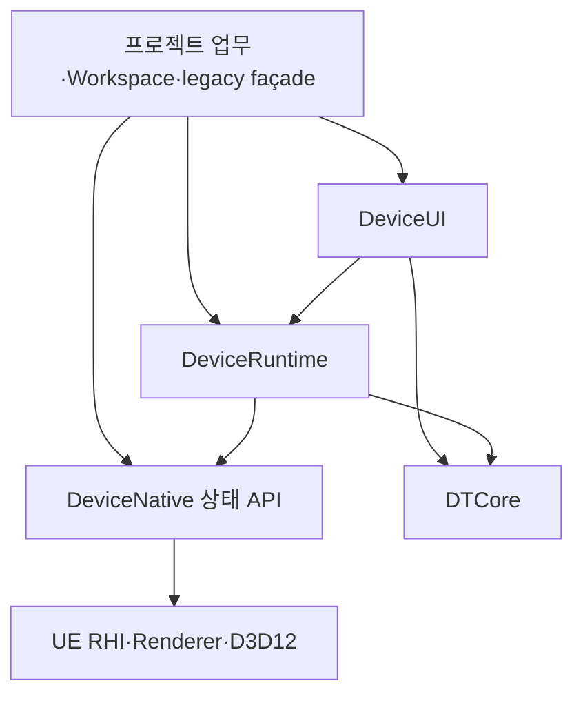

# DEVICE-PLUGIN-01 설계 — 0단계

기준: `14afb6b736b4d28a642acee0f851f01106a25b4b` / `feat/device-plugin`, UE 5.3, DTCore `bc60f05e2d1e64f4ffe1410cf3239fe24cb4d4c9`. 조사일 2026-11-03. TRAIN-BATCH-01 머지 후의 실제 소스를 기준으로 한다.

**설계 승인용 문서다. 이 단계에서는 코드·에셋 이동, 모듈/서브모듈 생성, 빌드·Editor·게임 실행을 하지 않았다.** 기존 [AGENTS](../AGENTS.md) §3/§5의 플러그인 착수 금지를 이번 사용자 요청이 조사·설계에 한해서 대체한다. 구현과 보호 에셋 이동 권한을 확대하지 않는다.

## 1. 결론과 불변 계약

플러그인 식별자는 **DTDevice**, 설치 폴더는 `Plugins/DTDevice`, 저장소는 [UE-DT-Device-Plugin](https://github.com/YonghoKwon/UE-DT-Device-Plugin)으로 제안한다. 0단계의 `git ls-remote` 조회에는 ref가 없었다. 저장소 생성·push·submodule add는 하지 않았다.

- **DTCore 필수**다. DTCore 없는 대체 모드나 자체 Widget/WebSocket 관리자를 만들지 않는다. DTCore는 형제 서브모듈 `Plugins/DTCore`에 두며 중첩 복제하지 않는다.
- 측정·스케줄러·코덱·전송·파일 저장·중립 계약은 `DeviceRuntime`, native RT·셰이더 초기화는 `DeviceNative`, 공통 화면 구현은 `DeviceUI`로 분리한다.
- Slab/해치/코일/학습/자동화/Workspace·Player·맵 조립·업무 TC는 프로젝트에 남긴다. 기존 혼합 클래스는 **프로젝트 호환 façade + 플러그인 공통 구현**으로 나눈다. 폴더를 통째 복사해 독립됐다고 판정하지 않는다.
- 20Hz·PCD 기본 on·33-byte little-endian 레코드·기존 v1/v2 bytes·Topic·FIFO·128/64MiB 예약·Camera8/기타20프레임·Blueprint 핀·enum 순서·SaveGame 슬롯/버전은 그대로다. 관찰/receipt/업무 ACK 의미도 유지한다.
- Runtime은 UI를 만들거나 숨겨진 capture/readback을 추가하지 않는다. TRAIN-BATCH 워커는 기존 `UserDir` 격리와 기본 꺼짐을 유지한다. 플러그인 로드만으로 맵·센서·조명·네트워크 구독을 자동 생성하지 않는다.

조사상 production의 L1→상위 **include**는 0건이지만 완전한 모듈 경계는 아니다. `VirtualSensorCoordinator.h`의 `BindMonitorWidget(UVirtualSensorMonitorPanelWidget*)`/`BoundMonitorWidget`는 UHT·GC 의존이고, ExternalSource의 본문 일부는 `WebSocket/TC`에 있다. Bootstrap은 셰이더 외에 **전역 WebSockets 1ms 서비스 주기 설정**도 수행한다. 이 세 가지는 단순 이동 전에 풀어야 한다.

## 2. 플러그인·모듈 의존과 로딩

### 2.1 `.uplugin` 초안

아래는 문서 속 제안이며 실제 파일을 만들지 않는다. 우선 지원은 검증된 **UE5.3 / Win64 / D3D12**다. CPU/DepthProjection/RHI/native 선택은 기존 정책을 유지하고 다른 플랫폼 지원 완료로 표기하지 않는다.

```json
{
  "FileVersion": 3,
  "Version": 1,
  "VersionName": "0.1.0",
  "FriendlyName": "DT Device",
  "CanContainContent": true,
  "Modules": [
    { "Name": "DeviceNative", "Type": "Runtime", "LoadingPhase": "PostConfigInit", "PlatformAllowList": ["Win64"] },
    { "Name": "DeviceRuntime", "Type": "Runtime", "LoadingPhase": "Default", "PlatformAllowList": ["Win64"] },
    { "Name": "DeviceUI", "Type": "Runtime", "LoadingPhase": "None", "PlatformAllowList": ["Win64"] }
  ],
  "Plugins": [
    { "Name": "DTCore", "Enabled": true },
    { "Name": "Niagara", "Enabled": true },
    { "Name": "ProceduralMeshComponent", "Enabled": true }
  ]
}
```

`DeviceUI`는 UI가 필요한 host 진입점이 명시적으로 로드한 후 위젯을 연다. `LoadingPhase=None`만으로 실행 파일에서 UI 링크가 제거되는 것은 아니다. 현재 프로젝트의 legacy UI façade는 DeviceUI를 링크하므로 워커 패키지에 바이너리가 포함될 수 있지만, 워커 실행에서는 UI 모듈 Startup·Widget·Tick·구독을 시작하지 않는 것을 별도로 검사한다. UI가 없는 소비 프로젝트는 DeviceUI 의존 자체를 생략한다. DTCore 모듈은 어느 경우에도 필수다.

| 모듈 | Public 의존 초안 | Private 의존 초안 | 시작/종료 책임 |
|---|---|---|---|
| DeviceNative | Core | Engine, RenderCore, RHI, Renderer; Win64에서 D3D12RHI + 엔진 DX12 ThirdParty | PostConfigInit 셰이더 매핑/등록, 기존 RT 종료·fence 계약. DTCore UObject를 이 시점에 생성하지 않음 |
| DeviceRuntime | Core, CoreUObject, Engine, DTCore; 공개 readback 헤더에 필요한 RenderCore/RHI | DeviceNative, RenderCore/RHI, ImageWrapper, Json/JsonUtilities, HTTP, WebSockets, Stomp, Sockets/Networking, PhysicsCore, ProceduralMeshComponent, Niagara/NiagaraCore | 공통 codec registry 등록/해제, 명시 서비스 수명. 무조건 센서 생성/송신 금지 |
| DeviceUI | Core, CoreUObject, Engine, DTCore, DeviceRuntime, UMG, Slate/SlateCore(공개 Slate 인자 때문에) | ApplicationCore, InputCore, EnhancedInput; DesktopPlatform/UnrealEd는 Editor 조건에만 | UDxWidget 기반 공통 화면, host bridge 연결. 닫힘/숨김/종료 delegate 정리 |
| 프로젝트 ma0t10_dt | 기존 업무 의존 + DeviceRuntime/DeviceUI | 기존 학습 zlib/libzip/OpenSSL, 필요 native 상태 API | 업무/Workspace façade·설정·맵/TC 조립. PixelStreaming 3개 의존·활성 유지 |
| 프로젝트 조기 Bootstrap 잔여 | Core | config에 필요한 Engine | 기존 host의 WebSockets 1ms 정책만 PostConfigInit에 유지 |

목록은 현재 include 소유 모듈에서 도출한 분리 시작안이다. 실제 Public/Private 경계는 non-unity 빌드에서 확인한다. 사용하지 않는 프로젝트 의존을 일괄 제거하지 않으며 PixelStreaming 제거는 금지다. 공통 Editor 테스트의 `PreviewScene.h` 등은 `Target.bBuildEditor`일 때만 UnrealEd 의존을 추가하고, 본문을 `WITH_DEV_AUTOMATION_TESTS && WITH_EDITOR`로 보호한다. Shipping에 Editor 헤더를 끌고 가지 않는다.



Native→Runtime, Runtime→UI, 플러그인→`ma0t10_dt`는 금지다. Native가 받을 mesh/ray/hit 계약은 현재 `SensorOwnedRayTracing.h`처럼 Core 값 타입으로 둔다. DTCore 의존이 필수인 것은 플러그인 descriptor와 Runtime의 public 상속으로 강제하며, 조기 Native 모듈에서 Default 단계 DTCore를 강제로 먼저 로드하지 않는다. Native의 plugin base 조회에는 Projects private 의존을 추가한다.

## 3. 단순 이동이 불가능한 경계와 분리 방식

### 3.1 Coordinator: UHT의 역방향 타입 의존 제거

현재 [Coordinator](../Source/ma0t10_dt/MA0T10/Sensor/VirtualSensorCoordinator.h)와 [UI binding 본문](../Source/ma0t10_dt/MA0T10/UI/VirtualSensorCoordinatorMonitorBinding.cpp)은 한 모듈이므로 성립한다. 모니터 클래스를 DeviceUI로 옮기면서 Coordinator를 Runtime에 그대로 두면 UHT 생성 코드까지 순환한다.

- Runtime에 **새 `ADeviceSensorCoordinator`**를 만들고 등록/선택/스케줄 연결·상태 집계를 옮긴다. 모니터는 기존 `IVirtualSensorMonitorView`와 weak UObject owner로만 바인딩한다. 새 API 예: `BindMonitorView(UObject* Owner)`; 유효 interface 확인 후 사용하며 매 Tick UObject 순회는 추가하지 않는다.
- **기존 `AVirtualSensorCoordinator` UCLASS는 프로젝트에 유지**한다. 새 base를 상속하고 기존 `BindMonitorWidget` 핀·Transient GC 참조를 가진 얇은 façade가 된다. 필드의 serialization owner 변경은 최소화하고, 기존 공개 UPROPERTY는 가능하면 façade에 보존하여 base로 전달한다. 기존 `GetAllActorsOfClass`/spawn은 host에서 old subclass를 생성하고 Runtime 검색은 base를 허용한다.
- `EVirtualSensorViewMode`, Summary/Health/HiddenComponent DTO는 Runtime로 옮겨 아래 redirect를 적용한다. 기존 Coordinator 클래스 자체는 redirect하지 않는다. 기존 UI가 새 base를 쓰도록 변경해도 public BP 함수 인자는 façade에서 보존한다.
- `Core/VirtualSensorLayoutSubsystem`의 private Coordinator helper와 ExternalSource의 private FindCoordinator 반환/탐색도 새 base로 바꿔 host forward 선언을 제거한다. UI public BP 인자가 남은 곳은 프로젝트 façade가 감싼다. 두 클래스가 각자 Timer/selection을 소유하지 않도록 실행 상태 소유권은 base 한 곳만 둔다. unbind/GC/EndPlay/PIE 종료 회귀를 넣는다.

### 3.2 Slab 이름과 실제 업무 정책 구분

현재 하위 폴더에는 Slab 이름이 남은 DTO와 실제 분석이 모두 있다. `VirtualSlabContextCompatibility`의 두 reflected struct, `FVirtualLidarSlabAnalysisResult`, payload의 `SlabContext`는 **기존 직렬화 호환 값 계약**이다. 이 이름·필드·wire를 유지하기 위해 Runtime의 `Contracts/Legacy` 역할로 보존하되, Slab Actor·세션·실행 우선순위·업무 TC는 들여오지 않는다. 새 API는 `FVirtualSensorAcquisitionContext`를 사용한다.

| 현재 위치/책임 | 플러그인 책임 | 프로젝트 구현/등록 |
|---|---|---|
| `VirtualLidarScanComponent.cpp::AnalyzeSlabPoints`, SemanticLabel/Yaw/MinPoints 및 JSON SlabAnalysis | 점 필터·PCA/OBB 등의 순수 수학 helper, immutable frame, optional 분석 provider 호출, 기존 DTO/encoding façade | `IDevicePointCloudAnalysisProvider`를 구현하는 프로젝트 adapter가 Slab 필터·기준 yaw·판정/문구를 소유. 기존 scalar BP 필드/결과 getter는 동결 호환 façade로 유지하고 adapter에 전달 |
| `VirtualLidarScanSceneQuery.cpp`, `VirtualSensorSemanticLabels.*` | collision query/일반 semantic lookup와 숫자 ID 계약 | Slab/Coil tag→label/ID2~7의 기본 표는 host가 명시 등록. plugin core에 과제 클래스 include 없음. wire enum/ID를 재번호 매기지 않음 |
| `VirtualSensorAcquisitionContext.*`, `VirtualSensorMotionProvider.h`, `VirtualSensorRayQuery.h` | 기존 중립 snapshot/provider 등록 계약 | 기존 SlabContext/Motion/해치 geometry provider는 host에 그대로. generation/run 승인도 host가 공급 |
| Publisher의 Slab run pending/failure 집계 | 중립 run key별 송신 예약/완료 통계 및 기존 compat accessor | Slab 실행 중/중단/삭제·receipt 대기·출력 선택은 Scenario adapter. 신규 벌크 기본 PCD와 replay 관찰 기본은 host가 적용 |
| `VirtualSensorIdentity.h`의 Coil alias | 새 identity normalization hook, raw generic ID 보존 | Coil.Quay.XT32→os_lidar_coil_quay와 저장 map key migration만 host에서 등록/실행 |
| `VirtualSensorDefaults.h` | 센서 Topic/출력 경로·기본 수치 | WorkspaceSlot/AppearanceSlot/Scenario 보고서 경로는 host shim. 기존 MA0T10 문자열을 이관과 동시에 새 이름으로 바꾸지 않음 |

Provider는 world/weak owner/generation을 갖고 BeginPlay 전 host 조립 시 등록하며 EndPlay에서 해제한다. 호출은 기존 acquisition snapshot 시점에 한 번만 수행한다. 플러그인의 로딩 순서가 원인이 되어 첫 프레임을 다른 정책으로 처리해서는 안 된다. 필수 host adapter가 준비되지 않으면 명시 preflight 오류로 보고하고, 조용한 default 변경·중간 재송신·무한 큐로 회피하지 않는다. 분리 전/후 golden payload와 원본 Slab 회귀가 일치해야 이 경계 완료다.

### 3.3 공통 UI: 기존 UCLASS는 host façade, 실제 공통 구현은 DeviceUI

현재 PanelBase는 Workspace enum·SaveGame·Host를 직접 알고 Settings는 AUTO/TESTSET, CaptureExport는 SlabRun/재생/Dataset을 안다. 모든 기존 UI UCLASS를 곧바로 옮기면 플러그인이 프로젝트를 역참조한다. **첫 이관에서는 기존 UI reflected 클래스·SaveGame·WBP를 프로젝트에 남기고**, 공통 Slate/UMG body/controller를 DeviceUI로 추출한다.

새 `UDeviceSensorPanelBase : UDxWidget`와 공통 Settings/Monitor/Capture body는 DeviceUI에 둔다. 기존 `UVirtualSensorPanelWidgetBase`와 파생 클래스 이름·기존 public UFUNCTION·UPROPERTY는 host façade로 보존한다. 공통 코드는 host 타입을 참조하지 않는 `IDevicePanelHostBridge`/중립 값으로만 위치·font·보기 상태·설정 적용을 요청한다. host가 이미 만든 **같은 Widget 인스턴스**를 등록하고 기존 UDxWidgetSubsystem의 열기/닫기/BringToFront/입력 차단을 사용한다. 별도 Widget 관리자·자체 ticking loop는 만들지 않는다.

| 원본 UI 파일군 | DeviceUI에 추출할 것 | 프로젝트에 남길 것 |
|---|---|---|
| `VirtualSensorPanelWidgetBase.*`, `PanelHostComponent.*` | drag/resize/DPI/clamp·공통 폼/폰트 등록·host bridge | Workspace concrete pointer, role/slot persistence, 기존 UCLASS·공개 필드/핀 |
| `VirtualSensorSettingsPanelWidget.*` | Read/Validate/ApplyEditableState 기반 공통 센서 설정 body | AUTO-01/AgentTestSet 진입 버튼·업무 선택, 기존 BP façade |
| `VirtualSensorMonitorPanelWidget*.cpp/.h` | cached camera/LiDAR 보기·preview·기본 상태·native safety 문구 | Workspace/프로젝트 coordinator 인자·Slab 표시 extension·저장 migration façade |
| `VirtualSensorCaptureExportPanelWidget.cpp/.Owned.cpp/.Dataset.cpp/.Bandwidth.cpp/.h` | 일반 capture/export/PCD bandwidth/file-save body와 DTO | SlabRun 선택/재생/비교, DATASET/EXPORT 업무, 전체 실패 정책; `Dataset` 번역 단위는 통째 잔류 |
| `VirtualSensorPlacementPanelWidget*.cpp/.h` | 공통 센서/IMU 배치 body·preview 입력 계약 | host 목록·코일 역할/시나리오 되돌리기, 기존 BP façade |
| `VirtualSensorUiStyle.*`, `VirtualPcdBandwidthPresentation.*`, 순수 경고/도움말 | 센서 전용 부분의 neutral helper | 과제 문구/전체 화면 공통 style은 host; main/다른 Widget에 일괄 적용 금지 |
| `VirtualSensorToolWorkspaceSubsystem*`, `SensorToolToolbarWidget*`, `SensorToolAppearance*`, `VirtualSensorUiPreferences*` | 처음에는 없음; bridge로 값만 제공 | 창/6+업무 패널·v1 Workspace/v6 SensorUI/Appearance 저장·Host·목록/5Hz 활동 캐시 전부 |
| `VirtualSensorUiHostActor*`, `VirtualSensorToolRig*`, `VirtualSensorTransformGizmoActor*`, `VirtualSensorPlayerInputBinding.cpp` | 공통 입력 owner interface만 기존 L1에 유지 | 맵 저장 검사·Player cast·Esc 중재·Gizmo 생성·전체 패널 조립 |
| `VirtualSensorCoordinatorMonitorBinding.cpp` | 없음 | 기존 Coordinator BP bind façade 본문 |

중립 bridge 제안은 `RequestOpenPanel(FName)`, 읽기 전용 `FDevicePanelPlacement/Appearance/ViewState`, 명시 변경 commit callback, optional 업무 extension slot이다. `ESensorToolPanelRole` 자체를 플러그인으로 옮겨 Slab/TrainBatch 역할을 노출하지 않는다. UI 갱신 5Hz 이하, 숨김/접힘 문자열 조립 중단, resize/헤더 안정화/TSR 재생성 0 정책을 유지한다.

### 3.4 TC·외부 수신과 시작 정책

`LidarJsonLiveFrameTC`, `Virtual{Camera,Lidar,PointCloud}StreamReceiverTC`, `VirtualSensorStreamReceiverRegistration.*`, `VirtualSensorExternalSourceReceiverAdapter.cpp`는 일반 센서 수신이므로 Runtime로 함께 옮긴다. 기존 DTCore TransactionCode 기반 파서와 stateless registry를 재사용한다. `FactoryAgentScenarioTC`, `TrainBatchScenarioTC`, `KP1D0012`는 host 업무다.

`ma0t10_dt.cpp`의 공통 codec 등록은 Runtime로 옮기되 두 모듈이 중복 등록/해제하지 않는다. 장치 수신 TC를 host DT_TransactionCode에 등록하는 정책은 host가 소유하고 다른 업무 row/Topic을 건드리지 않는다. ExternalSource cpp의 프로젝트 `ma0t10_dt.h` include는 로그용 의존까지 제거하고 Runtime 소유 log header를 사용한다(기존 진단 본문/플래그 검증 유지). Raw binary PCD는 기존 worker 경로로 유지하며 DTCore BodyString에 맞추려고 Base64로 바꾸지 않는다. 자기 송신 재구독은 기본 off를 유지한다.

현재 Bootstrap의 `GConfig->SetDouble(WebSockets.LibWebSockets.ThreadTargetFrameTimeInSeconds, 0.001)`는 성능상 기존 host 동작이다. 이를 새 plugin Startup에 숨겨 이식하지 않는다. 프로젝트의 조기 host adapter에 남겨 **같은 PostConfigInit 시점**에 적용한다. 다른 소비 프로젝트가 필요하면 명시 배포 정책으로 채택한다. Game.ini 디스크 수정이나 DTCore 설정 자동 덮어쓰기는 하지 않는다.

## 4. 파일별 이관 목록

기준 루트 `H = Source/ma0t10_dt/MA0T10/`, `B = Source/ma0t10_dtBootstrap/`, 목적 루트 `P = Plugins/DTDevice/Source/`. 표의 `DeviceRuntime/...`, `DeviceNative/...`는 `P` 아래다. `Runtime/*`는 header→Public, cpp/inl→Private 규칙이다. **분리 행은 순수 이동 전에 §3의 준비 커밋이 필요**하다. 프로젝트 잔류는 기존 경로 보존이다. 모든 수치는 git tracked 파일 기준이며 미래 생성 파일 수가 아니다.

### 4.1 Contracts — 15파일

| 원본 (`H/Contracts/` 뒤) | 목적 / 잔류 | 경계·분류 |
|---|---|---|
| `ConsumeReadyFuture.h` | DeviceRuntime/Public/Device/Contracts/ConsumeReadyFuture.h | 공통 실행/계약 |
| `LocalCapturePath.h` | DeviceRuntime/Public/Device/Contracts/LocalCapturePath.h | 공통 실행/계약 |
| `Tests/AcquisitionContextTests.cpp` | DeviceRuntime/Private/Tests/AcquisitionContextTests.cpp | 공통 회귀; Editor guard/fixture 원문 유지 |
| `TrainBatchContract.h` | 프로젝트 잔류 | 학습 Job 계약 |
| `VirtualSensorAcquisitionContext.cpp` | DeviceRuntime/Private/Contracts/VirtualSensorAcquisitionContext.cpp | 공통 실행/계약 |
| `VirtualSensorAcquisitionContext.h` | DeviceRuntime/Public/Device/Contracts/VirtualSensorAcquisitionContext.h | 공통 실행/계약 |
| `VirtualSensorDefaults.h` | 분리: Runtime/Public/Contracts/DeviceDefaults.h + host shim | 센서 리터럴 이관; Workspace/Appearance/Scenario 상수 잔류 |
| `VirtualSensorIdentity.h` | 프로젝트 잔류 + Runtime identity hook | 코일 alias/migration은 host |
| `VirtualSensorMotionProvider.h` | DeviceRuntime/Public/Device/Contracts/VirtualSensorMotionProvider.h | 공통 실행/계약 |
| `VirtualSensorRayQuery.h` | DeviceRuntime/Public/Device/Contracts/VirtualSensorRayQuery.h | 공통 실행/계약 |
| `VirtualSensorStreamReceiverRegistry.cpp` | DeviceRuntime/Private/Contracts/VirtualSensorStreamReceiverRegistry.cpp | 공통 실행/계약 |
| `VirtualSensorStreamReceiverRegistry.h` | DeviceRuntime/Public/Device/Contracts/VirtualSensorStreamReceiverRegistry.h | 공통 실행/계약 |
| `VirtualSensorStreamReceiverTypes.h` | DeviceRuntime/Public/Device/Contracts/VirtualSensorStreamReceiverTypes.h | 공통 실행/계약 |
| `VirtualSlabContextCompatibility.cpp` | DeviceRuntime/Private/Contracts/VirtualSlabContextCompatibility.cpp | legacy DTO만 동결 보존; 업무는 host provider |
| `VirtualSlabContextCompatibility.h` | DeviceRuntime/Public/Device/Contracts/VirtualSlabContextCompatibility.h | legacy DTO만 동결 보존; 업무는 host provider |

### 4.2 Camera — 10파일

| 원본 (`H/Camera/` 뒤) | 목적 / 잔류 | 경계·분류 |
|---|---|---|
| `Tests/CameraGroundTruthTests.cpp` | 프로젝트 잔류 | 과제·UI·맵·host fixture 전이 의존 |
| `VirtualCameraCaptureComponent.cpp` | DeviceRuntime/Private/Camera/VirtualCameraCaptureComponent.cpp | 공통 실행/계약 |
| `VirtualCameraCaptureComponent.h` | DeviceRuntime/Public/Device/Camera/VirtualCameraCaptureComponent.h | 공통 실행/계약 |
| `VirtualCameraGroundTruth.cpp` | DeviceRuntime/Private/Camera/VirtualCameraGroundTruth.cpp | 공통 실행/계약 |
| `VirtualCameraGroundTruth.h` | DeviceRuntime/Public/Device/Camera/VirtualCameraGroundTruth.h | 공통 실행/계약 |
| `VirtualCameraLocalFileCapture.cpp` | DeviceRuntime/Private/Camera/VirtualCameraLocalFileCapture.cpp | 공통 실행/계약 |
| `VirtualCameraPayloadCodec.cpp` | DeviceRuntime/Private/Camera/VirtualCameraPayloadCodec.cpp | 공통 실행/계약 |
| `VirtualCameraPayloadCodec.h` | DeviceRuntime/Public/Device/Camera/VirtualCameraPayloadCodec.h | 공통 실행/계약 |
| `VirtualCameraSensorActor.cpp` | DeviceRuntime/Private/Camera/VirtualCameraSensorActor.cpp | 공통 실행/계약 |
| `VirtualCameraSensorActor.h` | DeviceRuntime/Public/Device/Camera/VirtualCameraSensorActor.h | 공통 실행/계약 |

### 4.3 Core — 37파일

| 원본 (`H/Core/` 뒤) | 목적 / 잔류 | 경계·분류 |
|---|---|---|
| `VirtualPcdBandwidthMetrics.h` | DeviceRuntime/Public/Device/Core/VirtualPcdBandwidthMetrics.h | 공통 실행/계약 |
| `VirtualPointCloudCoordinates.h` | DeviceRuntime/Public/Device/Core/VirtualPointCloudCoordinates.h | 공통 실행/계약 |
| `VirtualSensorAcquisitionBackend.h` | DeviceRuntime/Public/Device/Core/VirtualSensorAcquisitionBackend.h | 공통 실행/계약 |
| `VirtualSensorCaptureRendering.h` | DeviceRuntime/Public/Device/Core/VirtualSensorCaptureRendering.h | 공통 실행/계약 |
| `VirtualSensorFileSaveSubsystem.cpp` | DeviceRuntime/Private/Core/VirtualSensorFileSaveSubsystem.cpp | 공통 실행/계약 |
| `VirtualSensorFileSaveSubsystem.h` | DeviceRuntime/Public/Device/Core/VirtualSensorFileSaveSubsystem.h | 공통 실행/계약 |
| `VirtualSensorFileSaveTypes.h` | DeviceRuntime/Public/Device/Core/VirtualSensorFileSaveTypes.h | 공통 실행/계약 |
| `VirtualSensorHighThroughputTransportSubsystem.cpp` | DeviceRuntime/Private/Core/VirtualSensorHighThroughputTransportSubsystem.cpp | 공통 실행/계약 |
| `VirtualSensorHighThroughputTransportSubsystem.h` | DeviceRuntime/Public/Device/Core/VirtualSensorHighThroughputTransportSubsystem.h | 공통 실행/계약 |
| `VirtualSensorHitchDiagnostics.cpp` | DeviceRuntime/Private/Core/VirtualSensorHitchDiagnostics.cpp | 공통 실행/계약 |
| `VirtualSensorHitchDiagnostics.h` | DeviceRuntime/Public/Device/Core/VirtualSensorHitchDiagnostics.h | 공통 실행/계약 |
| `VirtualSensorLayoutSubsystem.cpp` | DeviceRuntime/Private/Core/VirtualSensorLayoutSubsystem.cpp | 공통 실행/계약 |
| `VirtualSensorLayoutSubsystem.h` | DeviceRuntime/Public/Device/Core/VirtualSensorLayoutSubsystem.h | 공통 실행/계약 |
| `VirtualSensorLayoutTypes.h` | DeviceRuntime/Public/Device/Core/VirtualSensorLayoutTypes.h | 공통 실행/계약 |
| `VirtualSensorOutputPreflight.cpp` | DeviceRuntime/Private/Core/VirtualSensorOutputPreflight.cpp | 공통 실행/계약 |
| `VirtualSensorOutputPreflight.h` | DeviceRuntime/Public/Device/Core/VirtualSensorOutputPreflight.h | 공통 실행/계약 |
| `VirtualSensorPcdReceiveContract.cpp` | DeviceRuntime/Private/Core/VirtualSensorPcdReceiveContract.cpp | 공통 실행/계약 |
| `VirtualSensorPcdReceiveContract.h` | DeviceRuntime/Public/Device/Core/VirtualSensorPcdReceiveContract.h | 공통 실행/계약 |
| `VirtualSensorPeriodicFileSaveSubsystem.cpp` | DeviceRuntime/Private/Core/VirtualSensorPeriodicFileSaveSubsystem.cpp | 공통 실행/계약 |
| `VirtualSensorPeriodicFileSaveSubsystem.h` | DeviceRuntime/Public/Device/Core/VirtualSensorPeriodicFileSaveSubsystem.h | 공통 실행/계약 |
| `VirtualSensorPlacementMotion.h` | DeviceRuntime/Public/Device/Core/VirtualSensorPlacementMotion.h | 공통 실행/계약 |
| `VirtualSensorPlacementSubsystem.cpp` | DeviceRuntime/Private/Core/VirtualSensorPlacementSubsystem.cpp | 공통 실행/계약 |
| `VirtualSensorPlacementSubsystem.h` | DeviceRuntime/Public/Device/Core/VirtualSensorPlacementSubsystem.h | 공통 실행/계약 |
| `VirtualSensorPlacementTypes.h` | DeviceRuntime/Public/Device/Core/VirtualSensorPlacementTypes.h | 공통 실행/계약 |
| `VirtualSensorResourceDiagnostics.h` | DeviceRuntime/Public/Device/Core/VirtualSensorResourceDiagnostics.h | 공통 실행/계약 |
| `VirtualSensorSchedulerSubsystem.cpp` | DeviceRuntime/Private/Core/VirtualSensorSchedulerSubsystem.cpp | 공통 실행/계약 |
| `VirtualSensorSchedulerSubsystem.h` | DeviceRuntime/Public/Device/Core/VirtualSensorSchedulerSubsystem.h | 공통 실행/계약 |
| `VirtualSensorStompProtocol.cpp` | DeviceRuntime/Private/Core/VirtualSensorStompProtocol.cpp | 공통 실행/계약 |
| `VirtualSensorStompProtocol.h` | DeviceRuntime/Public/Device/Core/VirtualSensorStompProtocol.h | 공통 실행/계약 |
| `VirtualSensorStreamPublisherComponent.cpp` | DeviceRuntime/Private/Core/VirtualSensorStreamPublisherComponent.cpp | 송신/큐 이관; run 승인·identity provider 분리 |
| `VirtualSensorStreamPublisherComponent.h` | DeviceRuntime/Public/Device/Core/VirtualSensorStreamPublisherComponent.h | 송신/큐 이관; run 승인·identity provider 분리 |
| `VirtualSensorStreamPublisherComponentEncoding.cpp` | DeviceRuntime/Private/Core/VirtualSensorStreamPublisherComponentEncoding.cpp | 송신/큐 이관; run 승인·identity provider 분리 |
| `VirtualSensorStreamPublisherComponentRateControl.cpp` | DeviceRuntime/Private/Core/VirtualSensorStreamPublisherComponentRateControl.cpp | 송신/큐 이관; run 승인·identity provider 분리 |
| `VirtualSensorStreamPublisherComponentSession.cpp` | DeviceRuntime/Private/Core/VirtualSensorStreamPublisherComponentSession.cpp | 송신/큐 이관; run 승인·identity provider 분리 |
| `VirtualSensorTextureReadback.h` | DeviceRuntime/Public/Device/Core/VirtualSensorTextureReadback.h | 공통 실행/계약 |
| `VirtualSensorWireHeaders.cpp` | DeviceRuntime/Private/Core/VirtualSensorWireHeaders.cpp | 공통 실행/계약 |
| `VirtualSensorWireHeaders.h` | DeviceRuntime/Public/Device/Core/VirtualSensorWireHeaders.h | 공통 실행/계약 |

### 4.4 Sensor — 193파일

| 원본 (`H/Sensor/` 뒤) | 목적 / 잔류 | 경계·분류 |
|---|---|---|
| `CameraJsonLiveSourceComponent.cpp` | DeviceRuntime/Private/Sensor/CameraJsonLiveSourceComponent.cpp | 공통 실행/계약 |
| `CameraJsonLiveSourceComponent.h` | DeviceRuntime/Public/Device/Sensor/CameraJsonLiveSourceComponent.h | 공통 실행/계약 |
| `CsvPointCloudPreviewActor.cpp` | DeviceRuntime/Private/Sensor/CsvPointCloudPreviewActor.cpp | 공통 실행/계약 |
| `CsvPointCloudPreviewActor.h` | DeviceRuntime/Public/Device/Sensor/CsvPointCloudPreviewActor.h | 공통 실행/계약 |
| `IndustrialLidarProfiles.cpp` | DeviceRuntime/Private/Sensor/IndustrialLidarProfiles.cpp | 공통 실행/계약 |
| `IndustrialLidarProfiles.h` | DeviceRuntime/Public/Device/Sensor/IndustrialLidarProfiles.h | 공통 실행/계약 |
| `LidarCsvReplaySourceComponent.cpp` | DeviceRuntime/Private/Sensor/LidarCsvReplaySourceComponent.cpp | 공통 실행/계약 |
| `LidarCsvReplaySourceComponent.h` | DeviceRuntime/Public/Device/Sensor/LidarCsvReplaySourceComponent.h | 공통 실행/계약 |
| `LidarHttpJsonLiveSourceComponent.cpp` | DeviceRuntime/Private/Sensor/LidarHttpJsonLiveSourceComponent.cpp | 공통 실행/계약 |
| `LidarHttpJsonLiveSourceComponent.h` | DeviceRuntime/Public/Device/Sensor/LidarHttpJsonLiveSourceComponent.h | 공통 실행/계약 |
| `LidarJsonLinesReplaySourceComponent.cpp` | DeviceRuntime/Private/Sensor/LidarJsonLinesReplaySourceComponent.cpp | 공통 실행/계약 |
| `LidarJsonLinesReplaySourceComponent.h` | DeviceRuntime/Public/Device/Sensor/LidarJsonLinesReplaySourceComponent.h | 공통 실행/계약 |
| `LidarJsonLiveSourceComponent.cpp` | DeviceRuntime/Private/Sensor/LidarJsonLiveSourceComponent.cpp | 공통 실행/계약 |
| `LidarJsonLiveSourceComponent.h` | DeviceRuntime/Public/Device/Sensor/LidarJsonLiveSourceComponent.h | 공통 실행/계약 |
| `LidarPlayerDisplayComponent.cpp` | DeviceRuntime/Private/Sensor/LidarPlayerDisplayComponent.cpp | 공통 실행/계약 |
| `LidarPlayerDisplayComponent.h` | DeviceRuntime/Public/Device/Sensor/LidarPlayerDisplayComponent.h | 공통 실행/계약 |
| `LidarUdpJsonLiveSourceComponent.cpp` | DeviceRuntime/Private/Sensor/LidarUdpJsonLiveSourceComponent.cpp | 공통 실행/계약 |
| `LidarUdpJsonLiveSourceComponent.h` | DeviceRuntime/Public/Device/Sensor/LidarUdpJsonLiveSourceComponent.h | 공통 실행/계약 |
| `RealSensorAdapterStubs.cpp` | DeviceRuntime/Private/Sensor/RealSensorAdapterStubs.cpp | 공통 실행/계약 |
| `RealSensorAdapterStubs.h` | DeviceRuntime/Public/Device/Sensor/RealSensorAdapterStubs.h | 공통 실행/계약 |
| `RealSensorSourceComponent.cpp` | DeviceRuntime/Private/Sensor/RealSensorSourceComponent.cpp | 공통 실행/계약 |
| `RealSensorSourceComponent.h` | DeviceRuntime/Public/Device/Sensor/RealSensorSourceComponent.h | 공통 실행/계약 |
| `Tests/ArchitectureWireGoldenTests.cpp` | DeviceRuntime/Private/Tests/ArchitectureWireGoldenTests.cpp | 공통 회귀; Editor guard/fixture 원문 유지 |
| `Tests/CsvPointCloudPreviewAutomationTests.cpp` | DeviceRuntime/Private/Tests/CsvPointCloudPreviewAutomationTests.cpp | 공통 회귀; Editor guard/fixture 원문 유지 |
| `Tests/EditorMapSmokeAutomationTests.cpp` | 프로젝트 잔류 | 과제·UI·맵·host fixture 전이 의존 |
| `Tests/FinalAcceptanceMeasurement.h` | DeviceRuntime/Private/Tests/FinalAcceptanceMeasurement.h | 공통 회귀; Editor guard/fixture 원문 유지 |
| `Tests/FinalAcceptanceTestSession.h` | DeviceRuntime/Private/Tests/FinalAcceptanceTestSession.h | 공통 회귀; Editor guard/fixture 원문 유지 |
| `Tests/Fixtures/ArchitectureWire/.gitattributes` | DeviceRuntime/Private/Tests/Fixtures/ArchitectureWire/.gitattributes | 공통 회귀; Editor guard/fixture 원문 유지 |
| `Tests/Fixtures/ArchitectureWire/README.md` | DeviceRuntime/Private/Tests/Fixtures/ArchitectureWire/README.md | 공통 회귀; Editor guard/fixture 원문 유지 |
| `Tests/Fixtures/ArchitectureWire/with-context.camera.headers` | DeviceRuntime/Private/Tests/Fixtures/ArchitectureWire/with-context.camera.headers | 공통 회귀; Editor guard/fixture 원문 유지 |
| `Tests/Fixtures/ArchitectureWire/with-context.lidar.json` | DeviceRuntime/Private/Tests/Fixtures/ArchitectureWire/with-context.lidar.json | 공통 회귀; Editor guard/fixture 원문 유지 |
| `Tests/Fixtures/ArchitectureWire/with-context.pcd` | DeviceRuntime/Private/Tests/Fixtures/ArchitectureWire/with-context.pcd | 공통 회귀; Editor guard/fixture 원문 유지 |
| `Tests/Fixtures/ArchitectureWire/with-context.pcd.engine-headers` | DeviceRuntime/Private/Tests/Fixtures/ArchitectureWire/with-context.pcd.engine-headers | 공통 회귀; Editor guard/fixture 원문 유지 |
| `Tests/Fixtures/ArchitectureWire/with-context.pcd.headers` | DeviceRuntime/Private/Tests/Fixtures/ArchitectureWire/with-context.pcd.headers | 공통 회귀; Editor guard/fixture 원문 유지 |
| `Tests/Fixtures/ArchitectureWire/with-context.telemetry.headers` | DeviceRuntime/Private/Tests/Fixtures/ArchitectureWire/with-context.telemetry.headers | 공통 회귀; Editor guard/fixture 원문 유지 |
| `Tests/Fixtures/ArchitectureWire/with-context.telemetry.json` | DeviceRuntime/Private/Tests/Fixtures/ArchitectureWire/with-context.telemetry.json | 공통 회귀; Editor guard/fixture 원문 유지 |
| `Tests/Fixtures/ArchitectureWire/without-context.camera.headers` | DeviceRuntime/Private/Tests/Fixtures/ArchitectureWire/without-context.camera.headers | 공통 회귀; Editor guard/fixture 원문 유지 |
| `Tests/Fixtures/ArchitectureWire/without-context.lidar.json` | DeviceRuntime/Private/Tests/Fixtures/ArchitectureWire/without-context.lidar.json | 공통 회귀; Editor guard/fixture 원문 유지 |
| `Tests/Fixtures/ArchitectureWire/without-context.pcd` | DeviceRuntime/Private/Tests/Fixtures/ArchitectureWire/without-context.pcd | 공통 회귀; Editor guard/fixture 원문 유지 |
| `Tests/Fixtures/ArchitectureWire/without-context.pcd.engine-headers` | DeviceRuntime/Private/Tests/Fixtures/ArchitectureWire/without-context.pcd.engine-headers | 공통 회귀; Editor guard/fixture 원문 유지 |
| `Tests/Fixtures/ArchitectureWire/without-context.pcd.headers` | DeviceRuntime/Private/Tests/Fixtures/ArchitectureWire/without-context.pcd.headers | 공통 회귀; Editor guard/fixture 원문 유지 |
| `Tests/Fixtures/ArchitectureWire/without-context.telemetry.headers` | DeviceRuntime/Private/Tests/Fixtures/ArchitectureWire/without-context.telemetry.headers | 공통 회귀; Editor guard/fixture 원문 유지 |
| `Tests/Fixtures/ArchitectureWire/without-context.telemetry.json` | DeviceRuntime/Private/Tests/Fixtures/ArchitectureWire/without-context.telemetry.json | 공통 회귀; Editor guard/fixture 원문 유지 |
| `Tests/GpuCaptureLifetimeTests.cpp` | 프로젝트 잔류 | 과제·UI·맵·host fixture 전이 의존 |
| `Tests/IndustrialLidarProfileTests.cpp` | DeviceRuntime/Private/Tests/IndustrialLidarProfileTests.cpp | 공통 회귀; Editor guard/fixture 원문 유지 |
| `Tests/LidarCoordinateRegressionTests.cpp` | DeviceRuntime/Private/Tests/LidarCoordinateRegressionTests.cpp | 공통 회귀; Editor guard/fixture 원문 유지 |
| `Tests/LidarDemandPolicyTests.cpp` | DeviceRuntime/Private/Tests/LidarDemandPolicyTests.cpp | 공통 회귀; Editor guard/fixture 원문 유지 |
| `Tests/LidarDerivedProgressTests.cpp` | 프로젝트 잔류 | 과제·UI·맵·host fixture 전이 의존 |
| `Tests/LidarFidelityRhiTests.cpp` | 프로젝트 잔류 | 과제·UI·맵·host fixture 전이 의존 |
| `Tests/LidarFidelityTests.cpp` | 프로젝트 잔류 | 과제·UI·맵·host fixture 전이 의존 |
| `Tests/LidarGeometryPerformanceTests.cpp` | 프로젝트 잔류 | 과제·UI·맵·host fixture 전이 의존 |
| `Tests/LidarGeometryRuntimeTests.cpp` | 프로젝트 잔류 | 과제·UI·맵·host fixture 전이 의존 |
| `Tests/LidarGeometryTests.cpp` | DeviceRuntime/Private/Tests/LidarGeometryTests.cpp | 공통 회귀; Editor guard/fixture 원문 유지 |
| `Tests/LidarGeometryValidationRig.cpp` | 프로젝트 잔류 | 과제·UI·맵·host fixture 전이 의존 |
| `Tests/LidarGeometryValidationRig.h` | 프로젝트 잔류 | 과제·UI·맵·host fixture 전이 의존 |
| `Tests/LidarGpuSemanticRegressionTests.cpp` | 프로젝트 잔류 | 과제·UI·맵·host fixture 전이 의존 |
| `Tests/LidarReadbackReuseTests.cpp` | DeviceRuntime/Private/Tests/LidarReadbackReuseTests.cpp | 공통 회귀; Editor guard/fixture 원문 유지 |
| `Tests/LidarReplayAutomationTests.cpp` | DeviceRuntime/Private/Tests/LidarReplayAutomationTests.cpp | 공통 회귀; Editor guard/fixture 원문 유지 |
| `Tests/LidarSemanticDiagnosticsTests.cpp` | DeviceRuntime/Private/Tests/LidarSemanticDiagnosticsTests.cpp | 공통 회귀; Editor guard/fixture 원문 유지 |
| `Tests/LidarSemanticPsoTimeoutTests.cpp` | DeviceRuntime/Private/Tests/LidarSemanticPsoTimeoutTests.cpp | 공통 회귀; Editor guard/fixture 원문 유지 |
| `Tests/LidarVisualizationReliabilityAutomationTests.cpp` | DeviceRuntime/Private/Tests/LidarVisualizationReliabilityAutomationTests.cpp | 공통 회귀; Editor guard/fixture 원문 유지 |
| `Tests/LidarWallClockTests.cpp` | DeviceRuntime/Private/Tests/LidarWallClockTests.cpp | 공통 회귀; Editor guard/fixture 원문 유지 |
| `Tests/PcdBandwidthTests.cpp` | 프로젝트 잔류 | 과제·UI·맵·host fixture 전이 의존 |
| `Tests/PcdDemandAcceptanceFixture.h` | DeviceRuntime/Private/Tests/PcdDemandAcceptanceFixture.h | 공통 회귀; Editor guard/fixture 원문 유지 |
| `Tests/PcdEditorPressureTests.cpp` | 프로젝트 잔류 | 과제·UI·맵·host fixture 전이 의존 |
| `Tests/PcdFairBudgetTests.cpp` | DeviceRuntime/Private/Tests/PcdFairBudgetTests.cpp | 공통 회귀; Editor guard/fixture 원문 유지 |
| `Tests/PcdRateControlTests.cpp` | 프로젝트 잔류 | 과제·UI·맵·host fixture 전이 의존 |
| `Tests/PcdScratchReuseTests.cpp` | DeviceRuntime/Private/Tests/PcdScratchReuseTests.cpp | 공통 회귀; Editor guard/fixture 원문 유지 |
| `Tests/PerSensorDeliveryTests.cpp` | 프로젝트 잔류 | 과제·UI·맵·host fixture 전이 의존 |
| `Tests/PointCloudOverloadResumeTests.cpp` | 프로젝트 잔류 | 과제·UI·맵·host fixture 전이 의존 |
| `Tests/PointCloudOverloadSocketTests.cpp` | DeviceRuntime/Private/Tests/PointCloudOverloadSocketTests.cpp | 공통 회귀; Editor guard/fixture 원문 유지 |
| `Tests/RealSensorSourceAutomationTests.cpp` | 프로젝트 잔류 | 과제·UI·맵·host fixture 전이 의존 |
| `Tests/SensorDataWorkflowTests.cpp` | 프로젝트 잔류 | 과제·UI·맵·host fixture 전이 의존 |
| `Tests/SensorFileSaveRhiTests.cpp` | 프로젝트 잔류 | 과제·UI·맵·host fixture 전이 의존 |
| `Tests/SensorIncomingContractTests.cpp` | 프로젝트 잔류 | 과제·UI·맵·host fixture 전이 의존 |
| `Tests/SensorLayoutLifecycleTests.cpp` | DeviceRuntime/Private/Tests/SensorLayoutLifecycleTests.cpp | 공통 회귀; Editor guard/fixture 원문 유지 |
| `Tests/SensorLayoutPersistenceTests.cpp` | 프로젝트 잔류 | 과제·UI·맵·host fixture 전이 의존 |
| `Tests/SensorManagerAutomationTests.cpp` | 프로젝트 잔류 | 과제·UI·맵·host fixture 전이 의존 |
| `Tests/SensorManipulationRuntimeTests.cpp` | 프로젝트 잔류 | 과제·UI·맵·host fixture 전이 의존 |
| `Tests/SensorMonitorSimplificationTests.cpp` | 프로젝트 잔류 | 과제·UI·맵·host fixture 전이 의존 |
| `Tests/SensorNativeLifetimeHarnessTests.cpp` | DeviceRuntime/Private/Tests/SensorNativeLifetimeHarnessTests.cpp | 공통 회귀; Editor guard/fixture 원문 유지 |
| `Tests/SensorOutputPreflightTests.cpp` | DeviceRuntime/Private/Tests/SensorOutputPreflightTests.cpp | 공통 회귀; Editor guard/fixture 원문 유지 |
| `Tests/SensorOwnedPresentationTests.cpp` | 프로젝트 잔류 | 과제·UI·맵·host fixture 전이 의존 |
| `Tests/SensorOwnedUiLayoutTests.cpp` | 프로젝트 잔류 | 과제·UI·맵·host fixture 전이 의존 |
| `Tests/SensorPcd20HzSocketTests.cpp` | DeviceRuntime/Private/Tests/SensorPcd20HzSocketTests.cpp | 공통 회귀; Editor guard/fixture 원문 유지 |
| `Tests/SensorPcdSlabIntegrationTests.cpp` | 프로젝트 잔류 | 과제·UI·맵·host fixture 전이 의존 |
| `Tests/SensorPeriodicFileSaveTests.cpp` | DeviceRuntime/Private/Tests/SensorPeriodicFileSaveTests.cpp | 공통 회귀; Editor guard/fixture 원문 유지 |
| `Tests/SensorPlacementComparisonTests.cpp` | 프로젝트 잔류 | 과제·UI·맵·host fixture 전이 의존 |
| `Tests/SensorPlacementWorkflowTests.cpp` | 프로젝트 잔류 | 과제·UI·맵·host fixture 전이 의존 |
| `Tests/SensorPointCloudViewIsolationTests.cpp` | DeviceRuntime/Private/Tests/SensorPointCloudViewIsolationTests.cpp | 공통 회귀; Editor guard/fixture 원문 유지 |
| `Tests/SensorResourceSnapshotTests.cpp` | DeviceRuntime/Private/Tests/SensorResourceSnapshotTests.cpp | 공통 회귀; Editor guard/fixture 원문 유지 |
| `Tests/SensorSettingsReliabilityTests.cpp` | 프로젝트 잔류 | 과제·UI·맵·host fixture 전이 의존 |
| `Tests/SensorToolWorkspaceRuntimeTests.cpp` | 프로젝트 잔류 | 과제·UI·맵·host fixture 전이 의존 |
| `Tests/SensorToolWorkspaceTests.cpp` | 프로젝트 잔류 | 과제·UI·맵·host fixture 전이 의존 |
| `Tests/SensorTransportRuntimeConfigTests.cpp` | DeviceRuntime/Private/Tests/SensorTransportRuntimeConfigTests.cpp | 공통 회귀; Editor guard/fixture 원문 유지 |
| `Tests/SensorUploadDiagnosticsTests.cpp` | DeviceRuntime/Private/Tests/SensorUploadDiagnosticsTests.cpp | 공통 회귀; Editor guard/fixture 원문 유지 |
| `Tests/SensorUxrSelectionTests.cpp` | 프로젝트 잔류 | 과제·UI·맵·host fixture 전이 의존 |
| `Tests/SensorV2ArchitectureAutomationTests.cpp` | 프로젝트 잔류 | 과제·UI·맵·host fixture 전이 의존 |
| `Tests/SensorV2ParityAutomationTests.cpp` | DeviceRuntime/Private/Tests/SensorV2ParityAutomationTests.cpp | 공통 회귀; Editor guard/fixture 원문 유지 |
| `Tests/SensorV2RuntimeAutomationTests.cpp` | 프로젝트 잔류 | 과제·UI·맵·host fixture 전이 의존 |
| `Tests/SensorWorkflowToolbarTests.cpp` | 프로젝트 잔류 | 과제·UI·맵·host fixture 전이 의존 |
| `Tests/SensorWorkspaceForeignFixture.h` | 프로젝트 잔류 | 과제·UI·맵·host fixture 전이 의존 |
| `Tests/SlabMinimalUiTests.cpp` | 프로젝트 잔류 | 과제·UI·맵·host fixture 전이 의존 |
| `Tests/SlabProductionRuntimeTests.cpp` | 프로젝트 잔류 | 과제·UI·맵·host fixture 전이 의존 |
| `Tests/SlabProgressiveChartTests.cpp` | 프로젝트 잔류 | 과제·UI·맵·host fixture 전이 의존 |
| `Tests/SlabScenarioDeletionTests.cpp` | 프로젝트 잔류 | 과제·UI·맵·host fixture 전이 의존 |
| `Tests/SlabScenarioPolicyTests.cpp` | 프로젝트 잔류 | 과제·UI·맵·host fixture 전이 의존 |
| `Tests/SlabScenarioReplayRuntimeTests.cpp` | 프로젝트 잔류 | 과제·UI·맵·host fixture 전이 의존 |
| `Tests/SlabScenarioReplayTestAdapter.cpp` | 프로젝트 잔류 | 과제·UI·맵·host fixture 전이 의존 |
| `Tests/SlabScenarioReplayTestAdapter.h` | 프로젝트 잔류 | 과제·UI·맵·host fixture 전이 의존 |
| `Tests/SlabScenarioReplayTests.cpp` | 프로젝트 잔류 | 과제·UI·맵·host fixture 전이 의존 |
| `Tests/SlabScenarioValidationRig.cpp` | 프로젝트 잔류 | 과제·UI·맵·host fixture 전이 의존 |
| `Tests/SlabScenarioValidationRig.h` | 프로젝트 잔류 | 과제·UI·맵·host fixture 전이 의존 |
| `Tests/SlabSimulationUiTests.cpp` | 프로젝트 잔류 | 과제·UI·맵·host fixture 전이 의존 |
| `Tests/SlabUiSimplificationTests.cpp` | 프로젝트 잔류 | 과제·UI·맵·host fixture 전이 의존 |
| `Tests/TransportReceivePolicyTests.cpp` | DeviceRuntime/Private/Tests/TransportReceivePolicyTests.cpp | 공통 회귀; Editor guard/fixture 원문 유지 |
| `Tests/VirtualImuTests.cpp` | DeviceRuntime/Private/Tests/VirtualImuTests.cpp | 공통 회귀; Editor guard/fixture 원문 유지 |
| `Tests/VirtualLidarPhysicalAutomationTests.cpp` | DeviceRuntime/Private/Tests/VirtualLidarPhysicalAutomationTests.cpp | 공통 회귀; Editor guard/fixture 원문 유지 |
| `Tests/VirtualLidarVisualizationAutomationTests.cpp` | DeviceRuntime/Private/Tests/VirtualLidarVisualizationAutomationTests.cpp | 공통 회귀; Editor guard/fixture 원문 유지 |
| `Tests/VirtualSensorDataTransportAutomationTests.cpp` | DeviceRuntime/Private/Tests/VirtualSensorDataTransportAutomationTests.cpp | 공통 회귀; Editor guard/fixture 원문 유지 |
| `Tests/VirtualSensorHighThroughputTransportAutomationTests.cpp` | DeviceRuntime/Private/Tests/VirtualSensorHighThroughputTransportAutomationTests.cpp | 공통 회귀; Editor guard/fixture 원문 유지 |
| `Tests/VirtualSensorPerformanceAutomationTests.cpp` | 프로젝트 잔류 | 과제·UI·맵·host fixture 전이 의존 |
| `Tests/VirtualSensorRecorderAutomationTests.cpp` | DeviceRuntime/Private/Tests/VirtualSensorRecorderAutomationTests.cpp | 공통 회귀; Editor guard/fixture 원문 유지 |
| `Tests/VirtualSensorStreamAutomationTests.cpp` | 프로젝트 잔류 | 과제·UI·맵·host fixture 전이 의존 |
| `Tests/VirtualSensorTopicReceiverAutomationTests.cpp` | 프로젝트 잔류 | 과제·UI·맵·host fixture 전이 의존 |
| `Tests/VirtualSlabSensorTestDriver.cpp` | 프로젝트 잔류 | 과제·UI·맵·host fixture 전이 의존 |
| `Tests/VirtualSlabSensorTestDriver.h` | 프로젝트 잔류 | 과제·UI·맵·host fixture 전이 의존 |
| `VirtualImuComponent.cpp` | DeviceRuntime/Private/Sensor/VirtualImuComponent.cpp | 공통 실행/계약 |
| `VirtualImuComponent.h` | DeviceRuntime/Public/Device/Sensor/VirtualImuComponent.h | 공통 실행/계약 |
| `VirtualImuTypes.cpp` | DeviceRuntime/Private/Sensor/VirtualImuTypes.cpp | 공통 실행/계약 |
| `VirtualImuTypes.h` | DeviceRuntime/Public/Device/Sensor/VirtualImuTypes.h | 공통 실행/계약 |
| `VirtualLidarAnalysisComponent.cpp` | DeviceRuntime/Private/Sensor/VirtualLidarAnalysisComponent.cpp | 공통 실행/계약 |
| `VirtualLidarAnalysisComponent.h` | DeviceRuntime/Public/Device/Sensor/VirtualLidarAnalysisComponent.h | 공통 실행/계약 |
| `VirtualLidarCadence.h` | DeviceRuntime/Public/Device/Sensor/VirtualLidarCadence.h | 공통 실행/계약 |
| `VirtualLidarCadenceCohort.h` | DeviceRuntime/Public/Device/Sensor/VirtualLidarCadenceCohort.h | 공통 실행/계약 |
| `VirtualLidarExportComponent.cpp` | DeviceRuntime/Private/Sensor/VirtualLidarExportComponent.cpp | 공통 실행/계약 |
| `VirtualLidarExportComponent.h` | DeviceRuntime/Public/Device/Sensor/VirtualLidarExportComponent.h | 공통 실행/계약 |
| `VirtualLidarFidelity.cpp` | DeviceRuntime/Private/Sensor/VirtualLidarFidelity.cpp | 공통 실행/계약 |
| `VirtualLidarFidelity.h` | DeviceRuntime/Public/Device/Sensor/VirtualLidarFidelity.h | 공통 실행/계약 |
| `VirtualLidarGeometry.cpp` | DeviceRuntime/Private/Sensor/VirtualLidarGeometry.cpp | 공통 실행/계약 |
| `VirtualLidarGeometry.h` | DeviceRuntime/Public/Device/Sensor/VirtualLidarGeometry.h | 공통 실행/계약 |
| `VirtualLidarGpuDepthProjectionComponent.cpp` | DeviceRuntime/Private/Sensor/VirtualLidarGpuDepthProjectionComponent.cpp | 공통 실행/계약 |
| `VirtualLidarGpuDepthProjectionComponent.h` | DeviceRuntime/Public/Device/Sensor/VirtualLidarGpuDepthProjectionComponent.h | 공통 실행/계약 |
| `VirtualLidarHeight.h` | DeviceRuntime/Public/Device/Sensor/VirtualLidarHeight.h | 공통 실행/계약 |
| `VirtualLidarPayloadCodec.cpp` | DeviceRuntime/Private/Sensor/VirtualLidarPayloadCodec.cpp | 공통 실행/계약 |
| `VirtualLidarPayloadCodec.h` | DeviceRuntime/Public/Device/Sensor/VirtualLidarPayloadCodec.h | 공통 실행/계약 |
| `VirtualLidarPointModel.cpp` | DeviceRuntime/Private/Sensor/VirtualLidarPointModel.cpp | 공통 실행/계약 |
| `VirtualLidarPointModel.h` | DeviceRuntime/Public/Device/Sensor/VirtualLidarPointModel.h | 공통 실행/계약 |
| `VirtualLidarScanComponent.cpp` | DeviceRuntime/Private/Sensor/VirtualLidarScanComponent.cpp | 측정 이관; Slab 분석/태그 정책 provider 분리 |
| `VirtualLidarScanComponent.h` | DeviceRuntime/Public/Device/Sensor/VirtualLidarScanComponent.h | 측정 이관; Slab 분석/태그 정책 provider 분리 |
| `VirtualLidarScanComponentAcquisition.cpp` | DeviceRuntime/Private/Sensor/VirtualLidarScanComponentAcquisition.cpp | 측정 이관; Slab 분석/태그 정책 provider 분리 |
| `VirtualLidarScanComponentEncoding.inl` | DeviceRuntime/Private/Sensor/VirtualLidarScanComponentEncoding.inl | 측정 이관; Slab 분석/태그 정책 provider 분리 |
| `VirtualLidarScanComponentExport.cpp` | DeviceRuntime/Private/Sensor/VirtualLidarScanComponentExport.cpp | 측정 이관; Slab 분석/태그 정책 provider 분리 |
| `VirtualLidarScanComponentFidelity.cpp` | DeviceRuntime/Private/Sensor/VirtualLidarScanComponentFidelity.cpp | 측정 이관; Slab 분석/태그 정책 provider 분리 |
| `VirtualLidarScanComponentSampling.cpp` | DeviceRuntime/Private/Sensor/VirtualLidarScanComponentSampling.cpp | 측정 이관; Slab 분석/태그 정책 provider 분리 |
| `VirtualLidarScanSceneQuery.cpp` | DeviceRuntime/Private/Sensor/VirtualLidarScanSceneQuery.cpp | 측정 이관; Slab 분석/태그 정책 provider 분리 |
| `VirtualLidarSemanticDiagnostics.cpp` | DeviceRuntime/Private/Sensor/VirtualLidarSemanticDiagnostics.cpp | 공통 실행/계약 |
| `VirtualLidarSemanticDiagnostics.h` | DeviceRuntime/Public/Device/Sensor/VirtualLidarSemanticDiagnostics.h | 공통 실행/계약 |
| `VirtualLidarSemanticScene.cpp` | DeviceRuntime/Private/Sensor/VirtualLidarSemanticScene.cpp | 공통 실행/계약 |
| `VirtualLidarSemanticScene.h` | DeviceRuntime/Public/Device/Sensor/VirtualLidarSemanticScene.h | 공통 실행/계약 |
| `VirtualLidarSensorActor.cpp` | DeviceRuntime/Private/Sensor/VirtualLidarSensorActor.cpp | 공통 실행/계약 |
| `VirtualLidarSensorActor.h` | DeviceRuntime/Public/Device/Sensor/VirtualLidarSensorActor.h | 공통 실행/계약 |
| `VirtualLidarSensorTypes.h` | DeviceRuntime/Public/Device/Sensor/VirtualLidarSensorTypes.h | legacy DTO만 동결 보존; 업무는 host provider |
| `VirtualLidarStaticCollisionQuery.cpp` | DeviceRuntime/Private/Sensor/VirtualLidarStaticCollisionQuery.cpp | 공통 실행/계약 |
| `VirtualLidarStaticCollisionQuery.h` | DeviceRuntime/Public/Device/Sensor/VirtualLidarStaticCollisionQuery.h | 공통 실행/계약 |
| `VirtualLidarSurfaceResponseComponent.cpp` | DeviceRuntime/Private/Sensor/VirtualLidarSurfaceResponseComponent.cpp | 공통 실행/계약 |
| `VirtualLidarSurfaceResponseComponent.h` | DeviceRuntime/Public/Device/Sensor/VirtualLidarSurfaceResponseComponent.h | 공통 실행/계약 |
| `VirtualLidarVisualizationComponent.cpp` | DeviceRuntime/Private/Sensor/VirtualLidarVisualizationComponent.cpp | 공통 실행/계약 |
| `VirtualLidarVisualizationComponent.h` | DeviceRuntime/Public/Device/Sensor/VirtualLidarVisualizationComponent.h | 공통 실행/계약 |
| `VirtualPcdCodec.cpp` | DeviceRuntime/Private/Sensor/VirtualPcdCodec.cpp | 공통 실행/계약 |
| `VirtualPcdCodec.h` | DeviceRuntime/Public/Device/Sensor/VirtualPcdCodec.h | 공통 실행/계약 |
| `VirtualSensorActorBase.cpp` | DeviceRuntime/Private/Sensor/VirtualSensorActorBase.cpp | 공통 실행/계약 |
| `VirtualSensorActorBase.h` | DeviceRuntime/Public/Device/Sensor/VirtualSensorActorBase.h | 공통 실행/계약 |
| `VirtualSensorCoordinator.cpp` | 분리: Runtime/*/Sensor/DeviceSensorCoordinator.* + host façade | 원본 UCLASS/BP UI 핀은 host; enum/struct Runtime |
| `VirtualSensorCoordinator.h` | 분리: Runtime/*/Sensor/DeviceSensorCoordinator.* + host façade | 원본 UCLASS/BP UI 핀은 host; enum/struct Runtime |
| `VirtualSensorDeviceProfileTypes.h` | DeviceRuntime/Public/Device/Sensor/VirtualSensorDeviceProfileTypes.h | 공통 실행/계약 |
| `VirtualSensorEditableTypes.h` | DeviceRuntime/Public/Device/Sensor/VirtualSensorEditableTypes.h | 공통 실행/계약 |
| `VirtualSensorExternalSourceHostActor.cpp` | DeviceRuntime/Private/Sensor/VirtualSensorExternalSourceHostActor.cpp | 공통 수신; TC adapter 함께 이관 |
| `VirtualSensorExternalSourceHostActor.h` | DeviceRuntime/Public/Device/Sensor/VirtualSensorExternalSourceHostActor.h | 공통 수신; TC adapter 함께 이관 |
| `VirtualSensorMonitorView.h` | DeviceRuntime/Public/Device/Sensor/VirtualSensorMonitorView.h | 공통 실행/계약 |
| `VirtualSensorOutputComponent.cpp` | DeviceRuntime/Private/Sensor/VirtualSensorOutputComponent.cpp | 공통 실행/계약 |
| `VirtualSensorOutputComponent.h` | DeviceRuntime/Public/Device/Sensor/VirtualSensorOutputComponent.h | 공통 실행/계약 |
| `VirtualSensorPlacementInputOwner.h` | DeviceRuntime/Public/Device/Sensor/VirtualSensorPlacementInputOwner.h | 공통 실행/계약 |
| `VirtualSensorRecorderComponent.cpp` | DeviceRuntime/Private/Sensor/VirtualSensorRecorderComponent.cpp | 공통 실행/계약 |
| `VirtualSensorRecorderComponent.h` | DeviceRuntime/Public/Device/Sensor/VirtualSensorRecorderComponent.h | 공통 실행/계약 |
| `VirtualSensorRuntimeTypes.h` | DeviceRuntime/Public/Device/Sensor/VirtualSensorRuntimeTypes.h | 공통 실행/계약 |
| `VirtualSensorSemanticLabels.cpp` | DeviceRuntime/Private/Sensor/VirtualSensorSemanticLabels.cpp | 공통 실행/계약 |
| `VirtualSensorSemanticLabels.h` | DeviceRuntime/Public/Device/Sensor/VirtualSensorSemanticLabels.h | 공통 실행/계약 |
| `VirtualSensorStressSceneActor.cpp` | 프로젝트 잔류 | 시험 장면 조립 Actor |
| `VirtualSensorStressSceneActor.h` | 프로젝트 잔류 | 시험 장면 조립 Actor |
| `VirtualSensorTransportComponent.cpp` | DeviceRuntime/Private/Sensor/VirtualSensorTransportComponent.cpp | 공통 실행/계약 |
| `VirtualSensorTransportComponent.h` | DeviceRuntime/Public/Device/Sensor/VirtualSensorTransportComponent.h | 공통 실행/계약 |
| `VirtualSensorTransportRuntimeConfig.cpp` | DeviceRuntime/Private/Sensor/VirtualSensorTransportRuntimeConfig.cpp | 공통 실행/계약 |

### 4.5 Bootstrap — 17파일

| 원본 (`B/` 뒤) | 목적 / 잔류 | 경계·분류 |
|---|---|---|
| `Private/MA0T10MemoryTags.cpp` | DeviceNative/Private/MA0T10MemoryTags.cpp | 공통 native/진단; API 교체 |
| `Private/Memory26Diagnostics.cpp` | DeviceNative/Private/Memory26Diagnostics.cpp | 공통 native/진단; API 교체 |
| `Private/SensorNativeRayQueryDxil.h` | DeviceNative/Private/SensorNativeRayQueryDxil.h | 공통 native/진단; API 교체 |
| `Private/SensorNativeRayTracing.cpp` | DeviceNative/Private/SensorNativeRayTracing.cpp | 공통 native/진단; API 교체 |
| `Private/SensorNativeRayTracing.h` | DeviceNative/Private/SensorNativeRayTracing.h | 공통 native/진단; API 교체 |
| `Private/SensorNativeSafety.cpp` | DeviceNative/Private/SensorNativeSafety.cpp | 공통 native/진단; API 교체 |
| `Private/SensorNativeSafety.h` | DeviceNative/Private/SensorNativeSafety.h | 공통 native/진단; API 교체 |
| `Private/SensorNativeSafetyTests.cpp` | DeviceNative/Private/SensorNativeSafetyTests.cpp | 공통 native/진단; API 교체 |
| `Private/SensorOwnedRayTracing.cpp` | DeviceNative/Private/SensorOwnedRayTracing.cpp | 공통 native/진단; API 교체 |
| `Private/SensorUploadDiagnostics.cpp` | DeviceNative/Private/SensorUploadDiagnostics.cpp | 공통 native/진단; API 교체 |
| `Private/ma0t10_dtBootstrap.cpp` | 분리: Native module + host Bootstrap | shader/RT 종료는 Native; WebSockets 1ms 정책은 host |
| `Public/MA0T10MemoryTags.h` | DeviceNative/Public/DeviceNative/MA0T10MemoryTags.h | 공통 native/진단; API 교체 |
| `Public/Memory26Diagnostics.h` | DeviceNative/Public/DeviceNative/Memory26Diagnostics.h | 공통 native/진단; API 교체 |
| `Public/SensorNativeSafetyStatus.h` | DeviceNative/Public/DeviceNative/SensorNativeSafetyStatus.h | 공통 native/진단; API 교체 |
| `Public/SensorOwnedRayTracing.h` | DeviceNative/Public/DeviceNative/SensorOwnedRayTracing.h | 공통 native/진단; API 교체 |
| `Public/SensorUploadDiagnostics.h` | DeviceNative/Public/DeviceNative/SensorUploadDiagnostics.h | 공통 native/진단; API 교체 |
| `ma0t10_dtBootstrap.Build.cs` | DeviceNative/DeviceNative.Build.cs | Win64/DX12 조건 의존 유지 |

위 표는 **272개 파일 전체**(Contracts15/Camera10/Core37/Sensor193/Bootstrap17)를 열거한다. 이 안의 Tests/fixture 파일 107개는 공통 52개 / 프로젝트 통합 55개로 분류했다. Tests 분류는 include·같은 basename의 h/cpp·fixture 전이 의존까지 함께 본 결과다. 테스트가 Sensors/Tests에 있다는 이유로 과제 UI를 plugin에 포함시키지 않는다.

### 4.6 범위 밖이지만 함께 처리할 파일

| 원본 (`H` 뒤) | 목적 | 이유 |
|---|---|---|
| `WebSocket/TC/LidarJsonLiveFrameTC.cpp` | `DeviceRuntime/Private/Transport/LidarJsonLiveFrameTC.cpp` | 공통 TC/registry/외부 수신 본문 |
| `WebSocket/TC/LidarJsonLiveFrameTC.h` | `DeviceRuntime/Public/Transport/LidarJsonLiveFrameTC.h` | 공통 TC/registry/외부 수신 본문 |
| `WebSocket/TC/VirtualCameraStreamReceiverTC.cpp` | `DeviceRuntime/Private/Transport/VirtualCameraStreamReceiverTC.cpp` | 공통 TC/registry/외부 수신 본문 |
| `WebSocket/TC/VirtualCameraStreamReceiverTC.h` | `DeviceRuntime/Public/Transport/VirtualCameraStreamReceiverTC.h` | 공통 TC/registry/외부 수신 본문 |
| `WebSocket/TC/VirtualLidarStreamReceiverTC.cpp` | `DeviceRuntime/Private/Transport/VirtualLidarStreamReceiverTC.cpp` | 공통 TC/registry/외부 수신 본문 |
| `WebSocket/TC/VirtualLidarStreamReceiverTC.h` | `DeviceRuntime/Public/Transport/VirtualLidarStreamReceiverTC.h` | 공통 TC/registry/외부 수신 본문 |
| `WebSocket/TC/VirtualPointCloudStreamReceiverTC.cpp` | `DeviceRuntime/Private/Transport/VirtualPointCloudStreamReceiverTC.cpp` | 공통 TC/registry/외부 수신 본문 |
| `WebSocket/TC/VirtualPointCloudStreamReceiverTC.h` | `DeviceRuntime/Public/Transport/VirtualPointCloudStreamReceiverTC.h` | 공통 TC/registry/외부 수신 본문 |
| `WebSocket/TC/VirtualSensorExternalSourceReceiverAdapter.cpp` | `DeviceRuntime/Private/Transport/VirtualSensorExternalSourceReceiverAdapter.cpp` | 공통 TC/registry/외부 수신 본문 |
| `WebSocket/TC/VirtualSensorStreamReceiverRegistration.cpp` | `DeviceRuntime/Private/Transport/VirtualSensorStreamReceiverRegistration.cpp` | 공통 TC/registry/외부 수신 본문 |
| `WebSocket/TC/VirtualSensorStreamReceiverRegistration.h` | `DeviceRuntime/Public/Transport/VirtualSensorStreamReceiverRegistration.h` | 공통 TC/registry/외부 수신 본문 |

프로젝트 `Source/ma0t10_dt/ma0t10_dt.Build.cs/.cpp`, Bootstrap descriptor/Build.cs, `.uproject`, Target.cs, include 사용처와 host 등록 adapter는 후속 통합 변경 대상이다. `Source/ma0t10_dtEditor/**`는 전부 프로젝트에 남겨 맵·업무·UI 통합을 검증한다. 공통 테스트 이관 때문에 Editor 모듈 전체를 plugin으로 가져오지 않는다. `Scenario/**`, `Slab/**`, `Player/**`, `Manager/**`, 일반 업무 TC, TrainBatch archive/SFTP/Delivery/Widget/Tools는 프로젝트 잔류다.

### 4.7 UI 파일별 처리

아래 기존 파일은 **원본 경로와 reflected façade를 유지**한다. 추출 표시는 공통 구현 일부를 새 DeviceUI 파일에 옮긴다는 뜻이며 원본 전체 이동이 아니다. §3.3의 bridge 없이는 추출 완료로 세지 않는다.

| 원본 (`H/UI/` 뒤) | 처리 |
|---|---|
| `AgentTestSetWidget.cpp` | 프로젝트 잔류 (업무·Workspace·Host·입력·진단·저장 호환) |
| `AgentTestSetWidget.h` | 프로젝트 잔류 (업무·Workspace·Host·입력·진단·저장 호환) |
| `CoilLoadingMonitor.cpp` | 프로젝트 잔류 (업무·Workspace·Host·입력·진단·저장 호환) |
| `CoilLoadingMonitor.h` | 프로젝트 잔류 (업무·Workspace·Host·입력·진단·저장 호환) |
| `CoilLoadingMonitorHost.cpp` | 프로젝트 잔류 (업무·Workspace·Host·입력·진단·저장 호환) |
| `CoilLoadingPlanProjection.cpp` | 프로젝트 잔류 (업무·Workspace·Host·입력·진단·저장 호환) |
| `CoilLoadingPlanProjection.h` | 프로젝트 잔류 (업무·Workspace·Host·입력·진단·저장 호환) |
| `CoilLoadingPlanView.cpp` | 프로젝트 잔류 (업무·Workspace·Host·입력·진단·저장 호환) |
| `CoilLoadingPresentation.h` | 프로젝트 잔류 (업무·Workspace·Host·입력·진단·저장 호환) |
| `HatchMemoryExperimentDiagnostics.cpp` | 프로젝트 잔류 (업무·Workspace·Host·입력·진단·저장 호환) |
| `HatchMemoryExperimentDiagnostics.h` | 프로젝트 잔류 (업무·Workspace·Host·입력·진단·저장 호환) |
| `HatchMemoryRuntimeProbe.cpp` | 프로젝트 잔류 (업무·Workspace·Host·입력·진단·저장 호환) |
| `HatchMemoryRuntimeProbe.h` | 프로젝트 잔류 (업무·Workspace·Host·입력·진단·저장 호환) |
| `LidarMapMemoryRuntimeProbe.cpp` | 프로젝트 잔류 (업무·Workspace·Host·입력·진단·저장 호환) |
| `LidarMapMemoryRuntimeProbe.h` | 프로젝트 잔류 (업무·Workspace·Host·입력·진단·저장 호환) |
| `LidarMemoryAttributionProbe.cpp` | 프로젝트 잔류 (업무·Workspace·Host·입력·진단·저장 호환) |
| `LidarMemoryAttributionProbe.h` | 프로젝트 잔류 (업무·Workspace·Host·입력·진단·저장 호환) |
| `LidarNativeSafetyText.h` | DeviceUI 공통 body/helper 추출 + host façade/업무 잔류 (§3.3) |
| `Main/DxM7atMainBasic.cpp` | 프로젝트 잔류 (업무·Workspace·Host·입력·진단·저장 호환) |
| `Main/DxM7atMainBasic.h` | 프로젝트 잔류 (업무·Workspace·Host·입력·진단·저장 호환) |
| `Main/DxM7atMainTest.cpp` | 프로젝트 잔류 (업무·Workspace·Host·입력·진단·저장 호환) |
| `Main/DxM7atMainTest.h` | 프로젝트 잔류 (업무·Workspace·Host·입력·진단·저장 호환) |
| `PcdTransportRuntimeProbe.cpp` | 프로젝트 잔류 (업무·Workspace·Host·입력·진단·저장 호환) |
| `PcdTransportRuntimeProbe.h` | 프로젝트 잔류 (업무·Workspace·Host·입력·진단·저장 호환) |
| `SensorAcquisitionRateWarning.h` | DeviceUI 공통 body/helper 추출 + host façade/업무 잔류 (§3.3) |
| `SensorLidarHelp.h` | DeviceUI 공통 body/helper 추출 + host façade/업무 잔류 (§3.3) |
| `SensorMapCheckWidget.cpp` | 프로젝트 잔류 (업무·Workspace·Host·입력·진단·저장 호환) |
| `SensorMapCheckWidget.h` | 프로젝트 잔류 (업무·Workspace·Host·입력·진단·저장 호환) |
| `SensorOwnedPresentationStyle.h` | 프로젝트 잔류 (업무·Workspace·Host·입력·진단·저장 호환) |
| `SensorPlacementInteraction.cpp` | 프로젝트 잔류 (업무·Workspace·Host·입력·진단·저장 호환) |
| `SensorPlacementInteraction.h` | 프로젝트 잔류 (업무·Workspace·Host·입력·진단·저장 호환) |
| `SensorToolAppearance.cpp` | 프로젝트 잔류 (업무·Workspace·Host·입력·진단·저장 호환) |
| `SensorToolAppearance.h` | 프로젝트 잔류 (업무·Workspace·Host·입력·진단·저장 호환) |
| `SensorToolIcon.h` | 프로젝트 잔류 (업무·Workspace·Host·입력·진단·저장 호환) |
| `SensorToolNumericInput.h` | 프로젝트 잔류 (업무·Workspace·Host·입력·진단·저장 호환) |
| `SensorToolToolbarWidget.Guide.cpp` | 프로젝트 잔류 (업무·Workspace·Host·입력·진단·저장 호환) |
| `SensorToolToolbarWidget.Sidebar.cpp` | 프로젝트 잔류 (업무·Workspace·Host·입력·진단·저장 호환) |
| `SensorToolToolbarWidget.Status.cpp` | 프로젝트 잔류 (업무·Workspace·Host·입력·진단·저장 호환) |
| `SensorToolToolbarWidget.cpp` | 프로젝트 잔류 (업무·Workspace·Host·입력·진단·저장 호환) |
| `SensorToolToolbarWidget.h` | 프로젝트 잔류 (업무·Workspace·Host·입력·진단·저장 호환) |
| `SensorToolUiText.h` | 프로젝트 잔류 (업무·Workspace·Host·입력·진단·저장 호환) |
| `SensorToolWidgetDecl.h` | 프로젝트 잔류 (업무·Workspace·Host·입력·진단·저장 호환) |
| `SensorToolWorkspaceStyle.h` | 프로젝트 잔류 (업무·Workspace·Host·입력·진단·저장 호환) |
| `ShipHatchAnalysisView.cpp` | 프로젝트 잔류 (업무·Workspace·Host·입력·진단·저장 호환) |
| `ShipHatchFeedback.cpp` | 프로젝트 잔류 (업무·Workspace·Host·입력·진단·저장 호환) |
| `ShipHatchLabelPresentation.h` | 프로젝트 잔류 (업무·Workspace·Host·입력·진단·저장 호환) |
| `ShipHatchMetricPresentation.h` | 프로젝트 잔류 (업무·Workspace·Host·입력·진단·저장 호환) |
| `ShipHatchMonitorHost.cpp` | 프로젝트 잔류 (업무·Workspace·Host·입력·진단·저장 호환) |
| `ShipHatchMonitorHost.h` | 프로젝트 잔류 (업무·Workspace·Host·입력·진단·저장 호환) |
| `ShipHatchMonitorWidget.cpp` | 프로젝트 잔류 (업무·Workspace·Host·입력·진단·저장 호환) |
| `ShipHatchMonitorWidget.h` | 프로젝트 잔류 (업무·Workspace·Host·입력·진단·저장 호환) |
| `ShipHatchOverlay.cpp` | 프로젝트 잔류 (업무·Workspace·Host·입력·진단·저장 호환) |
| `ShipHatchOverlay.h` | 프로젝트 잔류 (업무·Workspace·Host·입력·진단·저장 호환) |
| `ShipHatchSensorLabelView.cpp` | 프로젝트 잔류 (업무·Workspace·Host·입력·진단·저장 호환) |
| `ShipHatchSiteVisualization.cpp` | 프로젝트 잔류 (업무·Workspace·Host·입력·진단·저장 호환) |
| `ShipHatchViewTransform.h` | 프로젝트 잔류 (업무·Workspace·Host·입력·진단·저장 호환) |
| `SlabChartsPanelWidget.cpp` | 프로젝트 잔류 (업무·Workspace·Host·입력·진단·저장 호환) |
| `SlabChartsPanelWidget.h` | 프로젝트 잔류 (업무·Workspace·Host·입력·진단·저장 호환) |
| `SlabInformationCard.cpp` | 프로젝트 잔류 (업무·Workspace·Host·입력·진단·저장 호환) |
| `SlabInformationCard.h` | 프로젝트 잔류 (업무·Workspace·Host·입력·진단·저장 호환) |
| `SlabProgressPanelWidget.cpp` | 프로젝트 잔류 (업무·Workspace·Host·입력·진단·저장 호환) |
| `SlabProgressPanelWidget.h` | 프로젝트 잔류 (업무·Workspace·Host·입력·진단·저장 호환) |
| `SlabScenarioChartWidget.cpp` | 프로젝트 잔류 (업무·Workspace·Host·입력·진단·저장 호환) |
| `SlabScenarioChartWidget.h` | 프로젝트 잔류 (업무·Workspace·Host·입력·진단·저장 호환) |
| `SlabScenarioReplayPanelWidget.cpp` | 프로젝트 잔류 (업무·Workspace·Host·입력·진단·저장 호환) |
| `SlabScenarioReplayPanelWidget.h` | 프로젝트 잔류 (업무·Workspace·Host·입력·진단·저장 호환) |
| `SlabScenarioReplayUiHostActor.cpp` | 프로젝트 잔류 (업무·Workspace·Host·입력·진단·저장 호환) |
| `SlabScenarioReplayUiHostActor.h` | 프로젝트 잔류 (업무·Workspace·Host·입력·진단·저장 호환) |
| `SlabSimulationUiHostActor.cpp` | 프로젝트 잔류 (업무·Workspace·Host·입력·진단·저장 호환) |
| `SlabSimulationUiHostActor.h` | 프로젝트 잔류 (업무·Workspace·Host·입력·진단·저장 호환) |
| `StableHeaderReservation.h` | DeviceUI 공통 body/helper 추출 + host façade/업무 잔류 (§3.3) |
| `TrainBatchWidget.cpp` | 프로젝트 잔류 (업무·Workspace·Host·입력·진단·저장 호환) |
| `TrainBatchWidget.h` | 프로젝트 잔류 (업무·Workspace·Host·입력·진단·저장 호환) |
| `VirtualPcdBandwidthPresentation.cpp` | DeviceUI 공통 body/helper 추출 + host façade/업무 잔류 (§3.3) |
| `VirtualPcdBandwidthPresentation.h` | DeviceUI 공통 body/helper 추출 + host façade/업무 잔류 (§3.3) |
| `VirtualPcdOptionsPresentation.h` | DeviceUI 공통 body/helper 추출 + host façade/업무 잔류 (§3.3) |
| `VirtualSensorCaptureExportPanelWidget.Bandwidth.cpp` | DeviceUI 공통 body/helper 추출 + host façade/업무 잔류 (§3.3) |
| `VirtualSensorCaptureExportPanelWidget.Dataset.cpp` | 프로젝트 잔류 (업무·Workspace·Host·입력·진단·저장 호환) |
| `VirtualSensorCaptureExportPanelWidget.Owned.cpp` | DeviceUI 공통 body/helper 추출 + host façade/업무 잔류 (§3.3) |
| `VirtualSensorCaptureExportPanelWidget.cpp` | DeviceUI 공통 body/helper 추출 + host façade/업무 잔류 (§3.3) |
| `VirtualSensorCaptureExportPanelWidget.h` | DeviceUI 공통 body/helper 추출 + host façade/업무 잔류 (§3.3) |
| `VirtualSensorControlTypes.h` | 프로젝트 잔류 (업무·Workspace·Host·입력·진단·저장 호환) |
| `VirtualSensorCoordinatorMonitorBinding.cpp` | 프로젝트 잔류 (업무·Workspace·Host·입력·진단·저장 호환) |
| `VirtualSensorMonitorPanelWidget.cpp` | DeviceUI 공통 body/helper 추출 + host façade/업무 잔류 (§3.3) |
| `VirtualSensorMonitorPanelWidget.h` | DeviceUI 공통 body/helper 추출 + host façade/업무 잔류 (§3.3) |
| `VirtualSensorMonitorPanelWidgetCapture.cpp` | DeviceUI 공통 body/helper 추출 + host façade/업무 잔류 (§3.3) |
| `VirtualSensorMonitorPanelWidgetConstruction.cpp` | DeviceUI 공통 body/helper 추출 + host façade/업무 잔류 (§3.3) |
| `VirtualSensorMonitorPanelWidgetPreview.cpp` | DeviceUI 공통 body/helper 추출 + host façade/업무 잔류 (§3.3) |
| `VirtualSensorMonitorPanelWidgetStatus.cpp` | DeviceUI 공통 body/helper 추출 + host façade/업무 잔류 (§3.3) |
| `VirtualSensorPanelHostComponent.cpp` | DeviceUI 공통 body/helper 추출 + host façade/업무 잔류 (§3.3) |
| `VirtualSensorPanelHostComponent.h` | DeviceUI 공통 body/helper 추출 + host façade/업무 잔류 (§3.3) |
| `VirtualSensorPanelWidgetBase.cpp` | DeviceUI 공통 body/helper 추출 + host façade/업무 잔류 (§3.3) |
| `VirtualSensorPanelWidgetBase.h` | DeviceUI 공통 body/helper 추출 + host façade/업무 잔류 (§3.3) |
| `VirtualSensorPlacementPanelWidget.Imu.cpp` | DeviceUI 공통 body/helper 추출 + host façade/업무 잔류 (§3.3) |
| `VirtualSensorPlacementPanelWidget.cpp` | DeviceUI 공통 body/helper 추출 + host façade/업무 잔류 (§3.3) |
| `VirtualSensorPlacementPanelWidget.h` | DeviceUI 공통 body/helper 추출 + host façade/업무 잔류 (§3.3) |
| `VirtualSensorPlayerInputBinding.cpp` | 프로젝트 잔류 (업무·Workspace·Host·입력·진단·저장 호환) |
| `VirtualSensorSettingsPanelWidget.cpp` | DeviceUI 공통 body/helper 추출 + host façade/업무 잔류 (§3.3) |
| `VirtualSensorSettingsPanelWidget.h` | DeviceUI 공통 body/helper 추출 + host façade/업무 잔류 (§3.3) |
| `VirtualSensorToolRig.cpp` | 프로젝트 잔류 (업무·Workspace·Host·입력·진단·저장 호환) |
| `VirtualSensorToolRig.h` | 프로젝트 잔류 (업무·Workspace·Host·입력·진단·저장 호환) |
| `VirtualSensorToolWorkspaceSubsystem.Docking.cpp` | 프로젝트 잔류 (업무·Workspace·Host·입력·진단·저장 호환) |
| `VirtualSensorToolWorkspaceSubsystem.Input.cpp` | 프로젝트 잔류 (업무·Workspace·Host·입력·진단·저장 호환) |
| `VirtualSensorToolWorkspaceSubsystem.cpp` | 프로젝트 잔류 (업무·Workspace·Host·입력·진단·저장 호환) |
| `VirtualSensorToolWorkspaceSubsystem.h` | 프로젝트 잔류 (업무·Workspace·Host·입력·진단·저장 호환) |
| `VirtualSensorTransformGizmoActor.cpp` | 프로젝트 잔류 (업무·Workspace·Host·입력·진단·저장 호환) |
| `VirtualSensorTransformGizmoActor.h` | 프로젝트 잔류 (업무·Workspace·Host·입력·진단·저장 호환) |
| `VirtualSensorUiHostActor.cpp` | 프로젝트 잔류 (업무·Workspace·Host·입력·진단·저장 호환) |
| `VirtualSensorUiHostActor.h` | 프로젝트 잔류 (업무·Workspace·Host·입력·진단·저장 호환) |
| `VirtualSensorUiPreferences.cpp` | 프로젝트 잔류 (업무·Workspace·Host·입력·진단·저장 호환) |
| `VirtualSensorUiPreferences.h` | 프로젝트 잔류 (업무·Workspace·Host·입력·진단·저장 호환) |
| `VirtualSensorUiStyle.cpp` | DeviceUI 공통 body/helper 추출 + host façade/업무 잔류 (§3.3) |
| `VirtualSensorUiStyle.h` | DeviceUI 공통 body/helper 추출 + host façade/업무 잔류 (§3.3) |

테스트 파일을 옮기면서 테스트명/expectation을 제거하거나 약화하지 않는다. `ArchitectureWire`의 바이너리/gitattributes/README는 통째 원문 보존하고 fixture 탐색 루트만 plugin base로 바꾼다. 공통 테스트가 host rig에 의존하면 표처럼 host에 남기거나 중립 fixture를 별도 준비 커밋으로 만든 후 이관한다. 개발용 private friend가 host 테스트에만 필요하면 exported public Test API를 늘리기보다 동일 모듈의 공통 테스트로 분리한다.

## 5. API export·include 전환

| 대상 | 변경 |
|---|---|
| Runtime로 이동하는 class/struct/비-inline 함수 | `MA0T10_DT_API` → **`DEVICERUNTIME_API`** |
| Bootstrap RT/안전/공통 태그 함수 | `MA0T10_DTBOOTSTRAP_API` → **`DEVICENATIVE_API`** |
| 새 공통 UI 클래스/함수 | **`DEVICEUI_API`** |
| 프로젝트 호환/업무 클래스 | 기존 `MA0T10_DT_API` 유지 |

UBT 모듈명은 DeviceRuntime/DeviceNative/DeviceUI이므로 생성 macro에는 중간 underscore가 없다. UENUM은 값·순서를 보존하고 export가 필요한 out-of-line 함수/UScriptStruct 반환·UINTERFACE의 U/I 양쪽은 경계별로 검사한다. 지금 한 모듈 안에서 export 없이 통하던 `FVirtualSensorLayoutEntry/Document`와 native free function/registry static data도 DLL 경계를 넘어가면 export/단일 정의가 필요하다. 같은 singleton/LLM 태그가 두 DLL에 복제되지 않도록 한다.

공개 include는 예를 들어 `Device/Sensor/VirtualLidarScanComponent.h`, `Device/Contracts/VirtualSensorAcquisitionContext.h`, `DeviceNative/SensorOwnedRayTracing.h`로 통일한다. §4의 Runtime public 목적지는 `Public/Device/`, Native는 `Public/DeviceNative/` 아래로 확정한 제안이다. 현재 `ma0t10_dt/MA0T10/...`/상대 include를 쓰는 host·Editor·테스트·generated code 입력을 변경하며, 장기간 프로젝트 include root를 plugin PublicIncludePaths에 넣는 우회는 금지다. 공개 header끼리 basename 충돌을 검사하고 `.generated.h`는 파일 마지막 include 규칙을 유지한다.

현재 scoped 파일 밖에서 Contracts/Sensor/Camera/Core를 include하는 소스는 202개다(중복 제거, 범위 안 파일 제외). 이 숫자는 수정 확정 파일 수가 아니라 **검토 상한 목록**이다. UHT 참조·forward 선언·문자열 `/Script`는 별도 검사한다. 한시적 host forwarding header는 기존 native C++ include 호환만 제공하고 old/new UCLASS 정의를 중복 생성하지 않는다. non-unity Editor/Development/Shipping 빌드로 transitive include 누락을 드러낸다.

## 6. CoreRedirects 전체 초안과 저장 호환

### 6.1 적용 위치/범위

**프로젝트의 `Config/DefaultEngine.ini` `[CoreRedirects]`**에 exact old→new 항목을 추가하는 호스트 통합안을 권장한다(지금은 파일 변경 없음). 이관 지원 목록을 plugin 문서에도 싣되 plugin 사용자에게 `ma0t10_dt`용 redirect를 강요하지 않는다. UE5.3 `FCoreRedirects::ReadRedirectsFromIni`는 지정 ini의 `[CoreRedirects]`를 읽으므로 plugin 독자 DefaultDTDevice.ini가 모든 Shipping 경로에서 자동으로 같은 역할을 한다고 가정하지 않는다. CDO/async asset load보다 먼저 redirect가 등록됐는지 startup 시험으로 확인한다.

**전체 `/Script/ma0t10_dt` PackageRedirect는 금지**다. 업무 클래스는 남는다. 타입명/함수명/프로퍼티명/enum 값은 바꾸지 않아 ValueChanges는 필요 없다. Class/Struct 이름은 reflection 규칙대로 C++ A/U/F 접두사를 빼고 enum E는 유지한다. UINTERFACE의 U 객체는 ClassRedirect다. 예:

```ini
[CoreRedirects]
+ClassRedirects=(OldName="/Script/ma0t10_dt.VirtualLidarSensorActor",NewName="/Script/DeviceRuntime.VirtualLidarSensorActor")
+StructRedirects=(OldName="/Script/ma0t10_dt.VirtualLidarPoint",NewName="/Script/DeviceRuntime.VirtualLidarPoint")
+EnumRedirects=(OldName="/Script/ma0t10_dt.EVirtualLidarPreset",NewName="/Script/DeviceRuntime.EVirtualLidarPreset")
```

다음 표의 행마다 `+<종류>=(OldName="<기존>",NewName="<신규>")` 한 줄을 만든다. 이동되는 모든 reflected 선언을 균형 괄호 기준으로 열거했으며 세미콜론/주석 속 UCLASS 문자열은 제외했다. 향후 preparatory split에서 새 타입이 생기면 같은 commit의 목록/검사를 갱신한다.

### 6.2 타입별 exact redirect 표

| 종류 | C++ 타입 | 기존 reflection 경로 | 신규 reflection 경로 |
|---|---|---|---|
| EnumRedirects | `EVirtualCameraOutputMode` | `/Script/ma0t10_dt.EVirtualCameraOutputMode` | `/Script/DeviceRuntime.EVirtualCameraOutputMode` |
| EnumRedirects | `EVirtualCameraCaptureMode` | `/Script/ma0t10_dt.EVirtualCameraCaptureMode` | `/Script/DeviceRuntime.EVirtualCameraCaptureMode` |
| ClassRedirects | `UVirtualCameraCaptureComponent` | `/Script/ma0t10_dt.VirtualCameraCaptureComponent` | `/Script/DeviceRuntime.VirtualCameraCaptureComponent` |
| ClassRedirects | `UVirtualCameraGroundTruth` | `/Script/ma0t10_dt.VirtualCameraGroundTruth` | `/Script/DeviceRuntime.VirtualCameraGroundTruth` |
| ClassRedirects | `AVirtualCameraSensorActor` | `/Script/ma0t10_dt.VirtualCameraSensorActor` | `/Script/DeviceRuntime.VirtualCameraSensorActor` |
| ClassRedirects | `UVirtualSensorMotionProvider` | `/Script/ma0t10_dt.VirtualSensorMotionProvider` | `/Script/DeviceRuntime.VirtualSensorMotionProvider` |
| EnumRedirects | `EVirtualSensorTopicReceiveKind` | `/Script/ma0t10_dt.EVirtualSensorTopicReceiveKind` | `/Script/DeviceRuntime.EVirtualSensorTopicReceiveKind` |
| EnumRedirects | `EVirtualSensorTopicReceiverScope` | `/Script/ma0t10_dt.EVirtualSensorTopicReceiverScope` | `/Script/DeviceRuntime.EVirtualSensorTopicReceiverScope` |
| EnumRedirects | `EVirtualSensorTopicReceiverState` | `/Script/ma0t10_dt.EVirtualSensorTopicReceiverState` | `/Script/DeviceRuntime.EVirtualSensorTopicReceiverState` |
| StructRedirects | `FVirtualSensorTopicReceiverStatus` | `/Script/ma0t10_dt.VirtualSensorTopicReceiverStatus` | `/Script/DeviceRuntime.VirtualSensorTopicReceiverStatus` |
| StructRedirects | `FVirtualSensorTopicReceiveLogEntry` | `/Script/ma0t10_dt.VirtualSensorTopicReceiveLogEntry` | `/Script/DeviceRuntime.VirtualSensorTopicReceiveLogEntry` |
| StructRedirects | `FVirtualSlabSensorOutputSelection` | `/Script/ma0t10_dt.VirtualSlabSensorOutputSelection` | `/Script/DeviceRuntime.VirtualSlabSensorOutputSelection` |
| StructRedirects | `FVirtualSlabFrameContext` | `/Script/ma0t10_dt.VirtualSlabFrameContext` | `/Script/DeviceRuntime.VirtualSlabFrameContext` |
| ClassRedirects | `UVirtualSensorFileSaveSubsystem` | `/Script/ma0t10_dt.VirtualSensorFileSaveSubsystem` | `/Script/DeviceRuntime.VirtualSensorFileSaveSubsystem` |
| EnumRedirects | `EVirtualSensorFileSaveMode` | `/Script/ma0t10_dt.EVirtualSensorFileSaveMode` | `/Script/DeviceRuntime.EVirtualSensorFileSaveMode` |
| EnumRedirects | `EVirtualSensorFileSaveState` | `/Script/ma0t10_dt.EVirtualSensorFileSaveState` | `/Script/DeviceRuntime.EVirtualSensorFileSaveState` |
| StructRedirects | `FVirtualSensorFileSaveStatus` | `/Script/ma0t10_dt.VirtualSensorFileSaveStatus` | `/Script/DeviceRuntime.VirtualSensorFileSaveStatus` |
| StructRedirects | `FVirtualSensorHighThroughputProfile` | `/Script/ma0t10_dt.VirtualSensorHighThroughputProfile` | `/Script/DeviceRuntime.VirtualSensorHighThroughputProfile` |
| StructRedirects | `FVirtualSensorStreamTelemetry` | `/Script/ma0t10_dt.VirtualSensorStreamTelemetry` | `/Script/DeviceRuntime.VirtualSensorStreamTelemetry` |
| ClassRedirects | `UVirtualSensorHighThroughputTransportSubsystem` | `/Script/ma0t10_dt.VirtualSensorHighThroughputTransportSubsystem` | `/Script/DeviceRuntime.VirtualSensorHighThroughputTransportSubsystem` |
| StructRedirects | `FVirtualSensorLayoutItem` | `/Script/ma0t10_dt.VirtualSensorLayoutItem` | `/Script/DeviceRuntime.VirtualSensorLayoutItem` |
| ClassRedirects | `UVirtualSensorLayoutSubsystem` | `/Script/ma0t10_dt.VirtualSensorLayoutSubsystem` | `/Script/DeviceRuntime.VirtualSensorLayoutSubsystem` |
| StructRedirects | `FVirtualSensorLayoutEntry` | `/Script/ma0t10_dt.VirtualSensorLayoutEntry` | `/Script/DeviceRuntime.VirtualSensorLayoutEntry` |
| StructRedirects | `FVirtualSensorLayoutDocument` | `/Script/ma0t10_dt.VirtualSensorLayoutDocument` | `/Script/DeviceRuntime.VirtualSensorLayoutDocument` |
| EnumRedirects | `EVirtualSensorLayoutOperation` | `/Script/ma0t10_dt.EVirtualSensorLayoutOperation` | `/Script/DeviceRuntime.EVirtualSensorLayoutOperation` |
| StructRedirects | `FVirtualSensorLayoutOperationStatus` | `/Script/ma0t10_dt.VirtualSensorLayoutOperationStatus` | `/Script/DeviceRuntime.VirtualSensorLayoutOperationStatus` |
| EnumRedirects | `EVirtualSensorPreflightPurpose` | `/Script/ma0t10_dt.EVirtualSensorPreflightPurpose` | `/Script/DeviceRuntime.EVirtualSensorPreflightPurpose` |
| StructRedirects | `FVirtualSensorOutputPreflightStream` | `/Script/ma0t10_dt.VirtualSensorOutputPreflightStream` | `/Script/DeviceRuntime.VirtualSensorOutputPreflightStream` |
| StructRedirects | `FVirtualSensorOutputPreflightResult` | `/Script/ma0t10_dt.VirtualSensorOutputPreflightResult` | `/Script/DeviceRuntime.VirtualSensorOutputPreflightResult` |
| ClassRedirects | `UVirtualSensorOutputPreflight` | `/Script/ma0t10_dt.VirtualSensorOutputPreflight` | `/Script/DeviceRuntime.VirtualSensorOutputPreflight` |
| EnumRedirects | `EVirtualSensorPeriodicSaveWaitReason` | `/Script/ma0t10_dt.EVirtualSensorPeriodicSaveWaitReason` | `/Script/DeviceRuntime.EVirtualSensorPeriodicSaveWaitReason` |
| StructRedirects | `FVirtualSensorPeriodicFileSaveStatus` | `/Script/ma0t10_dt.VirtualSensorPeriodicFileSaveStatus` | `/Script/DeviceRuntime.VirtualSensorPeriodicFileSaveStatus` |
| ClassRedirects | `UVirtualSensorPeriodicFileSaveSubsystem` | `/Script/ma0t10_dt.VirtualSensorPeriodicFileSaveSubsystem` | `/Script/DeviceRuntime.VirtualSensorPeriodicFileSaveSubsystem` |
| ClassRedirects | `UVirtualSensorPlacementSubsystem` | `/Script/ma0t10_dt.VirtualSensorPlacementSubsystem` | `/Script/DeviceRuntime.VirtualSensorPlacementSubsystem` |
| StructRedirects | `FVirtualSensorPoseBookmark` | `/Script/ma0t10_dt.VirtualSensorPoseBookmark` | `/Script/DeviceRuntime.VirtualSensorPoseBookmark` |
| EnumRedirects | `EVirtualSensorPoseSaveState` | `/Script/ma0t10_dt.EVirtualSensorPoseSaveState` | `/Script/DeviceRuntime.EVirtualSensorPoseSaveState` |
| StructRedirects | `FVirtualSensorPoseSaveStatus` | `/Script/ma0t10_dt.VirtualSensorPoseSaveStatus` | `/Script/DeviceRuntime.VirtualSensorPoseSaveStatus` |
| EnumRedirects | `EVirtualSensorPlacementPreviewState` | `/Script/ma0t10_dt.EVirtualSensorPlacementPreviewState` | `/Script/DeviceRuntime.EVirtualSensorPlacementPreviewState` |
| StructRedirects | `FVirtualSensorPlacementPreviewStatus` | `/Script/ma0t10_dt.VirtualSensorPlacementPreviewStatus` | `/Script/DeviceRuntime.VirtualSensorPlacementPreviewStatus` |
| StructRedirects | `FVirtualSensorPlacementSnapshot` | `/Script/ma0t10_dt.VirtualSensorPlacementSnapshot` | `/Script/DeviceRuntime.VirtualSensorPlacementSnapshot` |
| EnumRedirects | `EVirtualSensorRateState` | `/Script/ma0t10_dt.EVirtualSensorRateState` | `/Script/DeviceRuntime.EVirtualSensorRateState` |
| StructRedirects | `FVirtualSensorRateDiagnostic` | `/Script/ma0t10_dt.VirtualSensorRateDiagnostic` | `/Script/DeviceRuntime.VirtualSensorRateDiagnostic` |
| StructRedirects | `FVirtualSensorPerformanceTelemetry` | `/Script/ma0t10_dt.VirtualSensorPerformanceTelemetry` | `/Script/DeviceRuntime.VirtualSensorPerformanceTelemetry` |
| ClassRedirects | `UVirtualSensorSchedulerSubsystem` | `/Script/ma0t10_dt.VirtualSensorSchedulerSubsystem` | `/Script/DeviceRuntime.VirtualSensorSchedulerSubsystem` |
| ClassRedirects | `UVirtualSensorStreamPublisherComponent` | `/Script/ma0t10_dt.VirtualSensorStreamPublisherComponent` | `/Script/DeviceRuntime.VirtualSensorStreamPublisherComponent` |
| ClassRedirects | `UCameraJsonLiveSourceComponent` | `/Script/ma0t10_dt.CameraJsonLiveSourceComponent` | `/Script/DeviceRuntime.CameraJsonLiveSourceComponent` |
| EnumRedirects | `ECsvPointCloudPreviewRenderMode` | `/Script/ma0t10_dt.ECsvPointCloudPreviewRenderMode` | `/Script/DeviceRuntime.ECsvPointCloudPreviewRenderMode` |
| ClassRedirects | `ACsvPointCloudPreviewActor` | `/Script/ma0t10_dt.CsvPointCloudPreviewActor` | `/Script/DeviceRuntime.CsvPointCloudPreviewActor` |
| ClassRedirects | `ULidarCsvReplaySourceComponent` | `/Script/ma0t10_dt.LidarCsvReplaySourceComponent` | `/Script/DeviceRuntime.LidarCsvReplaySourceComponent` |
| ClassRedirects | `ULidarHttpJsonLiveSourceComponent` | `/Script/ma0t10_dt.LidarHttpJsonLiveSourceComponent` | `/Script/DeviceRuntime.LidarHttpJsonLiveSourceComponent` |
| ClassRedirects | `ULidarJsonLinesReplaySourceComponent` | `/Script/ma0t10_dt.LidarJsonLinesReplaySourceComponent` | `/Script/DeviceRuntime.LidarJsonLinesReplaySourceComponent` |
| ClassRedirects | `ULidarJsonLiveSourceComponent` | `/Script/ma0t10_dt.LidarJsonLiveSourceComponent` | `/Script/DeviceRuntime.LidarJsonLiveSourceComponent` |
| ClassRedirects | `ULidarPlayerDisplayComponent` | `/Script/ma0t10_dt.LidarPlayerDisplayComponent` | `/Script/DeviceRuntime.LidarPlayerDisplayComponent` |
| ClassRedirects | `ULidarUdpJsonLiveSourceComponent` | `/Script/ma0t10_dt.LidarUdpJsonLiveSourceComponent` | `/Script/DeviceRuntime.LidarUdpJsonLiveSourceComponent` |
| ClassRedirects | `URos2SensorBridgeSourceComponent` | `/Script/ma0t10_dt.Ros2SensorBridgeSourceComponent` | `/Script/DeviceRuntime.Ros2SensorBridgeSourceComponent` |
| ClassRedirects | `ULivoxLidarSourceComponent` | `/Script/ma0t10_dt.LivoxLidarSourceComponent` | `/Script/DeviceRuntime.LivoxLidarSourceComponent` |
| ClassRedirects | `URealSenseCameraSourceComponent` | `/Script/ma0t10_dt.RealSenseCameraSourceComponent` | `/Script/DeviceRuntime.RealSenseCameraSourceComponent` |
| EnumRedirects | `ERealSensorSourceKind` | `/Script/ma0t10_dt.ERealSensorSourceKind` | `/Script/DeviceRuntime.ERealSensorSourceKind` |
| EnumRedirects | `ERealSensorSourceConnectionState` | `/Script/ma0t10_dt.ERealSensorSourceConnectionState` | `/Script/DeviceRuntime.ERealSensorSourceConnectionState` |
| ClassRedirects | `URealSensorSourceComponent` | `/Script/ma0t10_dt.RealSensorSourceComponent` | `/Script/DeviceRuntime.RealSensorSourceComponent` |
| ClassRedirects | `UVirtualImuComponent` | `/Script/ma0t10_dt.VirtualImuComponent` | `/Script/DeviceRuntime.VirtualImuComponent` |
| EnumRedirects | `EVirtualImuProfile` | `/Script/ma0t10_dt.EVirtualImuProfile` | `/Script/DeviceRuntime.EVirtualImuProfile` |
| StructRedirects | `FVirtualImuConfig` | `/Script/ma0t10_dt.VirtualImuConfig` | `/Script/DeviceRuntime.VirtualImuConfig` |
| StructRedirects | `FVirtualImuSample` | `/Script/ma0t10_dt.VirtualImuSample` | `/Script/DeviceRuntime.VirtualImuSample` |
| ClassRedirects | `UVirtualLidarAnalysisComponent` | `/Script/ma0t10_dt.VirtualLidarAnalysisComponent` | `/Script/DeviceRuntime.VirtualLidarAnalysisComponent` |
| ClassRedirects | `UVirtualLidarExportComponent` | `/Script/ma0t10_dt.VirtualLidarExportComponent` | `/Script/DeviceRuntime.VirtualLidarExportComponent` |
| ClassRedirects | `UVirtualLidarGpuDepthProjectionComponent` | `/Script/ma0t10_dt.VirtualLidarGpuDepthProjectionComponent` | `/Script/DeviceRuntime.VirtualLidarGpuDepthProjectionComponent` |
| StructRedirects | `FVirtualLidarPayloadDescriptor` | `/Script/ma0t10_dt.VirtualLidarPayloadDescriptor` | `/Script/DeviceRuntime.VirtualLidarPayloadDescriptor` |
| StructRedirects | `FVirtualLidarV2EncodeOptions` | `/Script/ma0t10_dt.VirtualLidarV2EncodeOptions` | `/Script/DeviceRuntime.VirtualLidarV2EncodeOptions` |
| EnumRedirects | `EVirtualLidarCompatibilityOutputPolicy` | `/Script/ma0t10_dt.EVirtualLidarCompatibilityOutputPolicy` | `/Script/DeviceRuntime.EVirtualLidarCompatibilityOutputPolicy` |
| StructRedirects | `FVirtualLidarCompatibilityOutputStatus` | `/Script/ma0t10_dt.VirtualLidarCompatibilityOutputStatus` | `/Script/DeviceRuntime.VirtualLidarCompatibilityOutputStatus` |
| EnumRedirects | `ELidarPointCloudPreviewBackend` | `/Script/ma0t10_dt.ELidarPointCloudPreviewBackend` | `/Script/DeviceRuntime.ELidarPointCloudPreviewBackend` |
| StructRedirects | `FVirtualLidarSemanticClassRule` | `/Script/ma0t10_dt.VirtualLidarSemanticClassRule` | `/Script/DeviceRuntime.VirtualLidarSemanticClassRule` |
| ClassRedirects | `UVirtualLidarScanComponent` | `/Script/ma0t10_dt.VirtualLidarScanComponent` | `/Script/DeviceRuntime.VirtualLidarScanComponent` |
| ClassRedirects | `AVirtualLidarSensorActor` | `/Script/ma0t10_dt.VirtualLidarSensorActor` | `/Script/DeviceRuntime.VirtualLidarSensorActor` |
| EnumRedirects | `EVirtualLidarPreset` | `/Script/ma0t10_dt.EVirtualLidarPreset` | `/Script/DeviceRuntime.EVirtualLidarPreset` |
| EnumRedirects | `EVirtualLidarViewMode` | `/Script/ma0t10_dt.EVirtualLidarViewMode` | `/Script/DeviceRuntime.EVirtualLidarViewMode` |
| EnumRedirects | `ELidarMonitorProjectionMode` | `/Script/ma0t10_dt.ELidarMonitorProjectionMode` | `/Script/DeviceRuntime.ELidarMonitorProjectionMode` |
| EnumRedirects | `ELidarColorMode` | `/Script/ma0t10_dt.ELidarColorMode` | `/Script/DeviceRuntime.ELidarColorMode` |
| EnumRedirects | `ELidarHeightReference` | `/Script/ma0t10_dt.ELidarHeightReference` | `/Script/DeviceRuntime.ELidarHeightReference` |
| EnumRedirects | `ELidarPointCloudRenderPolicy` | `/Script/ma0t10_dt.ELidarPointCloudRenderPolicy` | `/Script/DeviceRuntime.ELidarPointCloudRenderPolicy` |
| EnumRedirects | `ELidarPointCloudRendererState` | `/Script/ma0t10_dt.ELidarPointCloudRendererState` | `/Script/DeviceRuntime.ELidarPointCloudRendererState` |
| StructRedirects | `FVirtualLidarPreviewPolicy` | `/Script/ma0t10_dt.VirtualLidarPreviewPolicy` | `/Script/DeviceRuntime.VirtualLidarPreviewPolicy` |
| StructRedirects | `FVirtualLidarRendererTelemetry` | `/Script/ma0t10_dt.VirtualLidarRendererTelemetry` | `/Script/DeviceRuntime.VirtualLidarRendererTelemetry` |
| StructRedirects | `FVirtualLidarVisualizationSettings` | `/Script/ma0t10_dt.VirtualLidarVisualizationSettings` | `/Script/DeviceRuntime.VirtualLidarVisualizationSettings` |
| EnumRedirects | `EVirtualLidarEchoType` | `/Script/ma0t10_dt.EVirtualLidarEchoType` | `/Script/DeviceRuntime.EVirtualLidarEchoType` |
| EnumRedirects | `EVirtualLidarPointValidity` | `/Script/ma0t10_dt.EVirtualLidarPointValidity` | `/Script/DeviceRuntime.EVirtualLidarPointValidity` |
| EnumRedirects | `EVirtualLidarTimeSyncState` | `/Script/ma0t10_dt.EVirtualLidarTimeSyncState` | `/Script/DeviceRuntime.EVirtualLidarTimeSyncState` |
| EnumRedirects | `EVirtualLidarEchoSelectionPolicy` | `/Script/ma0t10_dt.EVirtualLidarEchoSelectionPolicy` | `/Script/DeviceRuntime.EVirtualLidarEchoSelectionPolicy` |
| StructRedirects | `FVirtualPhysicalLidarPoint` | `/Script/ma0t10_dt.VirtualPhysicalLidarPoint` | `/Script/DeviceRuntime.VirtualPhysicalLidarPoint` |
| StructRedirects | `FVirtualLidarPoint` | `/Script/ma0t10_dt.VirtualLidarPoint` | `/Script/DeviceRuntime.VirtualLidarPoint` |
| StructRedirects | `FVirtualPhysicalLidarFrame` | `/Script/ma0t10_dt.VirtualPhysicalLidarFrame` | `/Script/DeviceRuntime.VirtualPhysicalLidarFrame` |
| StructRedirects | `FVirtualLidarSlabAnalysisResult` | `/Script/ma0t10_dt.VirtualLidarSlabAnalysisResult` | `/Script/DeviceRuntime.VirtualLidarSlabAnalysisResult` |
| StructRedirects | `FVirtualSensorRuntimeStatus` | `/Script/ma0t10_dt.VirtualSensorRuntimeStatus` | `/Script/DeviceRuntime.VirtualSensorRuntimeStatus` |
| EnumRedirects | `EVirtualLidarOutputMode` | `/Script/ma0t10_dt.EVirtualLidarOutputMode` | `/Script/DeviceRuntime.EVirtualLidarOutputMode` |
| ClassRedirects | `UVirtualLidarSurfaceResponseComponent` | `/Script/ma0t10_dt.VirtualLidarSurfaceResponseComponent` | `/Script/DeviceRuntime.VirtualLidarSurfaceResponseComponent` |
| ClassRedirects | `UVirtualLidarVisualizationComponent` | `/Script/ma0t10_dt.VirtualLidarVisualizationComponent` | `/Script/DeviceRuntime.VirtualLidarVisualizationComponent` |
| EnumRedirects | `EVirtualPcdFieldProfile` | `/Script/ma0t10_dt.EVirtualPcdFieldProfile` | `/Script/DeviceRuntime.EVirtualPcdFieldProfile` |
| StructRedirects | `FVirtualPcdSendOptions` | `/Script/ma0t10_dt.VirtualPcdSendOptions` | `/Script/DeviceRuntime.VirtualPcdSendOptions` |
| ClassRedirects | `AVirtualSensorActorBase` | `/Script/ma0t10_dt.VirtualSensorActorBase` | `/Script/DeviceRuntime.VirtualSensorActorBase` |
| EnumRedirects | `EVirtualSensorViewMode` | `/Script/ma0t10_dt.EVirtualSensorViewMode` | `/Script/DeviceRuntime.EVirtualSensorViewMode` |
| StructRedirects | `FVirtualSensorSummary` | `/Script/ma0t10_dt.VirtualSensorSummary` | `/Script/DeviceRuntime.VirtualSensorSummary` |
| StructRedirects | `FVirtualSensorHealthSummary` | `/Script/ma0t10_dt.VirtualSensorHealthSummary` | `/Script/DeviceRuntime.VirtualSensorHealthSummary` |
| StructRedirects | `FVirtualSensorHiddenComponentState` | `/Script/ma0t10_dt.VirtualSensorHiddenComponentState` | `/Script/DeviceRuntime.VirtualSensorHiddenComponentState` |
| EnumRedirects | `EVirtualCameraDeviceProfile` | `/Script/ma0t10_dt.EVirtualCameraDeviceProfile` | `/Script/DeviceRuntime.EVirtualCameraDeviceProfile` |
| EnumRedirects | `EVirtualLidarDeviceProfile` | `/Script/ma0t10_dt.EVirtualLidarDeviceProfile` | `/Script/DeviceRuntime.EVirtualLidarDeviceProfile` |
| EnumRedirects | `EVirtualLidarProfileClass` | `/Script/ma0t10_dt.EVirtualLidarProfileClass` | `/Script/DeviceRuntime.EVirtualLidarProfileClass` |
| EnumRedirects | `EVirtualSensorFidelityMode` | `/Script/ma0t10_dt.EVirtualSensorFidelityMode` | `/Script/DeviceRuntime.EVirtualSensorFidelityMode` |
| EnumRedirects | `EVirtualLidarAcquisitionBackend` | `/Script/ma0t10_dt.EVirtualLidarAcquisitionBackend` | `/Script/DeviceRuntime.EVirtualLidarAcquisitionBackend` |
| EnumRedirects | `EVirtualSensorSimulationQuality` | `/Script/ma0t10_dt.EVirtualSensorSimulationQuality` | `/Script/DeviceRuntime.EVirtualSensorSimulationQuality` |
| StructRedirects | `FVirtualSensorDeviceSpec` | `/Script/ma0t10_dt.VirtualSensorDeviceSpec` | `/Script/DeviceRuntime.VirtualSensorDeviceSpec` |
| StructRedirects | `FVirtualLidarProfilePreset` | `/Script/ma0t10_dt.VirtualLidarProfilePreset` | `/Script/DeviceRuntime.VirtualLidarProfilePreset` |
| EnumRedirects | `EVirtualSensorTargetKind` | `/Script/ma0t10_dt.EVirtualSensorTargetKind` | `/Script/DeviceRuntime.EVirtualSensorTargetKind` |
| EnumRedirects | `EVirtualSensorExportKind` | `/Script/ma0t10_dt.EVirtualSensorExportKind` | `/Script/DeviceRuntime.EVirtualSensorExportKind` |
| StructRedirects | `FVirtualSensorCaptureSelection` | `/Script/ma0t10_dt.VirtualSensorCaptureSelection` | `/Script/DeviceRuntime.VirtualSensorCaptureSelection` |
| StructRedirects | `FVirtualSensorEditableState` | `/Script/ma0t10_dt.VirtualSensorEditableState` | `/Script/DeviceRuntime.VirtualSensorEditableState` |
| StructRedirects | `FVirtualSensorExportResult` | `/Script/ma0t10_dt.VirtualSensorExportResult` | `/Script/DeviceRuntime.VirtualSensorExportResult` |
| ClassRedirects | `AVirtualSensorExternalSourceHostActor` | `/Script/ma0t10_dt.VirtualSensorExternalSourceHostActor` | `/Script/DeviceRuntime.VirtualSensorExternalSourceHostActor` |
| ClassRedirects | `UVirtualSensorMonitorView` | `/Script/ma0t10_dt.VirtualSensorMonitorView` | `/Script/DeviceRuntime.VirtualSensorMonitorView` |
| ClassRedirects | `UVirtualSensorOutputComponent` | `/Script/ma0t10_dt.VirtualSensorOutputComponent` | `/Script/DeviceRuntime.VirtualSensorOutputComponent` |
| ClassRedirects | `UVirtualSensorPlacementInputOwner` | `/Script/ma0t10_dt.VirtualSensorPlacementInputOwner` | `/Script/DeviceRuntime.VirtualSensorPlacementInputOwner` |
| StructRedirects | `FVirtualSensorRecordedFrame` | `/Script/ma0t10_dt.VirtualSensorRecordedFrame` | `/Script/DeviceRuntime.VirtualSensorRecordedFrame` |
| ClassRedirects | `UVirtualSensorRecorderComponent` | `/Script/ma0t10_dt.VirtualSensorRecorderComponent` | `/Script/DeviceRuntime.VirtualSensorRecorderComponent` |
| EnumRedirects | `EVirtualSensorKind` | `/Script/ma0t10_dt.EVirtualSensorKind` | `/Script/DeviceRuntime.EVirtualSensorKind` |
| EnumRedirects | `EVirtualSensorStreamKind` | `/Script/ma0t10_dt.EVirtualSensorStreamKind` | `/Script/DeviceRuntime.EVirtualSensorStreamKind` |
| EnumRedirects | `EVirtualSensorStreamTransportBackend` | `/Script/ma0t10_dt.EVirtualSensorStreamTransportBackend` | `/Script/DeviceRuntime.EVirtualSensorStreamTransportBackend` |
| EnumRedirects | `EVirtualPointCloudStreamFormat` | `/Script/ma0t10_dt.EVirtualPointCloudStreamFormat` | `/Script/DeviceRuntime.EVirtualPointCloudStreamFormat` |
| EnumRedirects | `EVirtualPcdDataMode` | `/Script/ma0t10_dt.EVirtualPcdDataMode` | `/Script/DeviceRuntime.EVirtualPcdDataMode` |
| EnumRedirects | `EVirtualPointCloudDeliveryMode` | `/Script/ma0t10_dt.EVirtualPointCloudDeliveryMode` | `/Script/DeviceRuntime.EVirtualPointCloudDeliveryMode` |
| StructRedirects | `FVirtualPointCloudFilterConfig` | `/Script/ma0t10_dt.VirtualPointCloudFilterConfig` | `/Script/DeviceRuntime.VirtualPointCloudFilterConfig` |
| StructRedirects | `FVirtualPointCloudBinaryMetadata` | `/Script/ma0t10_dt.VirtualPointCloudBinaryMetadata` | `/Script/DeviceRuntime.VirtualPointCloudBinaryMetadata` |
| StructRedirects | `FVirtualCameraJpegMetadata` | `/Script/ma0t10_dt.VirtualCameraJpegMetadata` | `/Script/DeviceRuntime.VirtualCameraJpegMetadata` |
| StructRedirects | `FVirtualLidarTelemetryFrame` | `/Script/ma0t10_dt.VirtualLidarTelemetryFrame` | `/Script/DeviceRuntime.VirtualLidarTelemetryFrame` |
| StructRedirects | `FVirtualSensorStreamConfig` | `/Script/ma0t10_dt.VirtualSensorStreamConfig` | `/Script/DeviceRuntime.VirtualSensorStreamConfig` |
| StructRedirects | `FVirtualSensorStreamStatus` | `/Script/ma0t10_dt.VirtualSensorStreamStatus` | `/Script/DeviceRuntime.VirtualSensorStreamStatus` |
| StructRedirects | `FVirtualSensorTransportLogEntry` | `/Script/ma0t10_dt.VirtualSensorTransportLogEntry` | `/Script/DeviceRuntime.VirtualSensorTransportLogEntry` |
| StructRedirects | `FVirtualSensorInteractionRequest` | `/Script/ma0t10_dt.VirtualSensorInteractionRequest` | `/Script/DeviceRuntime.VirtualSensorInteractionRequest` |
| EnumRedirects | `EVirtualSensorTransportMode` | `/Script/ma0t10_dt.EVirtualSensorTransportMode` | `/Script/DeviceRuntime.EVirtualSensorTransportMode` |
| StructRedirects | `FVirtualSensorTransportProfile` | `/Script/ma0t10_dt.VirtualSensorTransportProfile` | `/Script/DeviceRuntime.VirtualSensorTransportProfile` |
| StructRedirects | `FVirtualSensorTransportResult` | `/Script/ma0t10_dt.VirtualSensorTransportResult` | `/Script/DeviceRuntime.VirtualSensorTransportResult` |
| ClassRedirects | `UVirtualSensorTransportComponent` | `/Script/ma0t10_dt.VirtualSensorTransportComponent` | `/Script/DeviceRuntime.VirtualSensorTransportComponent` |
| ClassRedirects | `ULidarJsonLiveFrameTC` | `/Script/ma0t10_dt.LidarJsonLiveFrameTC` | `/Script/DeviceRuntime.LidarJsonLiveFrameTC` |
| ClassRedirects | `UVirtualCameraStreamReceiverTC` | `/Script/ma0t10_dt.VirtualCameraStreamReceiverTC` | `/Script/DeviceRuntime.VirtualCameraStreamReceiverTC` |
| ClassRedirects | `UVirtualLidarStreamReceiverTC` | `/Script/ma0t10_dt.VirtualLidarStreamReceiverTC` | `/Script/DeviceRuntime.VirtualLidarStreamReceiverTC` |
| ClassRedirects | `UVirtualPointCloudStreamReceiverTC` | `/Script/ma0t10_dt.VirtualPointCloudStreamReceiverTC` | `/Script/DeviceRuntime.VirtualPointCloudStreamReceiverTC` |

합계 **145개**. Native에는 현재 UCLASS/USTRUCT/UENUM 선언이 없어 script redirect가 없다. 새로운 DeviceUI 클래스는 새 이름이며 기존 UI façade는 `/Script/ma0t10_dt`에 남으므로 UI redirect가 없다. `AVirtualSensorCoordinator`, StressSceneActor, 프로젝트 테스트 fixture도 잔류이므로 redirect하지 않는다. `FVirtualSlabFrameContext` 등 legacy 값 타입은 Runtime 이동 대상이므로 위 표에서 빠뜨리지 않았다.

### 6.3 맵 재저장 없이 검증

1. 이관 전 기준 SHA의 전체 reflected path/name/property/enum numeric value·함수 핀·superclass 목록과 운영맵/WBP/SaveGame hash를 생성한다. 새 경로 기대 목록은 위 표와 일대일 비교하고 누락/중복/redirect cycle=0을 확인한다.
2. Editor의 **읽기 전용 load + 메모리 Blueprint compile**로 SensorTestMap과 DataTable의 간접 참조 맵·WBP를 연다. save/ResavePackages/FixupRedirectors는 실행하지 않는다. 원본 파일 before/after SHA가 같아야 한다.
3. 기존 맵의 actor/component 수·센서 ID·transform·preset·값·default subobject 이름을 비교한다. old path `StaticLoadClass/LoadObject` 및 Blueprint soft class/pin resolve를 전부 확인한다. class가 새 DLL에 있는 것만으로 통과하지 않는다.
4. 복사한 개인 SaveGame에서 SensorUI v1~v6·Workspace v1·Appearance v1·배치/레이아웃 JSON을 읽는다. 슬롯명/버전/프로퍼티·enum 값과 센서 위치 결과가 같아야 한다. 입력 원본을 덮지 않고 테스트 UserDir에만 재출력해 round-trip 비교한다.
5. `DT_TransactionCode` row struct·UClass/soft path와 Camera/PCD TC를 load해서 fixture payload를 파싱한다. BP-generated `_C` 이름·자산 mount redirect와 native class redirect를 혼동하지 않는다. 구조 변경이 없는 동일 이름 함수는 owner ClassRedirect를 우선 검증하고, 소유 클래스가 실제로 바뀌는 façade 함수가 있다면 별도 Function/PropertyRedirect 필요성을 추가 심사한다.
6. 쿠킹된 Development/Shipping에서도 old asset reference가 resolve되는지 검사한다. Editor 메모리 compile 성공을 Shipping 검증으로 대신하지 않는다. `SensorTestMap` 저장·stage 금지는 전 단계 유지한다.

## 7. 에셋·셰이더·native safety·패키징

### 7.1 에셋 목록과 단계 선택

바이너리 AssetRegistry를 Editor로 열지 않은 0단계이므로 아래는 **tracked 파일과 코드의 hard/soft path 조사 결과**다. Niagara의 내부 참조·WBP 디자이너 binding·material dependency의 완전성은 후속 읽기 전용 Unreal 검증 전까지 미확인이다. 이 설계에서 실제 이동하지 않는다.

| 현 asset/object 경로 | 장기 목적 | 이유·첫 단계 대안 |
|---|---|---|
| `/Game/MA0T10/Sensor/Materials/M_LidarSemanticId.M_LidarSemanticId` | `/DTDevice/Sensor/Materials/M_LidarSemanticId.M_LidarSemanticId` | semantic capture 공통 재질. 우선 host soft-path 설정으로 기존 asset 유지 |
| `/Game/MA0T10/Sensor/VFX/NS_VirtualLidarPointCloud.NS_VirtualLidarPointCloud` | `/DTDevice/Sensor/VFX/NS_VirtualLidarPointCloud.NS_VirtualLidarPointCloud` | point preview 공통 Niagara. 기존 UPROPERTY의 저장된 soft path도 검사 |
| `/Game/MA0T10/Sensor/VFX/M_VirtualLidarPointSprite.M_VirtualLidarPointSprite` | `/DTDevice/Sensor/VFX/M_VirtualLidarPointSprite.M_VirtualLidarPointSprite` | Niagara 의존 sprite material; 코드 literal에 없어도 누락 금지 |
| `/Game/MA0T10/UI/WBP_VirtualSensorSettingsPanel` | 프로젝트 유지 권장 | 기존 façade/Designer/업무 버튼. 다른 host는 새 DeviceUI native body 또는 자체 BP 사용 |
| `/Game/MA0T10/UI/WBP_VirtualSensorMonitorPanel` | 프로젝트 유지 권장 | 기존 façade·표시 설정 저장; 처음부터 mount 변경 불필요 |
| `/Game/MA0T10/UI/WBP_VirtualSensorCaptureExportPanel` | 프로젝트 유지 | Slab/Dataset/재생 업무 결합 |
| `/Game/MA0T10/UI/WBP_VirtualSensorPlacementPanel` | 프로젝트 유지 | 배치/host/역할 결합 |
| `/Game/MA0T10/Common/DataTables/DT_TransactionCode` | 프로젝트 유지 | 일반 업무 TC 포함, 장치 전용 테이블로 대체 금지. 이동 TC class redirect만 적용 |
| Slab UI3종, Main UI2종, 모든 운영맵/해치·코일 재질 | 프로젝트 유지 | 과제 자산이며 plugin 자동 맵/조명/Actor 생성 대상 아님 |

**권장 순서:** 코드 이관 시에는 Runtime asset settings(명시 soft object path)로 host의 기존 경로를 공급해 원본 asset/mount를 유지한다. 이후 독립 저장소에서 완결된 공통 센서 Content가 필요하면 사용자 승인하에 위 세 공통 asset과 확인된 dependency만 Unreal API로 이동한다. `/Game`→`/DTDevice` exact PackageRedirect/redirector·cook 포함을 검증하고 원본 맵은 재저장하지 않는다. 영구 리다이렉트가 필요한 기존 저장 path는 유지한다. 경로 설정은 비밀과 분리하고 센서 default 품질을 바꾸지 않는다. 에셋 이동을 승인받기 전에는 plugin 단독 사용에 host asset 설정이 필요하다는 배포 제한을 명시한다.

### 7.2 셰이더/조기 로드

현재 `Shaders/Private/SensorOwnedRayTracing.usf`와 `RegisterShaders()`는 `/MA0T10`→`ProjectDir/Shaders` 매핑이다. 파일은 plugin `Shaders/Private/`로 옮기고 `IPluginManager::Get().FindPlugin("DTDevice")->GetBaseDir()`에서 plugin Shaders를 찾는다(필요 Projects module은 Native private에 추가). **가상 경로 `/MA0T10`은 첫 이관에서 그대로 유지**해 shader declaration/DXIL golden 변경을 줄인다. project 기존 mapping은 제거하고 동일 prefix 중복 등록=0으로 검사한다. 후속 `/Plugin/DTDevice` 전환은 별도 shader-key 변경 commit으로만 한다.

`DeviceNative`는 계속 PostConfigInit다. 셰이더 type 등록 전에 매핑을 설치하고 기존 compile permutation·DXR Tier1.1·payload/stride·GPU mask·residency·BLAS/TLAS/input buffer fence 수명을 유지한다. 생성된 `SensorNativeRayQueryDxil.h`는 현재 소스/해시/생성 절차와 함께 보존하고 엔진 private 소스·ThirdParty 바이너리를 새 public 저장소에 복사하지 않는다. Native GPU 작업을 module Startup에서 시험 실행하지 않으며 기존 startup oracle은 RHI/장면 준비 후 동일 진입점에서 한 번 수행한다.

### 7.3 안전 상태/다중 프로세스

[기존 native 안전 문서](LIDAR_NATIVE_LIFETIME_26h.md)와 [현재 코드](../Source/ma0t10_dtBootstrap/Private/SensorNativeSafety.cpp)를 기준으로 **경로와 identity 계산을 바꾸지 않는다**.

- `FPaths::ProjectSavedDir()/NativeLidarSafety/active-<SHA1>.guard`.
- SHA1 입력: `VendorId`를 `%x`로 표기한 값, DeviceDescription, UserDriverVersion을 `|`로 잇는 FString의 **TCHAR 바이트**(`Len()*sizeof(TCHAR)`). UTF-8/이름만 hash로 임의 변경하지 않는다.
- 상태 파일은 위 marker **전체 파일명 뒤 `.state`**, 즉 `active-<SHA1>.guard.state`다. `StateFileName()`도 이 이름을 반환한다. 예전 CRC32 `active-%08x.guard` 처리도 기존 코드처럼 보존한다.
- 검증된 adapter/driver cache, bounded native-vs-RHI startup oracle, 비정상 종료 후 1회 RHI recovery·marker 정리, 같은 조합 비정상2회 ban은 유지한다. 정상 장치 soft disable은 세션만 RHI, cache invalidate 후 clean exit이며 다음 실행 재검증이다. Faulted/device loss와 구분한다.
- PID/creation stamp 생존 확인과 ACCESS_DENIED fail-closed 한계를 유지한다. 다른 살아 있는 인스턴스 marker를 삭제하지 않는다. 초기화는 모든 관련 프로세스 종료 후 해당 `.guard.state` 삭제 또는 driver identity 변경이라는 기존 절차다.
- TrainBatch `slot-%02d/UserDir/Saved/NativeLidarSafety`와 coordinator의 `safety-<identity>.json` 집계는 **프로젝트 업무**다. worker UserDir를 공유하지 않고 `.state`가 ban의 권위다. plugin SavedDir로 위치를 옮기거나 워커 EOF/취소를 새 native failure로 세지 않는다. `ProcessStamp ACCESS_DENIED`·4MiB receive budget은 기존 known limitation으로 보존한다.

### 7.4 배포/설정/쿠킹

- `Config/SensorTransport.ini`는 현재 host Build.cs가 `$(ProjectDir)/Config/SensorTransport.ini`를 **NonUFS**로 stage한다. 이관 후에도 host 배포 설정이다. plugin repo에 실서버 설정을 복사하지 않으며 빈 템플릿 원칙·검색 우선순위·Game.ini fallback을 유지한다. plugin만 설치한 host는 명시 템플릿/설정 경로를 제공하고 시작 전 유효성을 검사한다.
- `AgentTestSetScenario.json`·학습 archive libzip/zlib/OpenSSL·전송 설정은 프로젝트에 남긴다. common DeviceRuntime에 학습 압축 의존을 이식하지 않는다.
- `.uproject`는 DTCore와 DTDevice를 명시 활성화한다. host Target.cs가 모듈을 중복 빌드/초기화하지 않도록 이전 Bootstrap native 본체를 제거한 뒤 조기 config adapter만 남긴다. Public private-UE-header 의존을 새로 늘리지 않는다.
- plugin Content를 선택한 뒤에는 `CanContainContent=true`만으로 cook 보장을 가정하지 않는다. 참조 asset 또는 명시 cook rule/primary asset rule을 확인하고 DataTable 간접 맵도 포함한다. `RuntimeDependencies`는 shader source를 무조건 NonUFS로 복사하는 용도가 아니다. Shader library/PSO/필요 DXIL과 native DLL이 Development/Shipping에 들어가는지 stage manifest로 확인한다.
- `MA0T10MemoryTags`의 기존 7개 tag 숫자/이름과 diagnostic CVar는 유지한다. HatchAnalysis tag는 호환 라벨일 뿐 Native가 해치 서비스를 호출하지 않는다. `Memory26Diagnostics`/upload counters는 기본 비활성·Shipping 파괴적 진단 compile 제외를 보존한다. code move만으로 side-effectful 새로운 sampler를 켜지 않는다.

## 8. 저장소·버전·가드

```text
UE-DT-Device-Plugin/
  DTDevice.uplugin
  Source/DeviceRuntime/{Public,Private}/...
  Source/DeviceNative/{Public,Private}/...
  Source/DeviceUI/{Public,Private}/...
  Shaders/Private/SensorOwnedRayTracing.usf
  Content/Sensor/...             # 별도 승인 후 공통 3종과 확인된 dependency
  Config/DefaultDTDevice.ini     # 비밀 없는 plugin 자산 설정만
  Docs/{Compatibility,Migration,Validation}.md
  Scripts/                      # 독립 static checks/test host 안내
  TestHost/                     # DTCore + DTDevice만 쓰는 최소 검증 프로젝트
    DTDeviceTestHost.uproject
    Open_TestHost.bat            # 준비·Editor 빌드 후 열기; 실행은 검증 단계에서만
    TestHost.local.ini.example   # 개인 설정은 TestHost.local.ini(git 제외)
    Scripts/{setup_testhost,run_measurements}.ps1
  LICENSE                       # Copyright (c) 2026 YonghoKwon; all rights reserved
  .gitignore / .gitattributes
```

- 구현 승인 후에만 `Plugins/DTDevice`에 서브모듈을 연결한다. DTCore는 형제 plugin이며 플러그인 repo 안의 submodule로 중첩하지 않는다. 0단계에서는 worktree 생성/checkout/submodule add/update/gitlink stage를 하지 않는다.
- plugin 저장소의 독립 commit과 host의 검증된 gitlink pin은 두 단계다. 배포 project는 tag가 아닌 **정확한 commit SHA**를 고정한다. tag 제안은 `v0.1.0-ue5.3`(초기 이관), 안정 이후 SemVer. wire/API/저장 변경은 major/명시 migration이며 구조 이관에서 올리지 않는다.
- `Docs/Compatibility.md`에 UE5.3, DTCore **bc60f05 exact SHA**, host 기준 SHA, 테스트 adapter/driver/native safety policy, asset 요구/Plugin content 여부를 적는다. plugin descriptor의 의존 Enabled만으로 DTCore 버전이 고정된다고 보지 않는다. DTCore는 프로젝트/DTDevice로 해결할 수 없는 근거·최소 수정안을 사용자에게 보고한 뒤 멈춘다. 승인 후 별도 PR·DTCore 단독/UE-DT-Project/DTDevice TestHost 검증을 거쳐 pin과 guard 기준을 명시적으로 갱신한다.
- **장치 plugin pin guard 필요**: `validate_device_plugin_submodule_guard.ps1`에서 path/expected SHA/initialized/clean/staged gitlink/dirty·untracked source를 검사하는 기존 DTCore guard와 같은 fail-closed 정책을 제안한다. parent merge-check가 두 guard를 검사하게 한다. 단독 plugin 개발 repo의 소스 수정 자체를 dirty로 막는 검사는 소비 host 모드와 구분한다.
- public repo에는 새 이관 파일만 넣고 프로젝트 전체 과거 이력을 복제하지 않는다. 자격증명·실설정·개인 SaveGame·Saved/Reports·패키지·dump·엔진 코드/Engine ThirdParty를 넣지 않는다. **UE-DT-Project·UE-DT-Core-Plugin·UE-DT-Device-Plugin 세 저장소에 `Copyright (c) 2026 YonghoKwon`, 모든 권리 보유 `LICENSE`를 추가했다(2026-11-03 사용자 확인).** 라이선스 추가 사실은 이전 결정을 대체하며 기존 고정 pin을 자동 변경하지 않는다. 에셋 원저작/엔진 재배포 조건 확인은 유지한다.

## 9. 단계별 구현·검증·추정

아래 일수는 전담 개발 작업일이며 UE 빌드/장시간 실행·리뷰 대기·현장 수용은 별도다. 이 문서만으로 다음 단계가 자동 승인되지는 않는다.

| 단계 | 작업·commit 경계 | 예상 | 완료 증거 |
|---|---|---:|---|
| 0 (현재) | 전체 inventory/redirect/경계/검증 설계 문서만 | 1~2일 | 경로·타입 목록 static 대조, diff --check, DTCore clean |
| 1 경계 준비 | host façade·Coordinator base·분석/identity/UI bridge 추출. **로직 준비 commit**, 원래 모듈에서 먼저 검증 | 4~7일 | BP pins/UPROPERTY/enum/golden unchanged, common tests, layer0, default-off |
| 2 Runtime/Native | 저장소 scaffold/핀 연결(별도 승인), **순수 git mv+include/API/build/redirect commit**; UI 로직 변경 섞지 않음 | 3~5일 | non-unity 3종, native oracle/20Hz/fallback, clean maps |
| 3 UI 공통화 | 기존 host façade+새 DeviceUI body/bridge, **추출 logic commit과 move commit 분리** | 4~7일 | 기존 Workspace/UMG binding/5Hz/숨김/GC/input·직접 UI |
| 4 에셋/독립 host | 우선 host path 설정; 승인된 공통 에셋 이동은 **별도 asset+redirect commit**. 플러그인 저장소 `TestHost/`·`Open_TestHost.bat`·측정17개를 독립 검증 기반으로 사용(§9.1.1) | 2~4일 | plugin→host include0, TestHost DTCore 소스 선택·별도 검증, TC/간접 cook/Shipping, no map resave |
| 5 통합 gate | release/smoke/perf/장시간/워커/문서·guard·개인 설정 복원 | 2~4일 + 최소9시간 실측 | 동일 SHA 결과·skip·한계 구분, Claude 독립 검수 |

총 **15~27작업일 + 장시간 실행/리뷰**로 잡는다. façade의 UPROPERTY 소유권·패키지 단독 host 테스트에서 추가 문제가 나오면 일정 재산정한다. 기존 272파일 이동량만으로 1~2일 구현으로 추정하지 않는다.

### 9.1 필수 검증 계획

| 검증군 | 수행·기준 |
|---|---|
| Static | 기존 layer allowlist0 유지 + plugin에 프로젝트 include/Forward UHT/LoadClass `/Script/ma0t10_dt` 역참조0(문서용 legacy redirect 제외). exact reflected/redirect coverage. DTCore+Device pin guard·비밀·보호 경로 hash |
| 빌드3종 | Editor Development / Game Development / Shipping, Win64 UE5.3. non-unity/공개헤더 소비 smoke 포함. 엔진·DTCore 소스 수정 없이 빌드 |
| 기능 회귀 | 기존 `run_smoke_tests.ps1`, `verify.ps1 -Level quick`와 `-Level release` 절차. common MA0T10 테스트 이름/기대값 유지, 사업별 통합도 host에서 실행. skip은 별도 보고 |
| wire/결과 | ArchitectureWire14 golden byte, PCD33-byte 및 v1/v2/필터·payload headers, CPU/DepthProjection/RHI/native byte/point oracle, acquisition context/FrameId/UTC/revision 불변 |
| native/수명 | startup oracle 성공/실패·timeout/fallback; soft disable vs device loss·1회 recovery·2회 ban·driver 변경·동시 PID. geometry revision/3대 batch/1000회 디깅 crash0·native 자원 GBV 오류0, 엔진 warm-up 오류 범위 근거 분리 |
| UI/저장 | 읽기 전용 WBP 메모리 compile, SaveGame v1~v6/Workspace v1/Appearance v1와 배치 layout. 실제 마우스 설정/보기/캡처·숨김/resize/Esc/선택/PIE 종료·DPI/폰트. SensorTestMap 저장0 |
| headless/학습 | DeviceRuntime만 쓰는 DTCore 최소 host; 기존 TrainBatch default-off tick/thread/subscription0, packaged M1/M2·고유 UserDir·native safety 집계/취소/lease·resume/Delivery ZIP/TGZ 회귀. 실제 Linux SFTP는 기존 현장 수용과 분리 |
| 성능 | `Scripts/verify.ps1 -Level perf -BaseCommit 14afb6b -PerfRayTracing ProjectDefault`. 표준 RT-on QA-02 ABAB 교차 중앙값 **2%** 기준 그대로, 1920×1080·동일맵/프로필/센서/UI/송신/10초+30초. 기존 waiver는 동일 적용 범위 근거가 있을 때만 인용, 새 이관의 회귀를 자동 면제하지 않음 |
| 메모리 | **세 장면(해치/Slab native/원료 하역) 각3h를 최종 단계에 한 번만 수행(2026-11-03 사용자 승인)**. 모듈/asset/초기화/LLM singleton/native 수명 경계가 달라져 단순 rename으로 간주하기 어려움. 30분 warm-up 제외 후 종료까지 OS Commit OLS ≤8MiB/h, 20Hz/fallback0. old gate·tail-third·10~30분 증가·plateau 함께 보고. 기존 #26 90초5쌍을 다시 요구하거나 승인된 구간 정의를 바꾸지 않음 |
| Shipping | 기본 시작 맵 smoke와 명시 HatchStartup smoke 구분. native20Hz/fallback0·설정 NonUFS·plugin shader/library 포함. CVar 강제 완화/NullRHI 통과 대체 금지 |

장시간 실행·성능은 한 번에 하나, detached supervisor로 실행하고 영상 디코딩·외부 Unreal/빌드 중첩은 기존 규칙대로 무효/재시도한다. 진행 polling은15분 이상 간격, 개인 SaveGame/Editor/UI 설정은 사전 backup→원본 집합/hash 복원. 알려진 빈 Game.ini 자동 생성도 기준 부재로 복원하고 raw gate 실패를 지우지 않는다. 결과는 `Saved/Reports/DEVICE-PLUGIN-01/<단계>/`에 남기고 원시 대용량은 요약/inventory 후 승인된 정리 규칙을 따른다.

#### 9.1.1 4단계 — 독립 TestHost

`UE-DT-Device-Plugin/TestHost/`는 UE-DT-Project 없이 **DTCore + DTDevice만** 사용하는 최소 프로젝트다. 현재 pin `5e9b870`(cf09a7c + wire golden fixture 경로 수정)에는 launcher·DTCore 소스 설정·batch CRLF 정리가 포함되며 plugin `Source/`·`Shaders/` 변경은 없다. 호스트 façade나 과제 에셋의 자동 이관을 뜻하지 않는다.

- `TestHost/Open_TestHost.bat`은 `Scripts/setup_testhost.ps1`로 DTCore 준비·DTDevice junction 연결·Editor 빌드를 수행한 뒤 `DTDeviceTestHost.uproject`를 연다. 기본 UE5.3 경로는 launcher의 `UE_ENGINE_ROOT`로 바꿀 수 있다. 문서/설정 단계에서는 이 파일을 실행하지 않는다.
- **DTCore Source/Ref 선택 우선순위:** ① launcher 인자 `<source> [ref]`(setup의 `-DTCoreSource`/`-DTCoreRef`) → ② `TestHost/TestHost.local.ini`의 `[DTCore] Source=`, `Ref=` → ③ 환경 변수 `DTCORE_SOURCE`/`DTCORE_REF` → ④ 공개 UE-DT-Core-Plugin URL와 검증 SHA `bc60f05e2d1e64f4ffe1410cf3239fe24cb4d4c9`. Source와 Ref는 각각 비어 있는 값만 다음 우선순위로 보완한다.
- Source는 Git URL 또는 `DTCore.uplugin`이 있는 로컬 폴더다. Git source는 `TestHost/Plugins/DTCore`에 받고 Ref를 checkout한다. **로컬 폴더는 junction으로 연결할 뿐 Ref로 checkout하지 않는다.** 이 경로에서도 DTCore 변경은 AGENTS의 사전 승인 절차를 따른다. 검증 SHA와 다르면 경고가 나오며 자동 검증 완료로 간주하지 않는다. `TestHost.local.ini`는 예제 파일을 복사해 개인 PC에서 만들고 커밋하지 않는다. 내부 주소·비밀을 문서나 로그에 넣지 않는다.
- DTDevice 자체는 `TestHost/Plugins/DTDevice` junction으로 노출된다. 기존 실제 폴더를 임의 삭제하지 않고 setup 거절 사유를 확인한다. TestHost 준비를 위해 UE-DT-Project의 DTCore gitlink나 운영맵을 바꾸지 않는다.
- `TestHost/Scripts/run_measurements.ps1`의 기본10개 필터는 현재 **자동화17개**를 선택한다. 범위는 wire golden/33-byte PCD·context 수명/값, LiDAR 형상·wall-clock/cadence/backpressure, D3D12 readback 재사용, PCD20Hz 진단, 주기 캡처, 카메라 intrinsics/mask boxes, native/RHI startup oracle·native 안전 정책·셰이더 경로다. 원본 `index.json`/`editor.log`와 `Saved/Measurements/<UTC>/summary.json`의 실제 실행 수·상태·측정값·skip을 함께 확인한다. `-NullRhi`는 RHI 통과 증거가 아니다.
- semantic PSO는 프로젝트 재질/Slab label 등록이, SensorReplay는 프로젝트 Samples fixture가 필요하므로 UE-DT-Project 회귀에 남긴다. TestHost17개로 host release·직접 UI·Shipping·성능/메모리 전체 검증을 대체하지 않는다. 최종 장시간 검증은 기존 승인대로 세 맵3h를 최종 단계에서 한 번만 수행한다.

r49에서는 launcher/setup/측정 스크립트와17개 정의·설정 우선순위를 **읽기 전용으로 확인**했다. TestHost·Unreal·빌드·GPU·측정은 실행하지 않았으며 다음 통합 검증 지시를 기다린다.

### 9.2 위험과 열린 결정

| 항목 | 위험/대응 | 구현 전 결정 필요 |
|---|---|---|
| 기존 API를 가진 host façade | inherited property/function owner·BP parent migration은 CoreRedirect만으로 증명 불가 | 2026-11-03 승인: 기존 UI/Coordinator UCLASS는 host façade 유지 |
| legacy Slab 이름 DTO | 무리한 제거는 SaveGame/wire/BP 계약 파괴 | 2026-11-03 승인: 동결 Slab 값 계약 유지, 정책은 host |
| 에셋 mount | Niagara/material 내부 참조·cooked soft path 미확인 | 2026-11-03 확정: 현 project asset 유지 + 명시 soft path; 실제 이동은 후속 별도 단계 |
| UI 사용 선택 | 기존 host façade 링크는 worker binary에 포함될 수 있음 | DeviceUI 모듈 None/명시 로드안, UI-free 최소 host 지원 범위 |
| native/조기 초기화 | RT/global shader key·WebSockets 시작 시점 달라지면 품질/Hz 영향 | host 전역1ms 정책 보존, plugin에 숨겨 복제하지 않는 안 |
| 의존/배포 | UE private/DX12 ABI와 DTCore pin, public repo asset/IP | 초기 UE5.3/Win64/D3D12 한정; LICENSE 추가/저작권 보유 확정, 저작 표시 유지 |
| 외부 소비자 | 프로젝트 없어도 기본 센서/패널/TC 사용이 가능한지 | TestHost17개를 독립 검증 기반으로 사용; host 자산 의존 회귀와 최종 gate는 별도 |
| 장시간/일정 | 9시간 이상의 native 메모리 + 15~27작업일 | 세 맵3h는 최종 단계에 한 번만 수행(2026-11-03 확정); 중간 단계는 미수행 |

**0단계 당시 미수행:** 실제 module/redirect 적용·소스/에셋 이동·독립 repo/submodule 연결·빌드·RHI/UI/패키지/메모리 실행 전부. 이후 구현은 §10·§11, 독립 host 구성은 §9.1.1을 따른다. 이 문서의 추정/제안은 현재 제품 완료 또는 현장 수용 증거가 아니다. 0단계는 이 문서와 static 검증 결과만 커밋하며 push하지 않는다.

## 10. r46 — 1단계 경계 준비 구현 (2026-11-03)

현재 `ma0t10_dt` 모듈 안에서만 경계를 만들었다. 플러그인/모듈/서브모듈 생성과 실제 파일·에셋 이동은 하지 않았다. 이 절은 0단계 제안과 구분하는 실제 구현 요약이다.

- `ADeviceSensorCoordinator`가 실행 목록·선택·timer·weak monitor owner와 인스턴스별 점군 보기 snapshot을 소유한다. 기존 `AVirtualSensorCoordinator`는 공개 반영 선언56개와 default subobject 이름을 그대로 가진 façade다. 모니터의 기존 GC 소유 계약은 façade에 남고 base는 `IVirtualSensorMonitorView`로만 호출한다.
- `DevicePointCloudAnalysis`는 순수 기하와 thread-safe immutable provider snapshot, `ProjectDeviceAnalysisPolicy`는 Slab 선택·기준 yaw·최소 점 수/판정 문구를 소유한다. 기존 Slab DTO·BP 필드·JSON은 유지한다. semantic ID2~7/940nm 가정 값/Coil alias·저장 key migration은 host가 등록하며 Runtime은 일반 조회 hook을 쓴다.
- `FDeviceRunDeliveryLedger`는 기존32개 run 상한과 output/sensor/frame 중복 제거를 유지한다. Publisher는 중립 run API를 제공하고 Scenario adapter가 업무 조회를 소유한다. 기존 native Slab API는 호환 wrapper다. 큐와 receipt의 의미·정책은 바뀌지 않는다.
- `UDeviceSensorPanelBase`가 공통 panel/font 실행 상태를 소유한다. `IDevicePanelHostBridge`는 weak host의 위치/보기 서비스 경계이며 새 Widget 관리자가 아니다. Settings/Monitor/Capture/Placement body는 구체 host 클래스를 include하지 않는 generic View 계약으로 추출했다. callback은 weak UObject를 확인한 뒤 실행한다. 기존 Widget UCLASS·공개 반영 선언344개·WBP·SaveGame/v6 슬롯은 유지한다.
- 일반 수신 데이터/순수 codec은 L0/L1에 있고 DTCore TC와 raw receiver가 공유한다. primary-game-module 로그 header 의존을 제거했다. `UDeviceSensorAssetSettings`는 현재 `/Game/MA0T10/...` 재질/Niagara 경로를 명시 soft path로 제공하며 기존 per-actor 값은 덮지 않는다. asset은 그대로다.

새 base/body/registry의 로드로 추가 Tick/thread/네트워크 구독을 시작하지 않는다. 기존 측정·PCD·스케줄러와 TRAIN-BATCH 기본 꺼짐은 유지한다. Bootstrap·native safety·셰이더·DTCore는 수정하지 않았다.

경계별 Editor/관련 자동화·wire golden을 검증한 뒤 커밋했다. 마지막 통합 Editor/Development/Shipping·smoke·quick·release1회·직접 UI 수행/실패/미수행의 최종 판정은 `Saved/Reports/DEVICE-PLUGIN-01/stage1-r46/RESULT.md`와 `result.json`을 따른다. 중간 단계의 성능 ABAB·장시간 메모리는 실행하지 않으며 native3h×3장면은 최종 단계에 한 번만 한다.

## 11. r47 — Runtime·공통 UI 실제 이관 (2026-11-03)

1단계 경계 준비 위에서 DTDevice `main`의 LICENSE 추가 커밋30af5a2를 반영한 뒤, 공통248개 파일을 DeviceRuntime/DeviceUI로 옮겼다. 실제 목적 경로는 `Plugins/DTDevice/Source/DeviceRuntime/{Public/Device,Private}/...`와 `DeviceUI/{Public/DeviceUI,Private}/...`다. DeviceNative는 앞 단계의 구현·셰이더/안전 상태 계약을 그대로 사용한다. 자산은 이동하지 않았다.

- 순수 이동 짝: plugin `bdc1336`(origin/main push) + host `778f09a4`(로컬 pin), 준비 host `c6fd76f`. API/include/Build.cs·일반 codec 등록 수명만 새 모듈 소유로 옮기고 알고리즘·wire·기본값을 바꾸지 않았다. private unity 충돌 이름은 module-unique하게 바꿨다.
- Runtime은 공통 Contracts/Camera/Core/Sensor와 일반 수신 TC·공통 테스트를 소유한다. 프로젝트의 Coordinator/UI UCLASS·Workspace·Slab/해치/코일/학습·SaveGame·WBP·과제 테스트는 host에 남았다. 공통 테스트 header2개는 integration 테스트에서 쓸 수 있도록 `Public/Device/Tests/Sensor/`에 두고 개발 자동화 guard를 유지한다.
- 공통 UI body의 불필요한 toolbar/host identity include는 제거했다. `EVirtualSensorCaptureExportTab`은 DeviceUI 중립 계약에 있고, 기존 Widget 클래스와 공개 핀/값은 유지한다. `SensorToolUiText`의 공통4함수와 Runtime 기본 리터럴만 plugin으로 옮기고 나머지 Workspace/슬롯/시나리오 문구·값은 host shim에 남겼다.
- `Config/DefaultEngine.ini`에는 Runtime147/UI4의 exact Class/Struct/Enum redirect151개와 dynamic delegate signature FunctionRedirect2개를 추가했다. 전체 `/Script/ma0t10_dt` package redirect는 쓰지 않는다. 새 canonical class owner는 `/Script/DeviceRuntime` 또는 `/Script/DeviceUI`이며 old native import는 type-specific CoreRedirects/linker를 통해 해석한다. raw `StaticLoadObject`에 예전 native 문자열을 그대로 넘기는 경로를 general asset redirect와 혼동하지 않는다.
- `UDeviceSensorAssetSettings`의 이전 Engine config section은 `Config/ConfigRedirects.ini`의 SectionNameRemap으로 유지한다. 이 파일은 host에서 NonUFS stage하며 SensorTransport.ini의 기존 위치/빈 템플릿/우선순위는 바꾸지 않는다.
- plugin→project include/반영 타입 역참조0, Runtime→UI0. 기존 layer guard가 host+3개 device 모듈을 함께 검사하도록 확대했고 allowlist는0을 유지한다. opt-in inventory도 실제 옮긴 source를 포함해 같은 문서/환경변수 기준을 검사한다. 검증 도구와 추가 호환 테스트는 순수 이동 뒤 별도 host 커밋이다.

Editor unity 및 소유 모듈 non-unity(개별365 compile/unity0), Development/Shipping 빌드와 관련 자동화(raw42 Success 중 실제41 Success/선택 SftpLive1 Skip)에서 151개 native alias·기존 map/DataTable 읽기 전용 load/hash·TrainBatch·wire golden을 확인했다. 전역 `-DisableUnity`의 설치형 엔진 `UnrealEditorNU` 실패 시도는 제품 실패로 세지 않고, 소유 Build.cs에만 임시 `bUseUnity=false`를 적용해 검증한 뒤 byte-for-byte 복원했다.

실행 중이던 외부 NullRHI Editor 때문에 첫 RHI 시작은 차단됐다가 외부 프로세스가 자연 종료된 뒤 재개했다. 다른 작업 프로세스를 종료하지 않았다. Source/API 선언 body151개는 export/공백을 제외하고 원문과 동일하다. 최종 smoke/quick/release1회·skip·한계·개인 설정 복원·pin/guard의 최종 결과는 `Saved/Reports/DEVICE-PLUGIN-01/stage2-r47/RESULT.md`와 `result.json`을 따른다. 호스트 저장소 push·성능 ABAB·장시간 메모리는 하지 않는다.

최종 smoke36 Success·native/byte oracle6 Success, 합성1000회 native dispatch·전체 바이트 비교 및 PSO19.998628Hz를 확인했다. quick11단계·layer allowlist0·DTCore/DTDevice Connected guard도 통과했다. release는 정확히1회 실행했으나 supervisor의 외부 Unreal/build 감시 신호로 중단되어 stock manifest/완료 판정이 없다. 당시 PID가 없어 외부 원인은 확정하지 않으며 feature14 Success와 full 진행 로그135 Success/0 Fail 기록을 부분 증거로만 남긴다. 후속 WBP/rendered UI 단계는 미도달이고 release 재실행은 하지 않았다. offscreen 엔진 startup SwapChain4 ensure8개는 비치명 자동화 성공과 구분해 stack을 보존했다. 개인 설정5개·보호 hash/파일 집합은 원본과 일치한다. host 최종 검증 코드 커밋은 `05e077d9`, layer/inventory 확장 검증은 `310ecd8b`다. 병합 전 완료 release 재검증 여부는 Claude 독립 검토 대상으로 남긴다.
