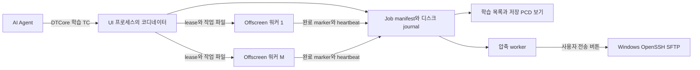

# TRAIN-BATCH-01 — 학습 시나리오 배치 설계

설계 기준: 2026-11-02(r41 사용자 결정 반영), `feat/train-batch-01`, parent `23d143b53f4bbf85b10846a2b740903bb9649cd3`, DTCore `bc60f05` 고정. **구현 전 제안**이며 이번 변경은 문서뿐이다. 빌드·게임·Editor·GPU·화면·외부 프로그램/다운로드 검증은 수행하지 않았다.

사용자가 결정한 것은 독립 게임 워커 M개, 20Hz sampled_timeline, ZIP / tar.gz, Linux SFTP 업로드, 학습 전용 목록과 선택 재생이다. tar.zst는 보류하며 zstd 소스를 포함하지 않는다. 부분 실패는 기본 전송 거절, 실패 목록 확인 뒤 성공분만 보내기를 명시 선택할 때만 허용한다. 아래의 메시지 이름·상한·API·시간 정책은 구현을 위한 제안이며 서버/현장 수용 완료를 뜻하지 않는다. N개와 N초를 혼동하지 않도록 **K=시나리오 개수, Dᵢ=항목 길이(초), M=동시 워커 수**로 표기한다.

## 1. 기존 구현에서 재사용할 것과 새로 필요한 것

| 확인한 기반 | 현재 사실과 설계 적용 |
|---|---|
| [TESTSET README](../README.md#testset-01-ai-agent-시나리오-테스트셋--임시-기능-로드맵-17), [AgentTestSetSubsystem](../Source/ma0t10_dt/MA0T10/Scenario/AgentTestSetSubsystem.h) | 현재 기본 `AutoFillExamples=True`, 소재 `SQ23456 077`를 만나면 수신 시나리오를 무시하고 템플릿 예시를 만든다(TESTSET-03). TRAIN Job을 이 트리거에 넣지 않는다. 기존 큐/실패 사유/원자 manifest/선점 및 복원 규칙을 참고하되 독립 Job 상태를 만든다. |
| [AgentTestSetWidget](../Source/ma0t10_dt/MA0T10/UI/AgentTestSetWidget.h) | 현재 전송은 `EDemoSend` 시연 표시뿐이다. 실제 전송 서비스나 성공 증거로 재사용하지 않는다. |
| [VirtualDatasetSubsystem](../Source/ma0t10_dt/MA0T10/Scenario/VirtualDatasetSubsystem.cpp), [타입](../Source/ma0t10_dt/MA0T10/Scenario/VirtualDatasetTypes.h) | immutable 획득 → bounded writer → PCD/라벨 → 마지막 완료 marker 흐름을 재사용한다. 현재 planned capture는 행 자세를 적용하고 안정화한 뒤 캡처하며 실시간 시계를 돌리는 시뮬레이션이 아니다. `Plan.Root`는 현재 `ProjectSavedDir()/TestSets` 하위만 허용하므로 TrainBatch 경로를 그냥 전달하면 실패한다. 명시적 로컬 Job 출력 context를 추가하고 기존 경로 검증을 유지하는 소규모 확장이 필요하다. |
| [저장 PCD 보기](../Source/ma0t10_dt/MA0T10/Scenario/AgentTestSetPcdPreview.cpp) | 독립 미리보기 컴포넌트, 읽기 worker 1건+다음 프레임 1개, 취소/generation, 저장 시각 간격을 재사용한다. 현재 `FAgentTestSetItem`과 `scene_XXXXX` 레이아웃에 결합돼 있으므로 중립 읽기 descriptor adapter가 필요하다. |
| [SlabScenarioReplaySubsystem](../Source/ma0t10_dt/MA0T10/Scenario/SlabScenarioReplaySubsystem.h), [SlabMotionComponent](../Source/ma0t10_dt/MA0T10/Slab/SlabMotionComponent.cpp), [codec](../Source/ma0t10_dt/MA0T10/Slab/SlabScenarioCodec.cpp) | 일반 시나리오 우선·관찰 전용·중복/실행 ID 분리를 유지한다. 학습 목록을 일반 보관 목록(메모리 10개)에 등록하지 않는다. `Sample`/`BuildPose`와 단위·TrackReference를 재사용한다. |
| [EXPORT-01 도구](../Tools/DatasetTools/README.md) | 완료 파일을 읽는 선택적 COCO/KITTI 후처리만 연결한다. Python 및 요구 환경이 준비되지 않으면 해당 옵션을 거절하며 실행 중 설치하지 않는다. |
| [서버 UI 패턴](../Source/ma0t10_dt/MA0T10/UI/VirtualSensorCaptureExportPanelWidget.Owned.cpp), [Transport](../Source/ma0t10_dt/MA0T10/Sensor/VirtualSensorTransportComponent.cpp) | URL/마스킹 입력·상태 표시 패턴만 따른다. 현재 센서 HTTP 전송은 `SetContent(Bytes)`로 전체 body를 메모리에 올리므로 대용량 archive 전송기로 사용하지 않는다. 기존 인증은 세션 전용이며 학습용 Saved 자격증명은 새로 분리한다. |
| [AUTO-01](../Source/ma0t10_dt/MA0T10/Scenario/Automation/AutomationControlSubsystem.cpp) | 기본 꺼짐, 명시적 `-MA0T10Job`, loopback 제어·취소·결과 기록 패턴을 참고한다. 워커마다 같은 8099 listener를 열지 않는다. 새 워커 모드는 파일 IPC가 기본이다. |

구조는 같은 Runtime 모듈 안에서 L0 `Contracts/`(Job/IPC 값 계약), L2 `Scenario/Training/`(접수·계획·프로세스·저장·압축·업로드), L3 `UI/`(학습 화면)로 나눈다. L1 센서가 학습 UI/업무 타입을 include하지 않으며 새 UE 모듈·플러그인·DTCore 수정은 만들지 않는다. 후보 파일명은 `TrainBatchTypes`, `TrainBatchCoordinatorSubsystem`, `TrainBatchWorker`, `TrainBatchArchive`, `TrainBatchUpload`, `TrainBatchWidget`이다. 이 문서가 해당 파일 생성 승인은 아니다.

## 2. 입력 계약과 일반 시나리오 우선

### 2.1 접수 경로

권장 경로는 **별도 `topic.train.scenario` + `MESSAGE_ID=ITrain-agent-batch`**다. 기존 DTCore `UDxWebSocketSubsystem → UDxDataSubsystem → 프로젝트 TC`를 이용한다. 현재 DTCore DataTable handler map은 초기화 뒤 불변이고 공개 동적 등록 API가 없다. 1A는 공개 `Subscribe` callback을 프로젝트 TC adapter에 연결해 background `ParseToStruct` → GT `ProcessStructData`를 수행한다. 기존 업무 구독/DataTable·private map은 건드리지 않고 별도 STOMP 연결을 만들지 않는다. 명시 활성화할 때만 학습 Topic을 구독하고 자기가 만든 구독만 해제한다. 자산 실행이 허용된 후 DataTable 행으로 옮기는 선택지는 별도 검토한다.

`topic.scenario/IFactory-agent`는 일반 입력과 기존 TESTSET 트리거 의미를 그대로 유지한다. 학습 envelope를 그 경로에 보내면 기존 시나리오로 해석하지 않고 명확히 거절한다. 서버가 기존 Topic만 쓸 수 있다면 **서버 adapter에서 새 Topic으로 변환**하는 안을 우선 협의한다. 일반 메시지를 학습용으로 가로채는 변경은 이번 설계에 포함하지 않는다.

Job은 작은 manifest와 항목별 메시지로 나눠 받는다. K개 전체 JSON을 하나의 거대한 STOMP body로 보내지 않는다. 같은 내부 admission 함수를 쓰는 로컬 manifest 가져오기도 제공해 네트워크 없이 단위/통합 시험을 할 수 있게 한다. HTTP 다운로드 URL이나 원격 명령 실행은 입력 계약에 포함하지 않는다.

```json
{
  "MESSAGE_ID": "ITrain-agent-batch",
  "schema": "ma0t10.train.job.v1",
  "kind": "job",
  "job_id": "8cdf7e10-7972-4493-b5d2-a7d36c1c04dd",
  "scenario_count": 1,
  "worker_limit": 2,
  "execution": {"mode": "sampled_timeline", "sample_hz": 20},
  "preset_id": "slab-train-v1",
  "dimension_unit": "mm",
  "position_unit": "cm",
  "capture": {"lidar": true, "camera": false, "camera_truth": false},
  "scenarios": [{"scenario_id": "case-001", "duration_sec": 10,
                 "input_sha256": "<64자리 hex>", "input_bytes": 12345}]
}
```

예시는 시나리오 1개인 Job이며, 실제로는 `scenario_count`와 같은 수의 descriptor가 필요하다. `slab-train-v1`은 신설 preset 이름 예시이며 현재 제품의 등록값이 아니다. `<64자리 hex>`는 설명용 자리 표시자이며 실제로는 원문 SHA256의 64자리 소문자 hex만 허용한다. `worker_limit`은 요청 상한으로, 이 예시는 항목이 1개이므로 실제 M은 1이다.

항목 메시지는 `schema`, `kind=scenario`, `job_id`, `scenario_id`, `input_sha256`, `scenario_json`(기존 IFactory-agent JSON의 원문 문자열)을 갖는다. SHA256은 **원문 UTF-8 bytes**에 대해 계산하고 원문을 다시 직렬화하지 않는다. Job manifest와 모든 항목 검증·디스크 저장이 끝나야 `Ready`가 된다. BROKER receipt와 Job 접수/생성 완료 응답을 구분한다. `kind=seal`은 누락 목록을 반환할 수 있으며 완료 파일이 없는 Job을 실행시키지 않는다.

### 2.2 제안 상한과 검증

| 항목 | MVP 제안값 / 처리 |
|---|---|
| K / Dᵢ | K 1–1000, Dᵢ 0초 초과–300초, 합계 30000 시뮬레이션 초 이하. 개수와 길이는 독립값이다. |
| 샘플 계획 | MVP는 20Hz만 허용, 프레임 수 `ceil(Dᵢ × sample_hz)`(구간 `[0,Dᵢ)`). 1항목 최대 10000프레임, Job 최대 600000프레임. 조용한 행 생략/1프레임 시연 cap 적용 금지. |
| 입력 용량 | Job manifest 256KiB, 원문 시나리오 각 8MiB, 항목 envelope 16MiB(문자열 escape 포함), Job 원문 합계 256MiB, 아직 저장하지 않은 입력 64MiB. 상한 초과는 추가 파싱/실행 전 거절·재전송 안내. DTCore 수신 이전 네트워크 body 메모리까지 이 상한이 보장하는 것은 아니므로 broker/client 수신 한도도 통합 시험에서 확인한다. |
| 기존 codec | 각 `DATA_MAP` 1–100000행, 프레임/시각 엄격 증가, 유한 수·단일 소재·고정 치수·단위·UUID 규칙 유지. TRAIN은 명시 UUID를 요구하고 manifest ID와 원문 UUID는 각각 보존한다. |
| 길이 일치 | 원문 `_meta.duration_sec`와 descriptor Dᵢ 일치(1µs 허용 오차), 마지막 행 시각 < Dᵢ, 첫 행 0초를 요구한다. 생략 길이를 추정하거나 데이터 없이 끝까지 외삽하지 않는다. 마지막 행 이후 Dᵢ까지 기존 `Sample`의 hold 정책을 명시한다. |
| 실행 설정 | map·센서 ID·해상도·backend·출력은 설치된 로컬 허용 preset ID로만 선택한다. envelope에 `dimension_unit`/`position_unit`(mm/cm/m)을 명시하고 preset의 Slab 입력 단위와 일치시킨다. 현행 codec이 이 단위를 자동 적용한다고 가정하지 않는다. 원격 임의 map path·콘솔 명령·프로세스 인자·출력 절대경로를 받지 않는다. |
| 캡처 상한 | 기존 Camera ≤1920×1080, LiDAR ≤25만 잠재 반환점, pipeline 두 장면 추정 합계 ≤256MiB를 유지한다. 카메라/GT/IMU/COCO/KITTI는 명시 선택, 기본 PCD+라벨이다. |
| 디스크 | 입력+예측 원본+압축 중간물+최종 archive+여유(최소 10GiB 또는 추정량의 10% 중 큰 값)를 예약한다. 여러 Job 합산 quota를 적용하고 여유 부족 시 접수/시작을 거절한다. 압축률을 낙관해 용량을 승인하지 않는다. |

같은 JobId+같은 manifest hash 재전송은 idempotent 조회/누락 보충, 다른 hash는 `JOB_CONFLICT`다. 동일 시나리오 ID 중복·hash/byte 수 불일치·알 수 없는 schema/실행 모드·잘못된 경로·NaN은 거절한다. 문자열/배열/행 수와 디스크 사용량을 먼저 제한하고 immutable 파싱/해시/쓰기 작업은 worker thread에서 수행한다. 접수 실패를 일반 시나리오 fallback으로 넘기지 않는다. 원본 시나리오를 추가로 임의 변형하지 않으며, 선택적 랜덤화가 필요하면 seed/채널/전역 항목 index를 입력 manifest에 고정해 워커 수·할당 순서·재시도에 따라 값이 달라지지 않게 한다.

일반 시나리오가 UI 프로세스에서 시작되면 **새 학습 할당을 즉시 보류**하고 워커는 현재 캡처/쓰기 경계에서 pause ACK를 낸다. 공유 GPU도 경쟁하므로 필요하면 워커를 정상 종료하고 완료 항목 이후부터 재개한다. 일반 실행을 학습 완료까지 기다리게 하지 않는다. 준비/정리 지연과 순간 GPU 경쟁은 측정·보고한다. 기존 TESTSET의 `YieldToOrdinaryScenario`, 일반 시나리오·센서 상태 복원 규칙은 변경하지 않는다.

### 2.3 D초의 의미 — 사용자 확정

사용자 승인 MVP는 기존 codec으로 `t=k/20`의 자세를 샘플링해 **D초 구간을 빠짐없이 저장하는 오프라인 시간축 생성**이다. 이때 `simulation_elapsed_s`, 원본 행 frame 번호, dataset 장면 번호, sensor FrameId/UTC를 분리한다. 출력상 20Hz 간격과 wall-clock 처리 20Hz는 다른 값이며 실제 처리량/지연을 별도로 표시한다. Engine world clock/Chaos/재질 시간까지 D초를 실시간 재현했다고 주장하지 않는다.

현재 `FVirtualDatasetFramePlan`은 원본 행 선택+`BuildPose`이고 `PumpPlanned`는 pose 고정 캡처다. 따라서 `FSlabScenarioCodec::Sample` 기반 전체 시간축 planner, `USlabMotionComponent::CaptureSensorMotion`에 해당하는 속도/context 보존, 움직임 기반 IMU/라이다 fidelity의 정합 adapter가 필요하다. 지원을 확인하지 못한 옵션은 명시 거절하고 정적인 값으로 위장하지 않는다. 실시간 물리/월드 시계 진행은 범위 밖이다. 1A에서는 운동 context 정합이 필요한 IMU/fidelity 옵션을 거절하고 정적인 결과로 위장하지 않는다.

## 3. 코디네이터와 M개 워커



### 3.1 실행과 격리

배포는 **같은 SHA의 Development/Shipping 패키지 실행 파일**이 기본이다. 개발 검증만 `UnrealEditor.exe <절대 .uproject> <허용 map> -game`을 쓴다. 예시 아래의 `-TrainBatchWorker`/`-TrainBatchAssignment`는 아직 없는 **신설 옵션**이다.

```text
<package.exe> "<절대 package/project.uproject>" "<allowlisted-map>" -RenderOffscreen -unattended -nosound
  -UserDir="<사용자 Saved>/TrainBatch/Workers/slot-01/UserDir/"
  -TrainBatchWorker -TrainBatchAssignment="<검증된 로컬 assignment.json>"
```

GPU LiDAR/카메라에는 실제 D3D12 RHI가 필요하다. `NullRHI`, dedicated server, 렌더 비활성화로 통과를 대신하지 않는다. 해상도/센서/출력은 preset에 고정하고 startup 결과 파일에 실제 값·adapter/driver·SHA·Saved 경로를 기록한다. UI 기본 시작 맵을 추정하지 않고 학습 허용 map/host를 지정한다. Asset/DataTable 간접 참조의 cooking도 검사한다.

프로세스는 shell 문자열 실행 대신 `FPlatformProcess::CreateProc`와 검증된 실행 파일/고정 옵션을 쓴다. 실행 후 pipe/프로세스 handle을 관리하고 부모 PID·creation time·worker UUID를 기록한다. 코디네이터 crash가 워커를 즉시 죽이지 않도록 detach하고, 소유 프로세스만 graceful cancel → bounded drain → 종료 대상으로 삼는다. 재개 때 PID 숫자만 보고 임의 프로세스를 kill/adopt하지 않는다.

워커는 UI/자동 TESTSET/업무 구독/센서 자동 송신/PixelStreaming 접속을 **자기 프로세스의 worker 실행 context에서만** 시작하지 않는다. 모듈/플러그인 의존·설정 파일·일반 프로세스 기본값은 유지한다. 현재 DTCore 초기화가 `Config/Game.ini` 빈 템플릿을 생성할 수 있으므로 UserDir만으로 설치 폴더 쓰기까지 격리됐다고 가정하지 않는다. 배포의 빈 템플릿을 사전 제공하고 worker 생성 전 존재/빈 값만 검증하며, 읽기 전용 설치·병렬 최초 실행에서 추가 쓰기/경쟁이 없는지 테스트한다. 공유 Config를 자동 생성/덮어써 해결하지 않는다.

### 3.2 native safety와 안정적인 UserDir

[SensorNativeSafety.cpp](../Source/ma0t10_dtBootstrap/Private/SensorNativeSafety.cpp)의 `MarkerPath()`는 `FPaths::ProjectSavedDir()/NativeLidarSafety/active-<vendor|adapter|driver SHA1>.guard`, 상태는 뒤에 `.state`가 붙는다. `Begin()`은 같은 경로의 live PID/creation stamp 또는 exclusive writer를 만나면 **RHI를 선택**한다. 따라서 같은 Saved를 공유하면 워커 2번부터 native 기본 조건을 만족하지 못할 수 있다.

UE5.3 `Paths.cpp`에서 명시 `-UserDir`는 `ProjectUserDir()`를 바꾸고 `ProjectSavedDir()`는 그 아래 Saved를 사용한다. **워커별 UserDir는 필수**이며 실제 해석된 절대 경로가 모두 다른지 startup handshake에서 확인한다. 슬롯별 UserDir는 Job/attempt마다 새로 만들지 않고 재시작 후에도 유지해 oracle 캐시·비정상 종료 횟수·1회 RHI 복구·2회 ban을 보존한다. startup oracle 및 장치 손실 정책 자체는 변경하지 않는다.

여러 코디네이터가 슬롯을 공유하지 않도록 사용자별 로컬 coordinator lease를 둔다. 워커별 safety를 분리해 crash 이력을 우회하지 않도록 코디네이터가 동일 adapter/driver의 ban/recovery 결과를 집계한다. ban이 하나라도 확인되면 새 native 학습 작업을 막고 사용자가 상태를 확인하게 한다. 다른 슬롯을 만들어 재시도하거나 `.state`/marker를 자동 삭제하지 않는다. 정상 장치의 soft disable은 현행처럼 해당 세션 RHI, oracle 무효화이며 비정상 종료로 집계하지 않는다.

worker crash/강제 종료 뒤 기존 슬롯으로 정상 안전 실행을 거친다. RHI 복구 출력은 backend가 다른 실행으로 기록하고 native 필수 Job이면 성공 산출물로 확정하지 않는다. 복구 완료 뒤 허용된 native 재시도까지의 대기/실패를 명시한다. `ProcessStamp ACCESS_DENIED`는 보수적으로 live owner로 보는 기존 한계로 남기며 파일 잠금을 강제로 풀지 않는다. 프로세스 분리는 GPU device loss 자체를 격리하지 못하므로 공유 GPU 장애로 여러 워커가 실패할 수 있다.

### 3.3 할당·진행·재할당·디스크 resume

| 계약 | 제안 |
|---|---|
| 분할 단위 | 시나리오 1개가 원자 단위. D초를 임의로 M등분하지 않는다(이전 상태/센서 시간축 손실 방지). 예상 `D × 샘플률 × 출력 비용`이 큰 항목부터 가용 워커에 동적 할당, 나머지는 disk queue. 한 워커 한 항목, 다른 워커 실패와 독립 진행. |
| 소유권 | coordinator만 Job journal을 쓰고, worker는 자기 attempt 하위만 쓴다. `worker_id`, `attempt_id`, lease epoch, Job revision, input hash를 assignment/result에 모두 넣어 늦게 온 결과를 거절한다. |
| heartbeat | 2초마다 atomic 교체, progress는 최대 1초마다. PID/start stamp·단계·완료 프레임·bytes·마지막 진전·오류 code·backend/fallback·Hz/gap 포함. heartbeat 정지 15초는 의심, 30초 lease 만료 뒤 소유 종료/리소스 정리 확인 후 재할당한다. 단순히 긴 압축/캡처를 crash로 판단하지 않도록 단계 deadline도 별도다. |
| 재시도 | 기본 항목당 자동 2회, 지수 backoff. 영구 검증 오류는 자동 재시도 없음. GPU OOM/device fault 시 새 할당 중지·M 축소/안전 복구 판단 후 실패 항목만 재할당한다. 다른 정상 워커는 계속하며 backend/품질을 몰래 바꾸지 않는다. |
| crash 일관성 | `*.pending` 쓰기→flush/close→같은 volume 원자 rename, sequence+checksum을 가진 journal과 snapshot. 완료 manifest는 모든 파일 close/hash 검증 뒤 마지막에 확정한다. 전원 장애에서 마지막 record 손실을 탐지하며 파일 rename만으로 영구 저장을 보장했다고 하지 않는다. |
| resume | 시작 시 manifest/journal checksum·SHA/DTCore/preset/input hash 검사. 실행 버전/preset이 다르면 재개를 거절하고 새 Job으로 분리해 서로 다른 build의 결과를 섞지 않는다. 완료 시나리오는 검증 후 건너뛴다. 미완료 항목은 **새 RunUUID/attempt 폴더로 처음부터** 재실행(MVP); 프레임 중간 resume는 2단계다. 원래 완성 파일/실패 증거를 덮지 않는다. |
| coordinator 종료 | 사용자 정상 종료는 워커 경계 pause/종료·journal 저장. coordinator 비정상 종료 시 새 할당 금지, 워커는 마지막 immutable 파일을 정리하고 lease 대기. 재시작 coordinator는 PID/start stamp·nonce 확인 후 기존 프로세스를 회수하거나 정상 종료를 기다리고 재할당한다. |

stale attempt가 늦게 성공해도 성공 commit은 시나리오당 하나만 채택한다. 물리 파일이 중복 생성될 수 있는 at-least-once 실행과 논리 결과의 단일 확정을 구분한다. `job.json` 상태만 신뢰하지 않고 완료 marker/파일 크기/SHA256/PCD POINTS/라벨 수를 재검증한다. 미완료/실패 포함 전체를 성공으로 압축하지 않는다.

### 3.4 12GB GPU에서 M 결정

자동값은 안전하게 **M=1**, 요청 상한은 MVP **4**다. VRAM 12GB라는 숫자만으로 M=4를 허용하지 않는다. 실제 adapter local-memory budget을 읽고 같은 preset에서 각 worker startup/oracle/BLAS 교체·캡처·Camera GT 최댓값을 측정한다.

```text
reserve = max(2 GiB, local_budget × 0.20)
worker_reserved = worker_peak_local_bytes × 1.25
M_gpu = floor((local_budget - coordinator_peak - other_process_usage - reserve) / worker_reserved)
M = min(requested_M, 4, K, max(0, M_gpu), M_cpu, M_ram, M_disk)
```

`local_budget`에 다른 프로세스 사용량이 이미 차감된 API 값을 쓰면 `other_process_usage`를 다시 빼지 않는다. 계측 정의를 manifest에 남긴다. 계산 결과 0이면 시작을 거절한다. M=1→2→4 짧은 calibration에서 전체 VRAM/RAM/Commit/프레임 지연/실제 처리량을 확인하고, 동시에 존재할 수 있는 native/RHI fallback의 큰 피크도 예약한다. 임의 해상도/품질/20Hz 저하로 M을 맞추지 않는다. 외부 GPU 작업이 시작되면 신규 할당을 멈추고 여유를 재평가한다. 실제 M·제한 사유를 UI에 표시한다.

## 4. 결과 폴더·무결성·압축

기본 결과 root는 사용자 Saved이며 서버 토큰/worker 설정은 archive 대상 밖이다.

```text
Saved/TrainBatch/
  Jobs/<JobId>/job.json, journal.ndjson, input/job.json
    input/<ScenarioId>/original.json
    scenarios/<ScenarioId>/attempt_<RunUUID>/
      dataset.json
      scene_00000/lidar.pcd, lidar_labels.bin, label.json
      scene_00000/rgb.png, depth.exr, seg.png, instance.png  (선택 출력만)
      scenario-result.json, checksums.sha256, complete.json
    ipc/<WorkerId>/assignment.json, heartbeat.json, progress.json
    artifacts/<JobId>.<zip|tar.gz>, artifact.json
    upload/state.json
  Workers/slot-01/UserDir/Saved/NativeLidarSafety/...
  Settings/sftp.json, known_hosts
```

`ScenarioId`는 표시 이름과 분리된 안전한 로컬 ID로 매핑한다. archive에는 선택된 성공 attempt·원본 입력·설정/버전/provenance·결과·체크섬만 포함한다. 워커 IPC/로그·개인 SaveGame·credentials·다른 Job을 포함하지 않는다. PCD는 기존 33-byte little-endian, 점별 라벨은 별도 5-byte, 좌표계/immutable transform·FrameId·UTC 계약 불변이다. scenario-result에는 요청/완료/무효/gap 수, 시뮬레이션 길이·wall 시간, backend·fallback 수, 원본/출력 hash를 분리해 남긴다.

파일별 SHA256과 크기를 정렬된 상대경로 manifest로 기록한다. `complete.json`은 그 manifest hash를 참조하고 **자기 자신을 해시 목록에 넣지 않는다**. archive 자체 SHA256/64-bit bytes/format/level/도구 버전은 archive 밖 `artifact.json`에 기록해 순환 참조를 피한다. ZIP CRC는 SHA256 대체가 아니다. 출력 manifest 스키마는 `ma0t10.train.result.v1`, archive metadata는 `ma0t10.train.artifact.v1`로 분리 제안한다.

### 4.1 로컬 압축 의존성 조사와 선택

조사 경로는 설치된 `C:/Program Files/Epic Games/UE_5.3/Engine/`이다. 설치본의 파일을 읽었으며 외부 다운로드나 compressor 실행은 하지 않았다.

| 형식/선택지 | 확인한 근거 / 권장 구현 |
|---|---|
| ZIP | `Source/ThirdParty/libzip/libzip.Build.cs`, `1.9.2/include/libzip/zip.h`, Win64 x64 `Release/zip.lib` 존재. libzip은 OpenSSL/zlib 의존, BSD-3-Clause license 파일이 있다. **엔진 libzip 재사용 권장**. store(0)/deflate(1–9), 기본 deflate 3 제안. file-backed `zip_source_file`과 `zip_set_file_compression`, 취소 callback 사용. JPEG/이미 압축된 파일은 store 선택 가능하되 manifest에 실제 방법 기록. |
| tar.gz | 엔진 `zlib/1.2.13/include/zlib.h`와 static lib/Build.cs 확인. 프로젝트의 작은 PAX tar streaming writer→zlib gzip wrapper(deflate `windowBits=15+16`), 기본 level 3. tar.gz는 ZIP 컨테이너가 아니며 파일명/크기/긴 UTF-8 경로는 PAX로 처리한다. gzip trailer ISIZE 32-bit 값만으로 총 크기를 판정하지 않는다. |
| tar.zst | **사용자 결정: 보류(미지원)**. UI에서 숨기거나 보류라고 표시하고 설정/입력은 거절한다. 엔진에 license·vcpkg 메타데이터·Boost wrapper만 확인됐고 사용 가능한 구현/라이브러리는 찾지 못했다. zstd 소스 포함·설치·다운로드·외부 compressor 실행 없음. |

MVP 압축은 ZIP/tar.gz만이다. 기존 엔진 ThirdParty private dependency 연결은 압축 구현 단계(1C)에 수행하며 1A에는 추가하지 않는다. 서버 전송은 §6의 Windows 기본 OpenSSH를 사용한다.

### 4.2 대용량·취소

archive 생성은 캡처와 분리된 background 작업 1개, 입력/출력 버퍼 각각 최대 1MiB와 코덱 workspace 상한으로 처리한다. 전체 파일/Job을 `TArray`/`BytesIO`에 올리지 않는다. 한 번에 연 파일 수도 제한하고 파일 목록은 disk manifest에서 읽는다. tar/gzip은 bounded streaming으로 프레임 CPU와 경쟁을 제한한다. 모든 선택 항목의 생성 완료 뒤 **압축 버튼**으로 시작하며, 생성과 겹치는 정책은 2단계 성능 검증 뒤에만 연다.

ZIP은 libzip의 64-bit API와 ZIP64 지원을 사용하고 **단일 파일/전체 archive 4GiB 초과, entry 65535 초과**를 실제 fixture로 검사한다. 압축 가능한 sparse 4GiB 파일만 통과시키지 말고 비압축 store archive offset/central directory가 4GiB를 넘는 경우도 검사한다. `int32` 크기 변환을 금지한다. libzip central-directory/entry metadata는 entry 수에 비례하므로 archive당 최대 100000 entries·metadata 추정 256MiB·원본 64GiB를 제안 상한으로 둔다. 넘으면 시나리오 묶음별 여러 archive+상위 manifest로 분할한다. 단일 시나리오가 넘으면 명시 거절하고 조용히 파일을 빼지 않는다. 분할은 일반 독립 archive들이며 split-ZIP 포맷은 아니다.

`*.partial`로 생성 후 close·무결성 검사·rename으로 확정한다. 취소는 원본을 보존하고 열린 handle 해제 뒤 자기 partial만 정리한다. compression resume는 MVP에서 처음부터, upload resume와 구분한다. entry 경로는 정규화된 상대 UTF-8만 허용하고 `..`, 절대경로, drive prefix, reparse/symlink 외부 탈출, 중복/대소문자 충돌을 거절한다. 결과 순서·tar 시각/권한 metadata를 고정할 수 있으나 센서 UTC 때문에 서로 다른 실행 archive byte 동일성을 약속하지 않는다.

## 5. 학습 전용 화면

새 `UTrainBatchWidget`은 기존 `UVirtualSensorPanelWidgetBase → UDxWidget` 경로와 `UDxWidgetSubsystem`의 열기/닫기/BringToFront/input blocker를 따른다. 기존 Workspace adapter에 명시 등록하고 enum이 필요하면 끝에 추가하며 기존 슬롯/버전/값을 재사용하거나 새 학습 전용 키만 쓴다. 별도 위젯 관리자를 만들지 않는다. 일반 replay/TESTSET 목록과 데이터 소유권을 분리한다.

화면은 Job 목록, 선택 Job의 시나리오 목록, 저장 결과 보기, 접힌 서버/압축 설정으로 구성한다. 상태는 **수신 중 / 대기 / 실행 / 일시정지 / 완료 / 실패 / 취소**, 압축·업로드 상태는 별도 열이다. 항목 실패가 다른 항목을 실패로 만들지 않으며 Job은 `부분 실패`를 명시한다. 실패만 재시도, 전체 중지, 결과 폴더, 서버 설정, 압축, 전송 버튼을 제공한다. 기본은 전체 성공 결과 전송만 허용하고 일부 성공본 전송은 사용자가 범위/실패 목록을 확인한 별도 선택이다.

완료 항목 클릭은 `complete.json`이 가리키는 성공 attempt의 **저장 PCD**를 기존 preview adapter로 재생한다. 일반 Slab Actor 재생/센서 재획득·송신을 일으키지 않는다. 중간 결과는 생성 중임을 표시하고 확정된 파일만 읽는다. 카메라는 저장 RGB가 있을 때만 별도 보기(재렌더 아님)를 제안한다. 선택 변경/닫기는 pending 읽기 결과를 generation으로 폐기하며, 창 숨김은 Job 취소가 아니다.

목록은 가상화·revision 기반, 표시 갱신 ≤5Hz, hidden 상세 문자열 조립 중지, 로그는 상태 전환/오류만 남긴다. 열기만 해서 Job/압축/업로드/worker를 시작하지 않는다. 서버 설정을 저장한 뒤에도 **전송 버튼을 눌러야** 업로드한다. 기존 TESTSET의 시연용 전송 성공 표시와 연결하지 않는다.

## 6. 서버 설정과 SFTP 전송 — 사용자 승인

Linux의 기존 SSH/SFTP 서비스와 쓰기 가능한 디렉토리를 사용한다. 서버 코드를 배포하지 않는다. HTTP chunk-v1/multipart/로컬 수신 서버는 이번 범위 밖이며 향후 별도 옵션이다. **1A에는 전송 구현/시연을 넣지 않는다.**

### 6.1 실행 파일·인증·host key

- 고정 `C:/Windows/System32/OpenSSH/sftp.exe`, `C:/Windows/System32/OpenSSH/ssh.exe`만 허용한다(사용자가 이 PC 9.5p2 확인). PATH 검색·설치·다운로드·대체 바이너리 실행 없음. 필요한 파일이 없으면 기능 거절/경로 안내.
- SSH 키 인증만 허용한다. 개인키는 경로만 지정하고 앱이 내용을 저장/복사하지 않는다. passphrase는 사용자가 ssh-agent로 준비한다. 앱은 비밀번호/passphrase를 저장하거나 대화형으로 받지 않으며 `BatchMode=yes`로 프롬프트를 차단한다. agent/서비스/보안 설정은 바꾸지 않는다.
- `StrictHostKeyChecking=yes`, `UserKnownHostsFile=<사용자 Saved>/TrainBatch/Settings/known_hosts`. 첫 연결은 사용자 지문 확인·명시 등록이 필요하다. 별도 신뢰 경로로 받은 공개 host key와 지문을 확인한 뒤 앱에 등록한다. 미검증 key 자동 신뢰/StrictHostKeyChecking 해제 금지. 변경된 host key는 거절 후 재확인.
- 개인키/passphrase/호스트 지문·공개 key 원문을 로그/archive/커밋에 남기지 않는다. 앱 전용 known_hosts와 설정은 사용자 Saved에만 둔다. stdout/stderr는 저장 전에 마스킹한다. 앱 전용 고정 SSH config(`-F`)로 사용자 전역 config의 ProxyCommand/LocalCommand 등을 상속하지 않도록 한다.

### 6.2 설정·경로·batch

| 설정 | 계약 |
|---|---|
| host / port / user | DNS/IPv4 또는 검증한 IPv6, port 기본22(1–65535), user 안전 문자 whitelist. 공백/줄바꿈/quote/leading `-`/shell 제어문자 거절. IPv6 인자/known_hosts 표기 별도 검증. |
| 원격 디렉토리 | 절대 POSIX 경로, 연속 구분자 정규화, `..` component·제어/인용/와일드카드/shell metacharacter 거절. MVP는 component를 `A-Za-z0-9._-`로 제한하며 공백 경로와 `/` 단독은 거절 안내. |
| 개인키 경로 | 로컬 절대 파일 경로, 제어문자/quote 거절·공백 경로 argv 인용 검증. 내용/비밀번호 저장 없음. |
| timeout | `ConnectTimeout` 기본30초, `ServerAliveInterval` 기본15초, `ServerAliveCountMax=3`, 별도 무진전 deadline. 유한 양수 상한 검증. |
| 동시성 / 보관 | 전송 동시1개. `Saved/TrainBatch/Settings/sftp.json`에 host/port/user/dir/key 경로/timeout·프로필 ID만. 실제 서버 정보는 문서/fixture/커밋 금지. |

`CreateProc`로 고정 실행 파일을 호출하고 cmd/PowerShell shell 조립은 하지 않는다. 앱이 sftp `-b` 파일을 생성한다. JobId/파일명은 UUID+고정 확장자, 경로/인자는 whitelist와 인용 함수로 처리하며 batch 줄바꿈/quote/escape injection을 거절한다. 임의 명령을 인자로 받지 않는다.

### 6.3 업로드·재개·무결성

1. 전체 성공 Job만 기본 전송한다. 부분 실패는 실패 목록 확인 후 **성공분만 보내기** 명시 선택을 artifact.json에 고정한다. 설정/범위를 확인한 다음 전송 버튼으로 시작한다.
2. 로컬 artifact SHA256/64-bit 크기·파일 identity 확인. 원격 최종 `<dir>/<JobId>.<ext>`가 있으면 덮어쓰지 않고 conflict.
3. `put`으로 `<JobId>.<ext>.partial` 업로드. 중단 뒤 같은 로컬 hash/크기·프로필 기록이 일치할 때만 `reput` 재개. 원격 partial이 더 크거나 identity가 불명확하면 거절. 크기만으로 prefix 동일성을 보장하지 못하는 한계를 표시하고 불확실하면 새 JobId로 분리한다.
4. 기본 원격 검증은 크기 비교. 선택적으로 고정 ssh 명령 **`sha256sum -- '<검증된 partial 절대경로>'` 한 종류만** 실행해 로컬과 비교한다(coreutils 필요). POSIX 인용 함수를 사용하고 임의 명령/추가 인자를 받지 않는다. 해시 확인 없이 SHA256 검증됨이라고 표시하지 않는다.
5. `<JobId>.<ext>.sha256.partial`, `<JobId>.<ext>.artifact.json.partial`도 전송·크기 확인. SHA256 sidecar는 최종 basename을 참조한다. payload rename→artifact metadata rename→**sha256 sidecar 마지막 rename** 순서다. 최종/sidecar가 이미 있으면 conflict.
6. 수신 완료는 해당 payload/sidecar `.partial`이 없고 `.sha256`과 artifact metadata가 존재하는 것이다. 여러 rename은 원자 transaction이 아니므로 단계 journal/resume이 필요하다. no-clobber rename의 경쟁 동작은 서버 구현을 실제 검증해야 하며 지원되지 않으면 고유 JobId/동시 작성자 제한을 요구한다.

진행률은 원격 크기 5초 조회 또는 sftp 출력 파싱. 파싱이 locale/버전에 따라 불안정하면 크기 조회만 사용한다(전송 mutation 동시1개, 조회만 별도). 조회 불가 구간은 불확정 진행이다. 원격 크기는 fsync/학습 완료 ACK가 아니다. 취소는 소유 process 종료+partial 유지, 성공으로 표시하지 않는다. local upload state는 프로필 ID·Job/선택 범위·artifact hash/크기·단계만 저장하고 키/지문/출력 원문은 저장하지 않는다.

### 6.4 검증과 실제 Linux 수동 절차

로컬에 Linux 서버가 없으므로 Windows OpenSSH Server 설치·서비스/방화벽/시스템 설정 변경을 하지 않는다. batch 생성·argv 인용·경로 whitelist·크기/해시 응답 parser·재개/취소·conflict/rename 순서는 fake process 결과로 단위 테스트하며 실제 서버 수용으로 세지 않는다.

사용자는 실제 정보를 Saved 설정에만 입력한 뒤, 신뢰 경로로 host key 확인/등록→ssh-agent key 준비→작은 ZIP/tar.gz 전송→크기/선택 SHA256 비교→완료 sidecar 순서 확인→중간 취소/reput→기존 최종 이름 conflict→잘못된 host key/인증/권한/네트워크 단절을 직접 검증한다. 기록은 비식별 프로필 ID·상태/수치만 남기고 서버 주소/키/지문은 커밋하지 않는다. Linux 디렉토리 결과와 수신 측 완료 판단은 후속 승인 시간에 확인한다.

## 7. 기본 정책·비용·보호 범위

TRAIN 기능 기본 꺼짐에서는 신규 tick/timer/스레드/파일 watcher/프로세스/구독/캡처/압축/SFTP 프로세스가 **0개**여야 한다. Subsystem 객체가 생성돼도 명시 활성화 전 일을 등록하지 않는다. 일반 PCD 송신 on·33-byte wire·FIFO/128MiB 전역/64MiB 스트림·frame 한도, DTCore pin·소스, 기존 TESTSET trigger 및 일반 시나리오 우선은 그대로다.

학습 실행 중 GPU·디스크 비용이 0이라고 주장하지 않는다. 사용자가 학습을 시작한 때만 비용을 허용하고 M admission·bounded 작업·일반 업무 우선 양보로 제한한다. 기본 꺼짐/학습 창 표시만/결과 보기/업로드를 구분해 성능을 측정한다. GT에서 대용량 JSON/압축/해시/socket I/O를 하지 않는다. product 기본 해상도·20Hz 목표를 낮추거나 물리/광학 품질을 몰래 생략하지 않는다.

DTCore에는 새 기능이 필요하지 않은 방향이다. TC DataTable 등록·UDxWidget 관리·공개 API로 해결하고, 일반 API가 부족하면 L2 프로젝트 adapter를 둔다. DTCore 내부/private 접근은 쓰지 않는다. 불가피한 공통 변경이 발견되면 재현/우회/최소안만 제안하고 승인 전 수정하지 않는다. Config/Game.ini·SensorTransport 빈 템플릿·기존 SaveGame·운영맵/SensorTestMap·Samples/PixelStreaming은 설계/구현 편의를 위해 덮어쓰지 않는다.

## 8. 검증 계획 — 구현 후 승인된 실행 시간에 수행

| 분류 | 검증/완료 조건 |
|---|---|
| 계약/시간축 단위 | K=1/상한/초과, D소수/0/NaN, schema/UUID/hash 충돌, 행/길이 불일치, 20Hz 구간 프레임 수·경계·보간·마지막 hold, 일반/시연 trigger 불변. 시뮬레이션 시간과 wall Hz를 별도 assertion. |
| 분할/복구 단위 | 균등/불균등 D, M>K, lease 만료·PID 재사용·ACCESS_DENIED, 워커 1개 실패 중 다른 완료, stale 성공 거절, journal truncate/checksum, coordinator/worker 재시작, disk full, partial write, 같은 Job 중복 접수. 완료 파일 검증 실패는 성공으로 복원하지 않는다. |
| 압축 단위/독립 검증 | ZIP/tar.gz level 경계·Unicode/긴 경로·빈 파일·취소·손상·탈출 경로·entry 수. Python `zipfile`/`tarfile`로 ZIP/tar.gz 해제 후 모든 파일 SHA256/bytes 비교. 실제 >4GiB 파일/archive 및 >65535 entries. 라이브러리 자신으로 압축/검증한 것만으로 완료하지 않는다. |
| SFTP 단위/현장 | 로컬 fake process로 batch/경로/인용·partial/reput·크기/선택 SHA256·취소/conflict/rename 순서 검사. 실제 Linux 서버는 사용자 Saved 설정과 수동 절차로만 검증한다. 서버 설치/시스템 설정 변경 없음. |
| 실제 RHI 통합 | M=1/2/4 같은 K/D/preset, 처리량·총 wall 시간·GPU local/resident/Commit·CPU/RAM/디스크·각 worker Hz/gap/native fallback 기록. VRAM admission에 걸린 M=4는 미수행/거절로 명시하고 성공으로 계산하지 않는다. 강제 worker 종료 뒤 다른 워커 계속, 재할당·safety 복구·native 재검증 확인. |
| 산출물 oracle | 동일 입력·seed·preset에서 단일/다중 worker의 예정 프레임·PCD 점/라벨·pose 일치. UTC/RunUUID/성능 metadata와 비결정적 RGB는 비교 대상/허용 규칙을 사전 명시한다. 기존 native byte/point oracle 및 20Hz 조건을 유지한다. |
| 기본 회귀 | Editor/Development 빌드, Shipping build/stage+worker smoke, `run_smoke_tests.ps1`, quick·layer·DTCore guard, 기존 release 절차. 기존 TESTSET/일반 replay/센서 송신/취소·종료·UI 저장 복원 회귀 포함. |
| 성능 gate | `Scripts/verify.ps1 -Level perf -BaseCommit <승인 기준 SHA> -PerfRayTracing ProjectDefault`, 표준 ABAB 중앙값·2% 기준 변경 없음. 표시형 1920×1080·1Camera+1LiDAR·10초 준비+30초 UI 비교와 offscreen batch 처리량을 구분한다. 과거 waiver를 새 변경에 자동 적용하지 않는다. |
| 메모리/장시간 | 일반 native 회귀는 r37 정책(30분 warm-up 제외, 이후 최소 60분 OS Commit ≤8MiB/h), old gate/last-third/warm-up 함께 보고. 배치 실행은 Job 원본/결과 증가와 프로세스 live allocation을 분리하고 반복 Job 후 bounded memory·종료 회수·VRAM 잔류를 검사한다. 3시간/24시간을 이번 설계 검증 완료로 표시하지 않는다. |
| 직접 UI | DTCore 열기/닫기/BringToFront/input 차단, Job 선택/실패 재시도/확정 PCD 재생·취소, SFTP/host key 설정·확인 후 전송·진행/재개/중지, 100/150% 글꼴·두 해상도·경계/긴 상태 문구·일반 화면 분리. 실제 client viewport/DPI/누른 것·기대·실제와 스크린샷 기록, 자동 테스트와 별도 판정. |

각 실행은 동일 SHA/DTCore/맵/프로필/센서 수/backend/출력/warmup/UserDir를 기록한다. GPU 시험은 사용자 PC의 다른 Editor·게임·빌드·영상 디코딩과 겹치지 않는 시간에 한 coordinator 측정만 허용한다(그 측정 내부의 M worker는 시험 조건). 개인 설정을 사전 백업/복원하며 release/perf skip·미수행을 PASS로 세지 않는다. 이번 r40은 링크/코드 근거·문서 diff/보호 경로·DTCore guard만 확인한다.

## 9. 단계·예상 작업량·열린 결정

아래는 구현자 1명 기준 **작업일 추정**이며 GPU 검증 시간/사용자 응답 대기는 별도다. 기능 구현 승인은 후속 지시가 필요하다.

| 단계 | 범위와 완료 기준 | 예상 |
|---|---|---|
| 1A MVP 기반 | 입력 계약 고정·DTCore TC 연결·opt-in 독립 목록·시간축 planner·파일 계약·M=1 파일 생성/보기. 기존 테스트셋 경로 제한의 안전한 확장. | 4–6일 |
| 1B MVP 다중 프로세스 | 고유 안정 UserDir·M=1/2/4 admission·heartbeat/lease·실패 재할당·시나리오 경계 disk resume·안전 상태 통합. | 4–6일 |
| 1C MVP 압축/전송 | ZIP/ZIP64·tar.gz·streaming SHA256, Windows OpenSSH SFTP batch/재개·앱 known_hosts·크기/선택 SHA256 검증·수동 Linux 절차. | 5–8일 |
| 1D MVP 통합 수용 | 두 형식 round-trip·실제 GPU/worker kill·release/smoke/perf·직접 UI·문서/제한. 소규모 Job으로 end-to-end, ZIP/tar.gz와 기본 정책이 모두 확인돼야 MVP 완료. | 3–5일 |
| 2단계 | 프레임 단위 checkpoint, 여러 Job quota/우선순위·선택 부분 전송, 생성/압축 겹침, 다중 archive 최적화, 현장 서버 adapter. 실시간 physics/time 모드는 범위 밖이며 별도 요청한다. | 6–10일 이상(서버/시간 의미에 따라 재산정) |

구현 전 Claude/사용자와 확정할 질문은 다음과 같다. 현재는 제안값으로 설계했으며 임의로 제품 정책을 바꾸지 않는다.

확정: 20Hz sampled_timeline·실시간 물리 제외, ZIP/tar.gz·tar.zst 보류, 키 기반 SFTP·HTTP 제외, 전체 성공 기본·명시적 성공분 전송 허용.

남은 현장 확인은 실제 preset/센서/선택 출력, 입력/디스크 상한, Linux SFTP endpoint/key/host-key 등록(값은 Saved만), 원격 sha256sum·동시 작성/no-clobber 지원, 보존 기간이다. 1A는 현재 World에서 명시 지정한 Slab/LiDAR와 일치하는 세션 preset으로 순차 생성하며 Actor 자동 배치·운영맵 저장을 하지 않는다.

## 10. 조사 근거와 이번 단계의 한계

소스 근거는 위 링크 및 [README §10](../README.md#10-아키텍처-뼈대), [DTCore DataSubsystem](../Plugins/DTCore/Source/DTCore/Private/Core/DxDataSubsystem.cpp), [DTCore WidgetSubsystem](../Plugins/DTCore/Source/DTCore/Public/Core/DxWidgetSubsystem.h), [native safety 설명](LIDAR_NATIVE_LIFETIME_26h.md)을 따른다. 엔진 설치본은 `Engine/Source/Runtime/Core/Private/Misc/Paths.cpp`의 `ProjectUserDir/ProjectSavedDir`, `Engine/Source/Runtime/Online/HTTP/Public/Interfaces/IHttpRequest.h`, `Engine/Source/ThirdParty/{libzip,zlib,Licenses,vcpkg}`를 읽었다.

현재 기반에 다중 UE worker·disk resume·archive/실제 학습 업로드가 이미 있다고 해석하지 않는다. ZIP64·OpenSSH/SFTP 서버 호환성·UserDir 별 안전 상태·카메라/운동 정합·GPU M 상한은 후속 실제 빌드/실행에서 검증할 설계 위험이다. r40은 문서만 작성했다. r41은 1A 코드/테스트 코드를 작성하되 빌드·Unreal/GPU·화면 실행 금지이므로 미컴파일·실행 미검증을 명시한다. DTCore·Config·자산·개인 설정은 변경하지 않는다.
